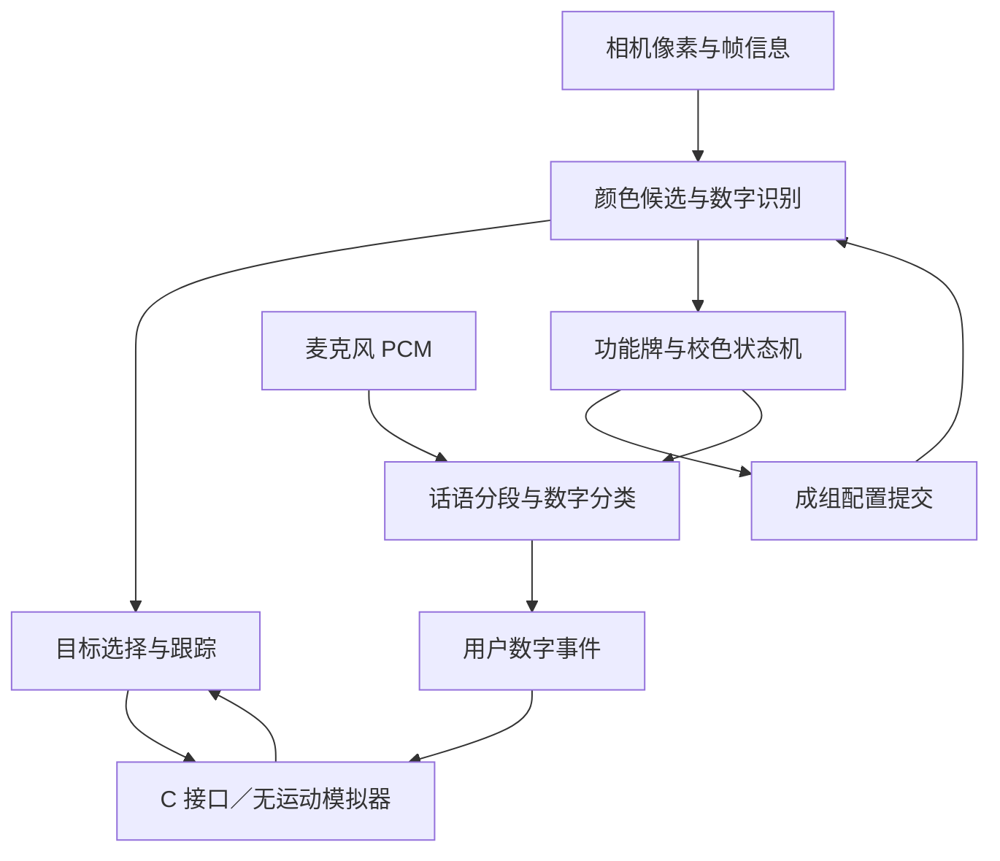

# Member B：开发范围、架构与设计理由

本文件是本次开发的设计说明。**实际起点仍是用户下载的原 GitHub 仓库**；任务包未完成新的 Member B RTL，也未连接用户的 FPGA。执行步骤见 `CODEX_MEMBER_B_PROMPT.txt`，课程来源见 `COURSE_REQUIREMENTS.md`，当前跨成员契约见 `MEMBER_C_INTERFACE.md`。

## 1. 从已有进展接续

历史审查锚点为原仓库 `codex/echo7-part-a` 分支的 `d2213d595b4da92d5cc3d1da759e26b64391cb89`。本地 Codex 必须先比较实际工作树；以下是已审查版本的结构线索，不是要求回退到旧提交。

| 已有内容 | 对 Member B 的价值 | 仍需补齐的部分 |
|---|---|---|
| `ECHOPHACE1/quartus/PartAPipeline.qpf` 及 Part A 顶层 | 独立视觉工程与不驱动底盘的调试基线 | B 工程、B 顶层、接口与可重复构建 |
| OV7670 配置、320×240 RGB565 捕获、红蓝候选 | 继续复用已存在的成像与颜色前端 | 真正从字形像素读数字、同帧 ROI、未知字形拒识 |
| VGA、ISSP、GCTL、GRAB、抓帧解码工具 | 可建立板上证据循环 | 明确设备选择、错误退出码、新帧检查、B 状态 schema |
| Part A 回归测试与数据包检查 | 防止开发 B 时破坏已有候选输出 | 不能把包格式正确当成数字识别通过 |
| 旧 WM8731 / `rtl/mic` 参考 | 可复用音频配置与 PCM 接收线索 | 真实采音验证、分段、数字分类、拒识；音量 gate 不等于语音识别 |
| 底盘、运动与旧整车顶层 | 供 C 后续集成时参考 | B 调试工程不接入运动输出 |

这里适合的是**重新整理工程边界并增量替换模块**。先保留能工作的捕获、引脚、IP 与约束，再把 B 功能放入清晰模块。一次性重写所有外设驱动会让输入故障、算法故障和接线故障混在一起，难以判断哪一步损坏。

## 2. 采用白字的依据与限制

正式配色为红 `#C00000`、蓝 `#0057B8`、白字 `#FFFFFF`。按 W3C 的 sRGB 相对亮度与对比度公式计算：

| 底色 | 白字的理想 sRGB 对比度 | 黑字的理想 sRGB 对比度 |
|---|---:|---:|
| 红 `#C00000` | 6.48:1 | 3.24:1 |
| 蓝 `#0057B8` | 6.87:1 | 3.06:1 |

这是按所选数字色值计算的设计比较，**不是摄像头识别率或纸张反射率测量**。W3C 的指标用于可读性，不能单独证明某种 OCR 的准确率。对本工程来说，白字还提供了一个便于检验的分割方向：先找有颜色的主区，再在主区内部寻找较亮、低色度的字形；黑字与暗部的区分需要另外评估。OpenCV 的官方教程说明了基于色相、饱和度和亮度范围分割颜色的方法，这一思想可用于离线参考；FPGA 是否使用完整 HSV 或等效的定点 RGB 判据，应由资源与实拍决定。

资料来源：

- W3C，relative luminance：<https://www.w3.org/TR/WCAG22/#dfn-relative-luminance>
- W3C，contrast ratio：<https://www.w3.org/TR/WCAG22/#dfn-contrast-ratio>
- OpenCV，Thresholding Operations using inRange：<https://docs.opencv.org/4.x/da/d97/tutorial_threshold_inRange.html>

打印时采用彩色、实际大小 100%，避免光滑覆膜造成强反射。实际阈值从真实摄像头数据校准，不能把 PDF RGB 常量当成摄像头会输出的像素值。

## 3. 纸面、编号与识别目标

一张 297×210 mm 横向 A4，中央 x=148.5 mm 对折。左侧是红 1 及其同板蓝色参考条、红 2；右侧是两列三行的蓝 1–6。主色块为 54×60.75 mm，字形和位置以 `markers/marker_spec.json` 为唯一几何源。

| 类型 | 数字 | 含义 |
|---|---|---|
| 红底白字 | 1 | 校准当前成像条件下的红蓝颜色分割 |
| 红底白字 | 2 | 开启一次可重复接收话语的语音输入会话 |
| 蓝底白字 | 1–6 | 六个车位身份 |
| 无字蓝条 | 无 | 红 1 校色板的蓝色参考，不能输出 bayId |

面积和宽高保留为候选质量、成像尺寸及跟踪信息；身份由颜色类型和字形决定。所有牌同尺寸不会影响身份定义。固定网格位置可帮助调试，不能代替数字判决。

当前正常有 7 个主要蓝区，先测原 CAP8 能否容纳。白字孔洞、方向块、噪声或印刷缺陷可能让原始 mask 出现更多连通分量，必须检查真实峰值和 overflow，不能只数纸上的牌。

全页宽度覆盖约 300 像素时，单牌约 54.5×61.4 像素，最细笔画约 4.1 像素。这只是几何预算。整页展开用于自动重复测试；对折后的半页更易占满画面，但翻页需要人完成。

## 4. 模块与数据责任

| 模块层 | 输入与输出 | 必须独立验证的边界 |
|---|---|---|
| `common` | 共享类型、版本、配置、ID、时间单位 | 位宽、复位、版本兼容、字段含义 |
| `capture` | OV7670→像素帧；WM8731→PCM | 外设配置、时钟、实际输入有效性、CDC |
| `vision` | 像素→颜色候选→字形 ROI→牌类型与数字 | 同帧、未知字形、方向、溢出、空白蓝条 |
| `interaction` | 功能牌观测与许可→校色/语音会话 | 一次执行、配置原子提交、失败保留旧值 |
| `audio` | PCM→话语片段→特征→数字或拒识 | 实际采样率、分段、模板与测试分离、噪声 |
| `tracking` | 车位观测+SELECT/CLEAR→目标报告 | 同号歧义、连续确认、立即失锁、时间与 tag |
| `debug` | 各模块状态→VGA/JTAG/证据；显式测试命令 | buildId、schema、帧号、输入来源、退出码 |
| `top` | `perceptionCore` 集成于 `perceptionDemoTop` | B 独立工程、无运动 C 模拟器、真实引脚与约束 |

VGA/JTAG 是这些模块的观测与调试出口，不能另造一套与实际识别结果无关的显示答案。数字分类的参考 Python 便于解释和对拍，最终在 FPGA 中应执行的部分仍需 RTL、综合和板上证据。

## 5. 同帧与配置是视觉链的核心约束

候选框来自帧 N 时，其字形也必须来自帧 N；不能用刚输出的框读取正在被帧 N+1 覆盖的缓存。候选、ROI、frameId、采集起点、配置版本和 bankId 要保持关联。320×240 的二值双缓冲逻辑容量为 18.75 KiB，实际 RAM 块数与时序由 Fitter 证实。

数字判决先依据彩色主区确定归一化 ROI，再读取固定七段字形及方向锚点，保留 unknown/rejected。数字 1 的笔画偏右，不应按其白字外接框自行重新居中。位置报告使用主色块 bbox，不使用白字质心。

校色在红 1 自己的红色无字区域和蓝参考条中采集原始 RGB，验证亮度、污染、样本量与稳定性后写 shadowProfile。在帧边界一次提交完整红蓝配置，并更新版本。失败保留旧配置，不能只更新红色后让蓝色继续使用旧版本。初始默认仅校红蓝阈值；白字阈值需要单独的可靠样本才更新。

## 6. 固定纸面交互

展开纸上两张红牌同时存在，因此不能把它们一直当成冲突，也不能让每帧触发校色和录音。

1. 用默认配置稳定识别红 1 与其蓝条，在交互许可有效时校色一次。
2. 新配置生效后，识别红 2，设置 `speechArmed`。
3. 空闲等待声音时仍持续做图像识别与跟踪；空闲武装不等于一直忙碌。
4. 每个经过起点、终点及静音间隔分隔的话语产生一次数字提议或拒识结果。
5. 静音结束后准备下一次话语，不要求红牌离开画面。明确的重新校色命令只开放一次新尝试，仍需看见真实红 1 并重新采样。

对折后从左页翻到右页，不单因红牌离场清除已经提交的校色或会话。目标的 observed/locked 则必须依据当前真正可见的蓝牌，不能继续报告已经翻走的观测。

## 7. B 与 C 的职责边界

B 识别说出的数字，输出“用户选择 3”的事件。C 接受该事件后发送 SELECT 3，B 输出蓝 3 的图像位置、尺寸、质量和状态。固定台架由不含电机逻辑的 C 模拟器执行这一步。

主要接口是 C→B `targetRequest`、B→C `targetReport`、B→C `userEvent`，以及许可、状态与时间基准。所有事务都明确 valid/ready 和反压语义。当前车位掩码是 `0x07E`，只启用 1–6；CLEAR 是独立操作。

外部图像坐标暂沿用原设计的正立 240×320 约定；纸张横向不自动改变外部坐标。先变换完整 bbox 再计算中心，避免整数取整误差。C 得到的是图像测量，不是世界坐标、距离、转向角或停车命令。详细字段与状态规则以 `MEMBER_C_INTERFACE.md` 为准。

## 8. 自动调试需要形成的证据链

Codex 的执行链为：修改→自检仿真→综合/拟合/时序检查→核对本次 .sof→下载到明确的 FPGA→读取 buildId/schema→抓取新帧或真实 PCM→分析→修复并重跑相关回归。

从失败日志继续工作的单位应是具体问题：输入缺失、颜色 mask、候选溢出、ROI/方向、字形判决、配置/版本、跟踪、音频或工具链。不能仅通过隐藏报错或反复随机调阈值取得“通过”。

MODEL、RTL_SIM、QUARTUS_FIT_TIMING、PROGRAMMED、CAMERA_HW、MIC_HW 分层记录。合成标牌素材和已知 crop 检查仅验证资产的一致性；下载成功也不是识别成功。必须能把某份源码、某个 .sof、当前硬件、当前新帧及实际输出关联起来。

五份课程讲义要求或介绍了增量实现、自检 testbench、模块化、仿真与综合的区别、时序和 BRAM 检查、AI 输出的理解与验证。具体页码及哪些内容属于本项目设计选择，见 `COURSE_REQUIREMENTS.md`。
