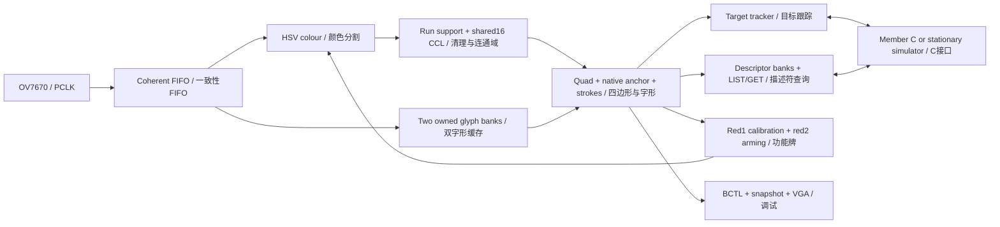

# MTRX3700 Member B — FPGA perception / FPGA 感知子系统

## 1. Scope and current status / 范围与当前状态

Member B reads coloured number signs from real OV7670 pixels, calibrates red/blue segmentation, lists and locates recognised signs, and tracks a selected blue bay1–6, red function card1/2 or uniquely paired calibration strip BJ. It displays VGA diagnostics and exposes a synchronous interface to Member C. The board wrapper is stationary and does not instantiate motor, chassis UART, steering or navigation control. Real microphone input is deferred by the user; JTAG/BCTL drives the non-motion C simulator for this development phase.

Member B 从实际OV7670像素识别红蓝数字牌、校准红蓝分割、列举和定位标牌，并持续跟踪选定的蓝车位1–6、红功能牌1/2或唯一配对校色蓝条BJ。通过VGA显示诊断，向Member C提供同步接口。独立板级顶层保持固定，不实例化电机、底盘串口、转向或导航控制。本阶段按用户要求暂缓麦克风，使用JTAG/BCTL驱动无运动C模拟器。

The implementation descends from the same-group preliminary repository by Hajin and Jiaze Sun; Hajin mainly contributed Member A work. Member B's confirmed SID is **540207680**. Original staff/IP notices remain applicable. See [OWNERS.md](OWNERS.md) for file-level responsibility, origin and unsigned human-review status; Git preserves earlier code history. A starter ZIP was not used as the replacement project.

项目起源于 Hajin 与 Jiaze Sun 共同构建的同组前置代码，Hajin 主要负责 Member A。Member B 已确认学号为 **540207680**。原课程代码与 IP 声明仍适用；逐文件归属、来源和尚未签署的人类审阅状态见 [OWNERS.md](OWNERS.md)，旧代码由 Git 历史保存。项目没有用 Starter ZIP 覆盖原工程。

| Evidence layer / 证据层 | Verified checkpoint / 已执行结果 | Boundary / 边界 |
|---|---|---|
| MODEL | Current reader9:370 tests plus independent counterfactual checks passed / 当前算法9的370项及独立反事实测试通过 | Historical profiles retain their IDs; model success is not camera acceptance / 历史配置不改编号，模型不代替相机 |
| RTL_SIM | `c63c9edb`:52-frame core/116 checks;11 normal+bypass reader cases;73 native support cases and1868-ROI strict equivalence passed / 当前核心及针对性仿真通过 | Full43-bench ModelSim run interrupted at user close-out; old7408a02d had39/39 / 本轮完整43项按收口中止，旧版本39项全过单列 |
| COURSE R6 RTL_SIM | Current run FAIL at300s aggregate deadline; seven benches passed, last bench/mutant not completed / 本轮总限时失败，最后一项及缺陷注入未完成 | Historical7408a02d PASS228.031s and645102d6 PASS255.766s do not certify current source / 旧版本成功不移用 |
| QUARTUS_FIT_TIMING / PROGRAMMED | `c63c9edb`, reader9/colour3/public3/schema8: built, timed, downloaded once and identity read back / 最终构建、时序、一次下载及身份核对通过 | 29133 adjusted ALMs,356M10K,57DSP;72 timing checks passed, no unconstrained paths / 72项时序通过、无未约束路径；放置统计详见版本记录 |
| CAMERA_HW | Final fresh frame251: red1/2,blue1–6,BJ; automatic eight-sample calibration committedcfg1/R33/B28;59.439ms capture-to-result / 最后一帧八张数字牌及BJ，八帧校色成功 | Single close-out frame only; blue6 stability deferred by user; old multi-trial scores are historical / 单帧不证明稳定性，蓝6暂缓，旧多轮成绩不移用 |
| VGA_PHYSICAL | Historical7408a02d SW0/SW1 combinations confirmed by user; final diagnostics passed3,944,178-pixel old/new RTL equivalence / 历史实体确认与当前像素等价分开 | Finalc63c9edb physical switches/monitor were not re-confirmed at user close-out / 收口未重复最终版本实体开关验收 |
| MIC_HW | DEFERRED_BY_USER / 用户暂缓 | `audioReady=0`; JTAG SELECT is not speech / JTAG 数字不是语音识别 |

The final programmed source is **c63c9edb**, publicv3/schema8, colourAlgorithm3 and readerAlgorithm9. It adds same-frame projective calibration and generic thin-anchor support, sharing the existing component scanner; VGA records now use synchronous RAM. Full fitting/timing passed and the exact new SOF was downloaded once. [Fresh frame251](tests/fixtures/camera/frame251/frame.png) read all eight formal numbered signs plus the paired BJ strip; eight valid raw sampling frames had already committed configuration1, red33/blue28. Capture-to-result latency was59.439ms. This single frame does not settle blue6 stability, which the user explicitly deferred. Current MODEL and targeted/full-core RTL passed; the R6 aggregate time budget and complete43-bench ModelSim run are not claimed as passed. Historical multi-trial, interface and physical-VGA results remain source-labelled. Detailed failures, remaining tests, source/SOF hashes and commands are in [VERSION_README.md](VERSION_README.md). Development is closed at this checkpoint; no microphone or further switch trials were undertaken.

最终板上源码为 **c63c9edb**，公共v3/schema8、颜色算法3、数字算法9。同帧透视校色与通用薄锚点补查复用现有扫描器，VGA记录改用同步RAM。完整拟合和时序通过，本轮新SOF已最后下载一次并核对身份。[新实拍frame251](tests/fixtures/camera/frame251/frame.png)识别了八张正式数字牌及配对BJ，八帧原RGB采样已提交配置1、红33/蓝28，采集到结果耗时59.439毫秒。单帧不证明蓝6长期稳定，按用户要求暂缓该问题。当前模型及针对性/完整核心RTL通过；R6总限时和完整43项ModelSim不能声称本轮通过。旧多轮实拍、接口与实体VGA结果保留各自源码身份。失败、剩余项、源码/SOF哈希及命令统一见VERSION_README；本版本已收口，不再进行麦克风或新增开关实验。

## 2. Repository and inputs / 仓库与输入

| Path / 路径 | Purpose / 用途 |
|---|---|
| `rtl/common/`, `rtl/capture/`, `rtl/vision/` | Types, CDC, camera capture and pixel algorithms / 类型、跨域、采集与像素算法 |
| `rtl/interaction/`, `rtl/tracking/`, `rtl/debug/`, `rtl/top/` | Calibration, tracking, C simulator/JTAG/VGA and integration / 校色、跟踪、C模拟器/JTAG/VGA与顶层 |
| `quartus/PartBDebug.qpf` | The single production project, top `perceptionDemoTop`, device5CSEMA5F31C6 / 唯一生产工程与器件 |
| `tests/rtl/manifest.json`, `tests/python/` | Self-checking HDL and independent/host tests / 自检 HDL 与独立参考/主机测试 |
| `tests/fixtures/camera/` | Small genuine camera regression PNGs with manifest, origin and hashes / 小型真实相机回归输入、来源与哈希 |
| `tools/echo7.py`, `tools/lib/`, `tools/tcl/` | Supported CLI, models/exporters and JTAG transport / CLI、模型/向量导出与 JTAG 传输 |
| `assets/markers/` | Single-page artwork, recovered geometry and synthetic templates / 单页标牌、恢复的几何与合成模板 |
| `docs/` | Original Brief, lecture and proposal PDFs / 原始Brief、讲义与提案PDF |
| `build/` | Ignored private build copies, IP, SOF, captures, vectors and run logs / 忽略的私有构建副本、IP、SOF、抓帧、向量与日志 |

The three root Markdown documents are this development/contract README, the version record and OWNERS. Generated databases, simulator outputs, personal toolchains and large captures do not belong in the tracked tree. Required small regression inputs are intentionally tracked; deleting them breaks reproducibility. `.gitignore`, `.gitattributes` and `.editorconfig` define exclusion, UTF-8 and line-ending conventions. Do not use destructive Git cleanup to hide uncommitted work.

根目录的三份 Markdown 分别为本文开发/接口说明、版本记录和 OWNERS。编译数据库、仿真输出、个人工具链和大抓帧不进入版本库；必要的小型回归输入应被明确跟踪，不能当作杂物删除。忽略规则、UTF-8 和换行约定由相应配置文件管理，不使用破坏性 Git 清理掩盖未提交修改。

Print [the formal artwork](assets/markers/ECHO7_All_Markers_A4_v2.pdf) at100% actual size: one297×210mm landscape A4, fold line x=148.5mm. Red1 with its own blue reference and red2 occupy the left half; blue1–6 occupy two columns by three rows on the right. Each main region is54×60.75mm; colours are red#C00000, blue#0057B8 and white digits. Paper/PDF colours are not sensor RGB thresholds. Native input remains320×240.

按100%实际尺寸打印[正式标牌](assets/markers/ECHO7_All_Markers_A4_v2.pdf)：同一张297×210mm横向 A4，中线 x=148.5mm 对折。左侧为红1及其专属蓝参考条、红2；右侧两列三行蓝1–6。主区54×60.75mm，红#C00000、蓝#0057B8，数字为白色。纸面/PDF 色值不是传感器阈值，相机输入保持320×240。

The original JSON was absent from the migrated input, so [marker_spec.json](assets/markers/marker_spec.json) and [scene_manifest.json](assets/markers/scene_manifest.json) explicitly record `RECOVERED_FROM_SUPPLIED_PDF` as a design recovery. `recover_from_pdf.py` reproduces the SVG/PNG/templates from PDF paths. Synthetic images/hex files are pixel replays, not full OV7670 bus transactions or camera photographs. The manifest and test regions never supply runtime IDs.

迁移输入缺失原始 JSON，因此上述几何/场景文件明确标为从所给 PDF 恢复的设计资料；恢复脚本从 PDF 路径生成 SVG/PNG/模板。合成图和 hex 是像素回放，不是完整 OV7670 总线事务，也不是实拍。场景答案与测试区域绝不进入运行时识别。

The default test keeps the full sheet unfolded. Optional folding is done by a person. Added duplicate blue1/2 cards are a separately declared ten-sign test arrangement; they do not change the enabled bay set or the formal one-page artwork. [frame30158's regions](tests/fixtures/camera/frame30158/expected_regions.json) score its photographed arrangement only; [frame19645's regions](tests/fixtures/camera/frame19645/expected_regions.json) describe a different pose and must not be substituted.

默认整页展开，折页必须由人完成。额外蓝1/2重复牌属于另行声明的十牌测试场景，不改变启用号码与正式单页标牌。frame30158和frame19645的独立区域标注对应不同取景，不能混用；相机或纸张移动后必须重新核对评分区域。

## 3. Tools, build and real hardware / 工具、构建与真实硬件

Use Python3 with the versions in [requirements.txt](requirements.txt). The inspected Windows environment uses Quartus Prime18.1 Lite, ModelSim Altera Starter10.5b and Verilator5.050 for the course runner. `doctor` discovers executable paths and actual JTAG targets; Windows Store Python aliases do not qualify. Linux uses its installed executables; do not copy Windows absolute paths.

使用 Python3 及 requirements 中的依赖。当前 Windows 实际工具为 Quartus Prime18.1 Lite、ModelSim Altera Starter10.5b，课程 runner 使用 Verilator5.050。`doctor` 发现绝对路径与实际 JTAG 目标，Windows Store 别名不算可用 Python；Linux 使用本机实际安装路径。

```powershell
# Inspected local example / 当前机器示例
$python = 'C:/Users/15402/.cache/codex-runtimes/codex-primary-runtime/dependencies/python/python.exe'
& $python tools/check_repository.py
& $python tools/echo7.py doctor
& $python tools/echo7.py test --replay
& $python tools/echo7.py test --rtl
& $python tools/echo7.py --quartus-bin 'C:/intelFPGA_lite/18.1/quartus/bin64' --timeout 3600 build
& $python tools/echo7.py program
& $python tools/echo7.py capture --fresh
& $python tools/echo7.py status
```

`build` hashes and copies the exact explicit source closure into `build/member_b/<run>/source/`; Quartus runs against that private copy. Generated Qsys/IP, databases, reports and SOF stay there. A build passes only with the intended top/device, a newly produced SOF, complete fitting, reviewed warnings, required clocks and accepted setup/hold/recovery/removal/CDC checks. A failed build's old SOF is never promoted. The build manifest binds source buildId to SOF SHA256.

`build` 将明确依赖闭包按哈希复制到私有运行目录，Quartus 仅编译该副本，生成 IP、数据库、报告和 SOF 都留在其中。通过必须包括正确顶层/器件、本次生成的 SOF、完整拟合、警告审查和所需时钟/时序/CDC 检查；失败构建遗留的旧 SOF 不能冒充新成果。构建清单绑定源码 buildId 与 SOF SHA256。

The board path is OV7670 → camera capture → FPGA processing/display buffers → DE1-SoC VGA, with USB-Blaster JTAG for volatile `.sof` programming, BCTL control/status and GCTL/GRAB snapshots. The discovered board was `DE-SoC [USB-1]`, Cyclone V5CSEMA5; chain index2 was an observed identity, not a hard-coded assumption. `--cable` and `--device` resolve ambiguity and are shared by program/capture. Multiple matching targets are an error. Never program the HPS or an unverified old image.

实际链路为 OV7670→相机接收→FPGA处理/显示缓冲→DE1-SoC VGA；USB-Blaster JTAG 用于易失 `.sof` 下载、BCTL 控制/状态和 GCTL/GRAB 抓帧。已发现设备为 DE-SoC USB-1 的 Cyclone V5CSEMA5，链上序号2只是当时实测结果，不是写死假设。下载与采集使用同一明确 cable/device，多目标歧义必须报错，不能误选 HPS 或旧镜像。

The source programmes OV7670 MVFP=0x07 and COM8=0xE7. COM8 enables AGC/AWB/AEC; exposure and white balance are not frozen. SCCB currently writes these values without register readback. Decoders/replay receive MVFP explicitly. Calibration adapts classification under current imaging; it does not establish an exposure lock, a calibrated lux/K range or immunity to changing illumination.

源码配置 MVFP=0x07、COM8=0xE7；后者开启 AGC/AWB/AEC，并未锁定曝光和白平衡。现有 SCCB 为写入流程，没有寄存器回读验证。解码/回放显式接收 MVFP；校色仅适配当前成像下的分类阈值，不等于曝光锁定或经标定的照度/色温范围。

## 4. Architecture, clocks and frame ownership / 架构、时钟与帧所有权



| Module / 模块 | Responsibility and timing / 职责与时序 |
|---|---|
| `capture/ov7670_*`, `cameraStreamBridge`, `common/asyncPixelFifo` | Preserve sensor configuration and capture tokens; transfer pixels/metadata atomically / 保留传感器配置与采集，整体跨域 |
| `hsvColourGate`, `horizontalRunFilter`, `causalMaskCleanup` | Classify raw colour, then remove unsupported pixels only for candidate extraction / 原色分类后仅对候选路径清理 |
| `boundedCandidates` | Fifteen active labels per colour, sixteen shared completed slots; explicit colour and whole-frame overflow / 每色15活动标签、总16完成槽，显式颜色与整帧溢出 |
| `glyphBanks` | Two320×240×2-bit banks,37.5KiB logical storage; synchronous read / 两个2位字形缓存，同步读取 |
| `projectiveMarkerReader`, `nativeAnchorReader` | Pixel-derived quad, unique native anchor,32×40 sampling and stroke/hole rejection / 像素四边形、唯一原生锚点与字形判决 |
| `mainColourSupportReader` | Reader7 bounded eight-label raw-colour component scan and synchronous support RAM; reject overflow, ties or changed candidate bbox / 算法7的八活动标签原色连通域扫描与同步支撑点RAM，溢出、并列或候选框不一致时拒绝 |
| `colourSampler`, `fixedSheetInteraction` | Raw RGB sample validation, shadow profile, permitted SOF commit / 原RGB样本验证、影子配置、许可下SOF提交 |
| `targetTracker`, `memberCSimulator` | Current observations, three-frame lock, requests/events and cache-age rules / 当前观测、三帧锁定及请求/事件/年龄 |
| `markerQueryStore` | Three synchronous16×64-bit descriptor banks, coherent LIST/GET batches and independent backpressure / 三组同步描述符RAM、同帧查询及独立反压 |
| `memberBDebug`, `frame_snap` | Transport acknowledgement with separate action acceptance/error, and same-frame captured status / 传输ACK与动作接受/错误分开，同帧抓取 |
| `memberBVgaContour`, `memberBVgaLabels`, `memberBVgaDiagnostics`, `memberBVgaOverlay` | Colour contours, typed labels and frame-published RGB/HSV panels / 色域轮廓、类型标签与整帧发布诊断 |
| `perceptionCore`, `perceptionDemoTop` | Integratable CLOCK_50 core and stationary board wrapper / 可集成核心与无运动板级封装 |

For Member C's resource planning, the `7408a02d` debug fit attributes16067.8 adjusted ALMs,46 M10K and23 DSP to the inclusive `perceptionCore` hierarchy. The complete debug top uses27810 adjusted ALMs,351 M10K and47 DSP, including camera display/frame-grab infrastructure. These are measured hierarchy allocations in this fit, not a guaranteed standalone or merged design budget: shared logic, packing and timing change when C integrates the core. Fit the combined project before claiming it fits. The placement table is essentially full despite the lower packing-adjusted ALM estimate; its detailed integer/fractional accounting is recorded in VERSION_README.

供C规划资源：7408a02d调试工程的拟合报告将16067.8个调整后ALM、46个M10K和23个DSP归属到包含子模块的perceptionCore层级。完整调试顶层还含显示和抓帧设施，共27810个调整后ALM、351个M10K和47个DSP。这是当前工程内的实测归属，不能保证单独核心或合并工程的占用；共享逻辑、打包和时序均会随集成变化，须重新拟合。实际放置几乎用满器件，不能将较低的打包调整估计直接理解为空闲位置；详细计数差异记录于VERSION_README。

`CLOCK_50` is50MHz. The video PLL generates25MHz display and10MHz camera XCLK. With the selected camera programme (`CAMERA_FPS=25`, CLKRC=0x81, DBLV=0x4A), returned PCLK is constrained as an independent20MHz source; it is not treated as a PLL-related clock after travelling through the camera/cable. SCCB is100kHz. JTAG has its own clock. [PartBDebug.sdc](quartus/PartBDebug.sdc) and [MemberBCdc.sdc](quartus/MemberBCdc.sdc) define the actual constraints.

系统主时钟50MHz；显示 PLL 产生25MHz显示时钟和10MHz相机 XCLK。当前相机程序下返回 PCLK 按独立20MHz约束，不能因 XCLK 来源相同就将经过相机/排线的 PCLK 当成同步 PLL 时钟。SCCB 为100kHz，JTAG 使用独立时钟；具体约束以上述 SDC 为准。

Single-bit asynchronous controls use synchronisers. Multi-bit pixels, requests, results and configurations cross through FIFOs or stable-payload request/acknowledge handshakes. Two independent synchronisers per bit are not an atomic bus transfer. Held buses remain unchanged until acknowledgement returns. The SDC uses bounded crossing delay/skew and narrow justified exceptions; no whole perception clock domain is globally excluded to hide failures. Synchroniser Meta-to-Sync paths remain checked.

异步单比特控制使用同步器，多比特像素、请求、结果和配置通过 FIFO 或稳定载荷握手跨域，不能逐位两级同步后声称整体原子。握手总线保持到确认返回；SDC 使用有界延迟/偏斜和明确端点的例外，不以切掉整个处理时钟域掩盖失败，同步器后级路径仍受检查。

Every candidate and glyph result carries one frameId, original captureStartUs, configVersion and bank identity. Banks have FREE/WRITING/READY/READING ownership. Reading a bank being overwritten is forbidden; lack of a free bank drops the entire new frame with diagnostics. A newer invalid/drop observation wins over a colliding older completion; the old bank is released, but its result cannot overwrite the newer loss or advance calibration. Camera capture never stops because C holds ready low.

候选和字形结果必须绑定同一 frameId、原始采集时间、配置版本和 bank。缓存所有权分 FREE/WRITING/READY/READING，禁止读取正在覆盖的缓存；无空闲 bank 时丢弃完整新帧并计数。较新坏帧/丢帧与旧完成结果同沿到达时，前者优先，旧 bank 释放但旧结果不能覆盖失锁或推进校色。C 反压不能停止相机。

## 5. Colour, candidates and digit reading / 颜色、候选与数字识别

Production colour algorithm3 retains algorithm2's HSV tests through signed integer products: red signed hue−24°…0°, blue200°…260°, saturation≥0.5, initial value floors R48/B20. Version3 changes horizontal run support from3to2pixels; the pixel colour gate itself is unchanged. Calibration changes the two value floors as one complete profile; white thresholds remain fixed. HSV separates brightness from hue better than a fixed RGB magnitude test, but cannot separate physically overlapping measured hues or restore lost optical detail.

生产颜色算法3保留算法2的整数HSV条件：红色环绕色相−24°…0°、蓝色200°…260°、饱和度至少0.5，默认亮度下限R48/B20。版本3将横向游程支持从3像素改为2像素，单像素颜色判据不变。校色原子更新整组红蓝下限，白字门槛固定。HSV更明确地区分亮度和色相，但不能分开实际重叠色相，也不能恢复丢失的光学细节。

CCL receives complete horizontal runs of at least2pixels followed by causal left-or-above support. This preserves measured narrow side connections on rotated signs, at the cost of admitting more small noise components; capacity overflow still rejects the whole frame. Raw colour retained for the reader's corner extraction is not eroded by those filters. Labels0/1–15 mean sentinel/active handles; completed count is5bits and supports16. Completed red and blue regions share one16-slot pool in retirement order; simultaneous retirement allocates red first. No colour quota is reserved. If only one slot remains, the second retirement raises overflow and invalidates the whole frame. Active labels remain separate by colour. Maintenance requires335 invalid processing clocks per row,336 for end-of-frame publication; the core guard is341 including upstream latency. A continuous gap-free fake stream cannot prove this hardware schedule.

连通域输入先保留至少2像素的完整横向同色游程，再做左/上邻支持清理，保留实拍旋转牌的窄侧边连接，但会接纳更多小噪声分量，容量溢出仍整帧拒绝。读字形原色缓存不经过该腐蚀。标签0为哨兵，1–15为活动句柄，完成计数5位可表示16。红蓝完成区域动态共享16槽，同沿先分红色、不预留配额，仅剩一槽时第二区域触发整帧溢出，不能隐藏重复目标。活动标签分色管理。每行维护335个无效处理时钟，末帧发布336个，核心保护341个；无行间空隙假输入不能证明实际调度可用。

Reader5 finds16 directional contour supports, the farthest pair and maximum signed-cross-product points on opposite sides to form a bounded convex quad. The canonical start is minimum(x+y), then y/x tie-break; orientation0–3 is a cyclic corner offset, **not a measured continuous angle**. Four native anchor hypotheses are checked before the glyph. Exactly one valid anchor permits one32×40 homography pass. The algorithm never chooses direction because one guessed direction yields a convenient digit. SW8's bbox baseline uses the same automatic anchor/number/rejection rules.

Reader5 从16个方向轮廓支撑点中取最远对及两侧最大叉积点形成有界凸四边形。规范起点按最小(x+y)、再y/x打破平局，方向0–3表示循环角点偏移，**不是测量得到的连续角度**。先检查四个原生锚点假设，只允许唯一有效方向进入一次32×40单应采样，不能选择“哪个方向碰巧能读出数字”。SW8轴对齐基线保留相同自动方向、字形与拒识规则。

The independent native anchor is a closed four-connected strong-white component in a quad-derived neighbourhood: at least3pixels, at least2rows and2columns, bounded extent/area, and exactly one qualifying component. Boundary-connected paper, multiple anchors and local active-label overflow reject. Glyph projection checks seven strokes and two empty holes; digit1 uses the same rectangle-relative ROI without recentering its narrow stroke. Blue accepts1–6; red accepts1/2; unknowns and the numberless blue reference do not receive bay IDs.

独立原生锚点必须是四边形预测邻域内闭合的四连通强白分量：至少3像素、跨2行2列，大小/面积有界且唯一。触边白纸、多锚点和局部标签溢出均拒绝。字形检查七段笔画投影和两个空洞；数字1仍用相对主色区的统一 ROI，不围绕窄笔画重新居中。蓝色只接受1–6，红色只接受1/2，未知图形和无数字蓝条没有车位编号。

Reader6 additionally requires the exact doubled centre of a white component's bounding box to lie inside the original measured colour candidate. This removes a neighbouring card's anchor from an overlapping search window without shrinking the anchor to a fixed pixel size. A component may cross the candidate edge while its centre remains inside; demanding full containment incorrectly rejected existing recordings. The candidate bbox and quad are latched together. Historical reader5 replay explicitly disables this new predicate and retains its recorded colour/white profile. This rule does not prove ownership when two candidate bounding boxes themselves overlap.

数字算法6增加归属检查：白分量包围框的精确双中心必须落在原始实测彩色候选框内，排除搜索窗碰到的邻牌锚点，不将锚点尺寸写死。允许分量边缘越过候选边界而中心仍在内部；要求整个分量包含会错误拒绝既有实拍。候选框与四边形同时锁存；历史算法5回放明确关闭新条件，并保持原记录的颜色及白字参数。两个候选包围框本身重叠时，该规则并不保证归属唯一。

Reader7 scans four-connected raw-colour components inside each candidate and takes supports only from the unique largest component. Its measured bbox must exactly match all four candidate edges; otherwise the candidate rejects. This removes a neighbouring card that merely enters the rectangular search area. Eight active component labels and synchronous support RAM bound the cost; ties and overflow reject rather than select arbitrarily. Area chooses geometry only: the digit still comes from anchor-oriented white strokes. SW8 bypass skips this component scan as well as perspective correction. Historical reader6 disables the new component stage; reader5 also disables the newer anchor ownership predicate.

数字算法7先扫描候选内的原色四连通分量，仅从唯一最大分量取支撑点，且其四条实测边界须与原候选框完全一致，否则拒识。这排除仅进入矩形搜索范围的邻牌。使用八个活动标签与同步支撑点RAM限制资源；并列及溢出均拒绝，不随意选择。面积只用于确定几何，数字仍由锚点定向后的白色笔画读取。SW8同时旁路该扫描与透视矫正。历史算法6关闭新增分量阶段，算法5还关闭后来的锚点归属检查。

Bank classes are00background,01raw colour,10weak stroke,11strong white. Strong white requires `R+2G+B>=384` and channel spread≤64. Weak strokes additionally allow sum≥334, spread≤64 and `2*spread<max(R,G,B)`; strong white remains included. This is fixed empirical classification, not automatic white calibration. Historical readers1–8 remain explicit replay profiles; current working-source defaults are reader9/colour3/shared16/active15. Reader8 adds same-frame calibration geometry; reader9 adds the generic rule below. Model canonical geometry sorting is not hardware slot order.

缓存编码为00背景、01原色、10弱笔画、11强白。强白要求加权和至少384且通道差不超过64；弱笔画额外允许和至少334、差不超过64并满足两倍差小于最大通道。强白包含在笔画集合中。这是固定经验分类，不是自动白色校准。旧读字算法1–8保留显式历史回放，当前工作源码默认9/3/共享16/活动15；算法8增加同帧校色几何，算法9增加以下通用薄锚点规则。模型的几何排序不代表硬件槽顺序。

Reader9 preserves strict-anchor priority across all four orientations. Only when none passes, no ambiguity/overflow hazard exists and exactly one eligible closed strong component is one row or one column wide may the same component scanner inspect its weak-white support. The complete weak component must retain every strong seed pixel, contain no foreign strong pixels, remain closed and satisfy the original scale/area/ownership gates. A successful fallback reports the true strong count, uses supported dimensions and caps quality at192. It does not depend on digit, colour, candidate slot or expected scene. SW8 bypass and explicit historical profiles retain strict behaviour. A second thin seed, foreign bridge, missing seed or insufficient support rejects; weak pixels never invent a seed. One shared scan engine performs the extra pass only when needed, rather than instantiating another recogniser. The extra control has a measured cost: isolated MAP adds155 estimated ALMs and194 registers, with unchanged1280 RAM bits and10 DSPs; full fitted resources are reported separately.

算法9先完成四个方向的严格锚点判定，严格结果优先。只有全部未通过、无歧义/溢出风险且恰好存在一个合格的闭合强白单行或单列种子时，才复用同一连通域扫描器检查周围弱白支撑。完整弱白分量必须包含全部原强白种子、没有其它强白像素、保持闭合并满足原有相对尺度、面积和归属门槛。补救成功仍报告真实强白数量，尺寸采用支撑分量，质量最高192。规则不依赖数字、颜色、槽位或场景答案；SW8旁路和历史版本保持严格行为。第二个薄种子、连接其它强白、种子缺失或支撑不足均拒绝，弱白不能凭空生成锚点。额外扫描按需分时复用，不另实例化一套识别器；它仍有资源代价：独立MAP增加约155个ALM、194个寄存器，RAM1280位和10个DSP不变，完整拟合结果另行记录。

## 6. Calibration, switches and display / 校色、开关与显示

Fixed-sheet mode allows red1 and red2 to remain together. Three consecutive good red1/reference observations begin one permitted calibration attempt. Eight consecutive native-frame IDs must provide valid raw-RGB samples under one configuration; a bad sample, skipped sample-frame ID, version mismatch or timeout fails the attempt. The reference must belong geometrically to red1 and must not be an accepted blue bay. Previous-frame sampling regions are checked against the actual sampled frame: bbox edges may move at most3pixels, and normal-mode polygon vertices at most48Q4 units (3pixels) per axis. A validated shadow profile commits atomically at input SOF, increments configVersion and clears target confirmation. Failed or cancelled attempts retain the last complete profile. Red1 remaining visible does not repeatedly recalibrate after success.

固定纸面允许红1/红2同时常驻。连续三个有效红1及专属参考观测开启一次许可下的校色尝试；同一配置下连续八个原生帧号必须提供有效原RGB样本，坏样本、采样帧号跳变、错版本或超时均使该次尝试失败。蓝参考必须按几何属于红1，不能是已接受的蓝车位。上一帧采样区域须由实际采样帧复核：包围框边界每轴最多移动3像素，正常模式下多边形每角点每轴最多移动48个Q4单位，即3像素。验证后的shadow在输入SOF原子生效、版本加一并清跟踪确认，失败/取消保留旧完整配置；成功后红1常驻不反复校色。

In the current reader9 source, **SW8 down** pairs the anchor-oriented measured red1 quad with a measured blue component from the same frame. A forward homography predicts the formal reference strip; scale-relative corner errors, edge ratios, forward half-plane bounds, positive convexity and exactly one candidate/cyclic match must pass. Each object's own measured quad supplies its inset sampling polygon. Coordinates use canonical scale320 and floor-Q4 mapping, including negatives. Blue geometry may be available from a four-pixel bbox minimum, but the digit's24-pixel edge/400-pixel area gates are unchanged. This is a bounded projective design, not a guarantee for all angles, distances or clipping: insufficient projected gaps, samples, component capacity or geometry reject. Pixel-cell field-of-view checks do not prove that every physical card edge is visible. Reader8 calibration currently has model/targeted RTL evidence; fitting, programming and new-camera acceptance remain separate gates.

当前算法9源码在**SW8下拨**时，以红1的实际锚点定向四边形和同帧实测蓝色分量配对。前向单应变换预测正式蓝条位置，须通过按牌尺度计算的角点误差、边长比例、前向半平面、正向凸性及唯一候选/循环对应检查，再用两者各自实测四边形产生内缩采样多边形。规范坐标为scale320，Q4映射向下取整，包含负值。蓝分量的包围框可从4像素门槛提供几何，数字仍保留24像素边长和400像素面积门槛。这是有界透视方案，不保证任意角度、距离或裁切都成功；投影间隙、样本、容量或几何不足均拒绝。像素单元视野检查不证明实体标牌边界全部可见。该校色流程已有模型及完整核心RTL回放证据，拟合、下载和新实拍仍按第1节分层记录。

**SW8 up** keeps the historical configured-orientation bbox pairing and rectangular raw-RGB sampling, while digit recognition uses its bbox baseline. Pairing retains reference width80–120% of card width, height10–30% of card height, gap0…height/8, scale-relative doubled-centre tolerance and80% overlap. It does not use the new quads. The programmed reader7 checkpoint uses this historical calibration geometry in both switch modes; its completed board tests remain recorded in VERSION_README. Normal and bypass sampling never borrow another blue bay as a calibration answer.

**SW8上拨**时保留历史配置方向下的包围框配对、矩形原RGB采样，读字使用轴对齐基线。配对保留参考宽为牌宽80–120%、高为牌高10–30%、间隔0至牌高八分之一、相对尺度双中心容差及80%交叠，不使用新增四边形。此前已下载的算法7在两种开关状态均使用这套历史校色几何，其板验记录见VERSION_README。两种模式都不能借邻近蓝车位作为校色答案。

All pixels inside a sampling region contribute raw RGB; the old colour mask never filters out inconvenient samples. Each colour needs at least16 samples. Red/blue selected-channel minima must be at least32/24, exceed the largest other channel by more than8, span at most80, and have selected-channel maxima below248 and other channels below224. The eight proposed half-minimum floors may span at most24 per colour; the committed floor is half the darkest validated reference sample. Hue, saturation and white gates remain fixed. AGC/AWB/AEC remain enabled, so rapid lighting changes, a colour-temperature-induced hue shift, clipping or contamination can reject calibration. Initial red1/reference detection still requires the active colour gate; unfiltered sampling does not remove that bootstrap limit. No lux/K operating range has been proved. Common reset restores defaults; `calibrate --arm` only permits another real attempt and does not inject success or restore default thresholds.

采样区域内所有像素都贡献原RGB，不能用旧颜色mask剔除不利样本。每色至少16个样本；红/蓝目标通道最小值至少32/24，且比其他通道最大值严格高8以上，目标通道跨度不超过80、最大值低于248、其他通道最大值低于224。八次提出的半最小值门槛每色跨度不超过24，最终采用全部有效参考中最暗样本的一半。色相、饱和度及白字门槛保持固定。AGC/AWB/AEC仍开启，快速照明变化、色温造成的色相偏移、过曝或污染都可能使校色拒绝。初始红1/参考检测仍依赖当前颜色门槛，原RGB采样不能解除这个启动条件。尚未证明照度/色温工作范围。共同复位恢复默认；`calibrate --arm`仅允许再次真实尝试，不注入成功，也不恢复默认阈值。

| Switch / 开关 | Down0 / 下拨0 | Up1 / 上拨1 |
|---|---|---|
| SW0 | No per-object RGB/HSV panel / 不显示逐对象面板 |4×4 raw-display RGB/HSV for accepted signs and the uniquely paired BJ strip / 已识别牌及唯一 BJ 的4×4采样 |
| SW1 | No centre panel / 无中心面板 |8×8 centre box, mean RGB/HSV, detected colour and unique accepted-box association / 中心8×8、均值和颜色/关联数字 |
| SW8 | Reader9: measured-quad digit normalisation and projective calibration pairing/sampling / 算法9：实测四边形读字及透视校色配对/采样 | Bbox digit baseline and historical bbox calibration/raw sampling; algorithms still running / 轴对齐读字及历史框校色/原RGB采样，算法继续运行 |
| SW9 | Perception and normal VGA / 正常处理与VGA | Perception/interaction paused at input SOF, exact raw camera VGA at packet boundary / 输入SOF暂停处理，显示包边界切纯相机 |

SW0 and SW1 may be enabled together. Blue objects use#0–#7, red#A–#F; BJ has a separate row and is only the uniquely paired calibration strip. UI tags are association labels, not bay IDs. Unknown candidates do not occupy empty panels. Display capacity overflow is shown explicitly, while recognition/tracking still uses all16shared slots. RGB/S/V are0–255 and H is0–359degrees, calculated from mean raw-display RGB before overlays. Values publish together at display SOP as `VGA HELD`; the scan and native metadata IDs may differ. STALE/BAD must prevent old panels being mistaken for current measurements. The centre digit is an accepted-main-bbox association, not OCR of eight pixels.

SW0/SW1可同时开启。蓝对象编号#0–#7、红对象#A–#F，BJ独占一行且仅表示唯一配对的校色条；这些是显示关联号，不是车位号码。未知候选不占空面板，显示容量溢出明确提示，但识别/跟踪仍保留16槽。RGB/S/V范围0–255，H为0–359度，来自覆盖图形前原显示RGB均值。数值在显示SOF一起发布为 VGA HELD，显示扫描与原生元数据编号可能不同；STALE/BAD不能让旧面板冒充当前测量。中心数字来自已接受主区的唯一框关联，不是对8像素小框单独读字。

Contours follow raw HSV boundaries, supporting several same-colour and non-rectangular regions; a contour alone is not recognition. SW9 overrides every overlay and SW0/SW1. Camera reception, original frame count and time continue while processing is paused. Input-SOF pause/resume increments configuration once per applied transition, cancels uncommitted calibration, keeps committed colour settings and clears tracking. Disabled-frame reports are explicit bad/empty observations. Previously presented stalled transactions remain stable. Readiness falls immediately on the disabled request and rises only after a fresh normal completion; resume requires three new unique frames to lock. Switch request, processing mode and actual display mode are separately reported during transitions.

轮廓沿原始HSV边界，可显示多个同色非矩形区域，但轮廓本身不是识别。SW9优先关闭所有覆盖图形，不受SW0/SW1影响。暂停时相机、原生帧号和时间继续；输入SOF应用暂停/恢复时版本只增一次、取消未提交校色、保留已提交颜色并清跟踪。禁用帧明确报告坏/空观测，已展示且被反压的事务仍稳定。readiness在禁用请求后立即下降，恢复后直到新正常完成帧才上升，锁定仍须三个新唯一观测。切换请求、处理实际模式、显示实际模式分别记录，过渡期短暂不同合法。

## 7. Authoritative Member B/C contract v3 / 唯一 B/C 契约v3

This section and [perception_pkg.sv](rtl/common/perception_pkg.sv) define the single public contract. [perceptionLink.sv](rtl/common/perceptionLink.sv) provides perception/controller/monitor directions; [perceptionCore.sv](rtl/top/perceptionCore.sv) is the integration entry and [memberCSimulator.sv](rtl/debug/memberCSimulator.sv) is a stationary consumer. All fields are unsigned, packed in table order from most significant to least significant. This internal FPGA contract does not specify off-chip serial byte order.

本节及共享 package 是唯一公共契约；perceptionLink 定义双方/监视方向，perceptionCore 为集成入口，memberCSimulator 为无运动消费者。字段均无符号，按表序从高位到低位打包；此 FPGA 内部接口不定义片外串行字节序。

`PERCEPTION_CONTRACT_VERSION=3`, `DEFAULT_ACTIVE_BAY_MASK=10'h07E`, `INVALID_BAY_ID=4'hF`. A marker is identified by **type and digit**, never its candidate slot or sheet position. `MARKER_BAY=1` means blue1–6; `MARKER_FUNCTION=2` means red1/2; `MARKER_REFERENCE=3,digit=15` means the uniquely paired blue calibration strip BJ. `MARKER_NONE=0,digit=15` is the empty identity. Blue0/7/8/9 and unimplemented red digits are invalid. `fixedSheetMode=1` is a B configuration. Contract version is distinct from run-time configVersion and private debug schema. Request/report/query/event/status widths are24/141/141/104/76bits. Both sides build from the same package and verify `$bits`; v2 wiring cannot silently connect to v3. No version field is repeated in every public transaction.

公共协议版本3，用**类型＋数字**表达查询目标，不能用槽号或纸面位置。类型1为蓝车位1–6，类型2为红功能牌1/2，类型3加数字15为唯一配对确认的蓝校色条BJ，类型0加数字15表示空身份。蓝0/7/8/9及未实现红牌无效。掩码仍为0x07E，CLEAR独立。请求/跟踪报告/查询结果/事件/状态分别为24/141/141/104/76位；v2必须显式迁移，不能靠补位连接。双方共用package，协议版本与运行配置版本、调试schema分开，避免逐包重复版本开销。

### 7.1 Clock, reset and channels / 时钟、复位与通道

| Signal / 信号 | Bits / 位宽 | Direction / 方向 | Meaning / 含义 |
|---|---:|---|---|
| `CLOCK_50` |1| Top→B/C | Shared50MHz rising edge / 共用50MHz上升沿 |
| `reset` |1| Top→B/C | Common synchronous active-high / 共同同步高有效复位 |
| `timeUs` |32| Top→B/C | Shared microsecond counter, modulo2³², resets0 / 共享微秒计数、模回绕 |
| `interactionEnable` |1| C→B | Enable interactions/arming; low cancels unfinished work and disarms / 允许交互，低取消未完事务并撤武装 |
| `interactionPermit` |1| C→B | C confirms stationary and permits actual work continuously / C确认静止并持续许可实际工作 |
| `targetRequest`, `targetRequestValid/Ready` |24,1,1| C→B, C→B/B→C | Four operations share one channel / 四种操作共用一个请求通道 |
| `targetReport`, `targetReportValid/Ready` |141,1,1| B→C, B→C/C→B | Continuous selected-target result; valid does not mean observed / 持续跟踪结果，valid不等于看见 |
| `queryResult`, `queryResultValid/Ready` |141,1,1| B→C, B→C/C→B | On-demand LIST/GET result batch / 按需列举、位置查询结果批次 |
| `userEvent`, `userEventValid/Ready` |104,1,1| B→C, B→C/C→B | Interaction terminal event / 交互终结事件 |
| `status` |76| B→C | Current CLOCK_50-domain state, sampled synchronously; no valid/ready / CLOCK_50域当前状态，同步采样，无独立握手 |

A transfer occurs only on `!reset && valid && ready`. A sender must assert valid without waiting for ready. Once `valid && !ready`, valid and the entire payload remain unchanged until transfer or common reset, including across new requests, commits and cancellation. Reset takes priority, clears driven valid/ready, queues, bank ownership, tracker history and C caches. Reset restores version0/default profile, calibrated=0, speechArmed=0, busy=0, kind=NONE, state=IDLE and no target; readiness stays0 until recovered. Independent B-only reset with C retaining state is unsupported; it would require a new epoch/supervision contract.

只有非复位且valid/ready同为1的沿发生传输；发送方不能等ready才置valid。反压后valid及整个载荷保持到握手或共同复位，新请求、提交或取消也不能改写。复位优先，清双方valid/ready、队列、bank、跟踪历史和C缓存；恢复默认颜色/version0、未校准、未武装、空闲无目标，链路恢复前readiness为0。不支持B独自复位而C继续沿用旧缓存，这需要另行升级epoch/监控契约。

### 7.2 `targetRequest_t` —24bits / 统一请求

| Field / 字段 | Bits | Meaning / 含义 |
|---|---:|---|
| `operation` |2|0=`TARGET_CLEAR`,1=`TARGET_SELECT`,2=`TARGET_LIST`,3=`TARGET_GET` |
| `requestTag` |16| New tag per request,0legal; modulo wrap / 每次新请求标签，0合法 |
| `markerType` |2|0NONE,1BAY (blue),2FUNCTION (red),3REFERENCE (BJ) / 标牌类型 |
| `digit` |4| BAY1–6,FUNCTION1/2,REFERENCE15; CLEAR/LIST ignore identity / 数字或BJ专用值15 |

SELECT starts continuous tracking of the exact type/digit; CLEAR stops tracking. At acceptance C changes its expected tracking tag and clears its cache; B clears confirmation. The request binds from the first complete capture after safe application. Already captured/processing frames retain their old bound tag. An invalid SELECT identity is consumed, clears selection, keeps its tag, sets FAULT_REQUEST_INVALID and uses NONE/15,targetSelected0. On a current good, ready frame, invalid SELECT gives INVALID_REQUEST and CLEAR gives NO_SELECTION; higher-priority errors are listed below. **LIST returns all recognised markers; GET returns all locations matching one exact identity. Neither changes selection, tracking tag, confirmation count or cache.** LIST/GET use queryResult, not targetReport. An invalid GET produces QUERY_INVALID_REQUEST and leaves tracking intact. Tags compare by equality and must not be reused while old same-tag transactions remain. Acceptance is neither recognition nor lock.

SELECT持续跟踪指定类型和数字；CLEAR停止跟踪。只有这两类请求更新跟踪tag并清确认/缓存，已采集旧帧保留旧tag。无效SELECT清选择、保留新tag并报告NONE/15及INVALID_REQUEST，不能继续旧目标。**LIST列出当前识别标牌；GET返回指定类型和数字的全部位置，均不改变当前跟踪。** 两种查询通过queryResult返回，无效GET也不影响跟踪。Tag按相等比较，旧事务未排空前不能复用；请求被接受不代表已经识别或锁定。

### 7.3 `targetReport_t` —141bits / 持续跟踪报告

Report reason priority is RESOURCE_DROP → FRAME_BAD → PIPELINE_NOT_READY → REQUEST_CHANGED → CONFIG_CHANGED → NO_SELECTION → INVALID_REQUEST → duplicate/quality/match evaluation. Thus a CLEAR selection on a bad capture can report FRAME_BAD. Clearing lock means clearing internal confirmation and subsequent reports; a previously presented report stalled by C is still immutable. C must reject that old tag/config/age when it is eventually transferred.

报告原因优先级为资源丢帧→坏帧→未就绪→请求变化→配置变化→无选择→非法身份→重复/质量/匹配判决，所以CLEAR之后遇坏帧也可能先报告FRAME_BAD。立即失锁指内部确认及随后生成报告清除；已经向C呈现但被反压的旧报告仍不能改写，最终收到时由C按旧tag/配置/年龄拒绝。

| Field / 字段 | Bits | Meaning / 含义 |
|---|---:|---|
| `requestTag` |16| Request bound at capture / 采集时绑定请求 |
| `frameId` |16| Original capture sequence,0legal / 原生采集序号 |
| `captureStartUs` |32| Actual capture SOF time / 真实采集SOF时间 |
| `configVersion` |16| Configuration actually used by this frame / 本帧实际配置 |
| `markerType` |2| Selected type, otherwiseNONE / 选中类型或空 |
| `digit` |4| Selected digit,15 forBJ or empty; inspect type / 选中数字，BJ或空为15，须结合类型 |
| `frameGood` |1| Whole consistent frame/candidates/glyph/config / 整帧与附属数据一致可用 |
| `observed` |1| Exactly one reliable current selected target / 当前唯一可靠目标 |
| `locked` |1| Confirmed across three consecutive distinct good frames / 连续三个不同好帧确认 |
| `ambiguous` |1| Multiple accepted locations for the exact selected type/digit / 同类型同数字多个位置 |
| `targetSelected` |1| Legal logical selection, not visibility / 逻辑选择合法，不等于可见 |
| `centreU` |8| Public u0–239 / 对外横坐标 |
| `centreV` |9| Public v0–319 / 对外纵坐标 |
| `boxWidth` |8| Inclusive transformed main-region width1–240 / 变换后主区宽 |
| `boxHeight` |9| Inclusive transformed main-region height1–320 / 变换后主区高 |
| `quality` |8| Observed quality1–255, not probability / 质量分，不是概率 |
| `reason` |8| Enumeration below / 下表枚举 |

| Value | `reportReason` | Meaning / 含义 |
|---:|---|---|
|0|`REPORT_OK`|Current observation locked / 当前已锁定 |
|1|`REPORT_NO_SELECTION`|No selection / 无选择 |
|2|`REPORT_ACQUIRING`|Observed, fewer than three confirmations / 可见未满三帧 |
|3|`REPORT_NOT_FOUND`|No current selected target / 当前未发现 |
|4|`REPORT_DUPLICATE_ID`|Same-ID ambiguity / 同号歧义 |
|5|`REPORT_FRAME_BAD`|Bad/inconsistent frame / 坏帧或错帧 |
|6|`REPORT_CONFIG_CHANGED`|Configuration invalidated confirmation / 配置切换 |
|7|`REPORT_REQUEST_CHANGED`|Request invalidated confirmation / 请求切换 |
|8|`REPORT_PIPELINE_NOT_READY`|Current pipeline unavailable / 当前链路不可用 |
|9|`REPORT_INVALID_REQUEST`|Invalid SELECT identity / SELECT身份无效 |
|10|`REPORT_LOW_QUALITY`|Insufficient classification/geometry / 质量不足 |
|11|`REPORT_RESOURCE_DROP`|Capture discarded for resource shortage / 资源丢帧 |

`observed=0` requires centreU/V, boxWidth/Height and quality all0, and locked0. `observed=1` requires frameGood1,targetSelected1,ambiguous0; reason is ACQUIRING until locked then OK. Missing/bad/ambiguous frames, capture gaps, SELECT/CLEAR requests and configuration changes immediately clear continuity/lock; returning targets need three fresh distinct confirmations. Repeated snapshots/transfers do not count. C backpressure losing a report is not a lost capture. For duplicates: good frame, selected1, ambiguous1, observed0, locked0, zero measurements, DUPLICATE_ID; never choose largest/first. Different numbers together are normal. Every completed frame produces an observation, including absent targets; candidate overflow or frame mismatch invalidates the whole frame.

observed为0时公开位置、尺寸、quality全部清零且不能锁定；为1则必须好帧、已选择且无歧义，满三帧前ACQUIRING，之后OK。缺失/坏帧/歧义/采集缺口/SELECT或CLEAR/新配置立即清确认和锁，重现需三个新帧；LIST/GET不清跟踪。重复快照或传输不计数，C反压漏收报告不等于B漏采帧。同类型同号多位置时歧义、无观测无锁定、测量零，不能取最大或第一个。不同号码或不同类型同时存在正常，候选溢出/错帧使整帧无效。

### 7.4 Coordinates, time and sequence / 坐标、时间与序号

Native320×240 and public240×320 remain distinct. The inclusive coloured main bbox is transformed **before** centre rounding; never use a white-glyph centroid, fixed cell or predicted history as current public geometry. Internal ROI orientation does not change this contract.

原生320×240与对外240×320分开；对包含端点的主色区框先变换再向下取中心，不能用白字质心、固定格子或历史预测代替当前测量。内部ROI旋转不改变外部契约。

```text
uMin=yMin                 uMax=yMax
vMin=319-xMax             vMax=319-xMin
centreU=floor((uMin+uMax)/2)
centreV=floor((vMin+vMax)/2)
boxWidth=uMax-uMin+1      boxHeight=vMax-vMin+1

ageUs=(timeUs-captureStartUs)&0xffffffff
fresh=(ageUs<0x80000000) && (ageUs<=maxAgeUs)
delta=(newFrameId-lastFrameId)&0xffff
newer=(delta>0) && (delta<0x8000)
```

Extend additions before summing endpoints; x10–13/y20–24 gives public centre(22,307), width5,height4. Capture time is taken at actual SOF and travels with bank/frame/config; publication, completion, handshake and PC transfer never refresh it. Initial maxAgeUs150000 is a design budget, not a blanket measured guarantee. Recheck age whenever C uses a cached value, even without new reports. A half-range future/invalid timestamp rejects. Frame delta0 is duplicate;1–32767newer;32768–65535reject.65535→0 is legal. After a half-range gap clear history before reacquisition. eventId uses the same modular deduplication; requestTag/configVersion/interactionId mainly match current equality. Any16-bit identifier reuse must exclude stale same-value transactions.

端点加法先扩位，上例说明先旋转再取整的重要性。时间来自真实SOF并随bank/帧/配置传递，发布、处理完成、握手或PC接收不能刷新。初始150000µs只是设计预算；C每次用缓存都重新算年龄，半范围未来/无效时间拒绝。帧差0重复，1–32767更新，其余拒绝，65535→0合法；半范围中断后先清历史。eventId同样模序号去重，其余ID主要按当前相等匹配，复用前排除同值旧事务。

### 7.5 `perceptionStatus_t` —76bits / 当前状态

| Field / 字段 | Bits | Meaning / 含义 |
|---|---:|---|
| `interactionBusy` |1| Real active wait/sample/classify/result-queue transaction / 实际活跃事务 |
| `kind` |2|0NONE,1CALIBRATION,2SPEECH,3reserved / 类型 |
| `state` |4| State table below / 下表状态 |
| `calibrated` |1| At least one complete profile committed since reset/default recovery / 本次复位/恢复后曾成功提交 |
| `audioReady` |1| Actual capture and vocabulary ready, not activity detection / 真采音与词表就绪 |
| `perceptionReady` |1| Processing enabled/active with a completion within150ms; does not imply frameGood / 处理启用且150ms内有完成，不保证本帧有效 |
| `activeCfgVersion` |16| Currently active configuration, not stalled report's version / 当前配置 |
| `reportDropCount` |16| Saturating replaced-not-presented report count / 待发报告替换饱和计数 |
| `eventOverflow` |1| Event capacity shortage, sticky to reset / 事件容量不足保持到复位 |
| `faultFlags` |16| Sticky historical fault bits / 历史故障位 |
| `interactionId` |16| Current/latest actual interaction / 当前或最近实际交互 |
| `speechArmed` |1| Red2 opened input; starting still needs readiness/permission/space / 红2武装意图 |

| Value | State | Required busy/kind / busy与kind约束 |
|---:|---|---|
|0|`INTERACTION_IDLE`|0/NONE |
|1|`INTERACTION_WAIT_PERMIT`|1/CALIBRATION, bounded wait / 有限等待 |
|2|`INTERACTION_CAL_COLLECT`|1/CALIBRATION |
|3|`INTERACTION_CAL_VALIDATE`|1/CALIBRATION |
|4|`INTERACTION_CAL_COMMIT`|1/CALIBRATION, final commit result pending / 等提交结果 |
|5|`INTERACTION_LISTEN`|1/SPEECH, actual utterance started / 已开始话语 |
|6|`INTERACTION_CLASSIFY`|1/SPEECH |
|7|`INTERACTION_RESULT_QUEUE`|1/current terminal transaction kind / 当前终结事务类型 |
|8|`INTERACTION_REARM`|0/NONE, silence interval / 静音间隔 |
|9|`INTERACTION_SPEECH_ARMED`|0/NONE, speechArmed1, idle wait / 空闲等声 |

Fault bits0–6 are CAMERA_TRANSPORT, CANDIDATE_OVERFLOW, MASK_BUFFER_OVERRUN, CONFIG_REJECTED, AUDIO_CAPTURE, REQUEST_INVALID, INTERNAL_PROTOCOL;7–15reserved0. Sticky history does not mean a fault persists; readiness describes current usability. Idle armed allocates no new interactionId, no permanent queue reservation and no repeated NO_SPEECH events. The speech contract is retained for future integration; current microphone implementation/acceptance remains deferred.

故障位0–6依次为相机传输、候选溢出、mask缓存超限、配置拒绝、音频采集、请求无效、内部协议，7–15保留0。历史位不等于持续故障，当前可用性看readiness。空闲武装不分配新交互ID、不永久占队列、不反复产生无声错误；语音协议保留用于后续集成，当前真实麦克风实现/验收仍暂缓。

### 7.6 Fixed-sheet lifecycle and cancellation / 固定纸面生命周期与撤销

After successful calibration, three good red2 observations under the new configuration set speechArmed1; idle busy is0. A future actual utterance may start only with armed+enable+permit+audioReady, required silence and a reserved terminal-event slot. Start allocates interactionId and sets busy; end/classification produces one proposal or explicit rejection. The next utterance cannot be appended while CLASSIFY. After enqueue, busy0/kindNONE, armed remains and a silence interval rearms without removing red2. C accepts a proposal then sends a new SELECT; B cannot silently select internally.

成功校色后新配置下连续三个有效红2观测设置武装，空闲busy为0。未来真实话语只能在武装、enable、permit、audioReady、静音条件与事件空位均满足时开始，起点分配ID并忙碌，终点分类只产生一次提议或拒识；CLASSIFY不能拼入下一段。入队后空闲并经静音重武装，不要求移走红2。C接受提议后再发SELECT，B不能内部偷偷选择。

Wait-for-permit, valid-sample collection and active utterance processing have finite configured timeouts; idle silence has none. Initially failed automatic calibration retries cool down1s and reconfirm red1 for three frames. Repeated identical failure episodes are coalesced before enqueue; changed reason, cancellation and eventual success are retained. Explicit attempts each yield one terminal event. Retrying still needs actual red1/pixels, not an injected success. Initial failed calibration does not unlock red2's fixed-sheet stage.

等待许可、有效采样和活跃话语处理都有配置的有限超时，空闲等声不作为超时事务。首次自动校色失败冷却1秒后重新三帧确认，重复同原因失败在入队前按episode合并，原因变化、取消和最终成功保留；每次显式尝试仍只有一个终结事件。重试仍需真实红1和像素，不能注入成功；初始校色失败不能开放固定纸面红2阶段。

| Change / 变化 | Committed profile / 已提交配置 | Armed / 武装 | Target / 目标 |
|---|---|---|---|
| Red cards remain/disappear; page is folded / 红牌常驻、消失、翻页 | Keep / 保持 | Keep if already armed / 已武装则保持 | Current visible pixels only; loss clears lock / 仅当前可见像素 |
| permit0 | Keep; commit race below / 保持，按提交竞态 | Idle intent may remain; no new utterance / 可保持意图，不启动 | Continue truthful observation / 继续真实观察 |
| enable0 | Keep | Clear and clear start/silence history / 清武装和历史 | Keep logical selection / 保留逻辑选择 |
| Re-enable / 再使能 | No automatic repeat after success / 不重复成功校色 | Must see real red2 again / 重新看见红2 | Existing request rules / 按原请求 |
| Explicit recalibration / 显式重校 | Keep old until commit; failure keeps old / 提交前/失败保旧 | Clear then require red2 again / 清后重新红2 | New config requires3frames / 新配置三帧 |
| Common reset / 共同复位 | Default,version0,calibrated0 | Clear | Clear selection/cache / 清选择缓存 |

Only completed profile/arming state persists across folding. Moving red1 during sampling can invalidate that attempt. After selecting blue3, returning to the red half may keep targetSelected1 but must give observed0; returning to the blue half requires three fresh frames again. Debug recalibration is not an extra targetRequest operation and cannot directly assert recognised/calibrated state. Only common reset restores the default profile in this implementation; no run-time restore command is implemented.

翻页只保留已完成的配置/武装，采样期间移走红1可使尝试失败。选蓝3后翻到红侧可保留targetSelected，但必须observed0；翻回仍需三个新帧。调试重新校色不新增targetRequest操作，也不能直接写“识别/校色成功”。当前仅共同复位恢复默认颜色并令版本归零，没有运行时“恢复默认”BCTL命令。

`interactionPermit` is continuous authorisation. permit0 during WAIT_PERMIT is normal waiting; after sampling/classification begins, revocation discards unfinished samples/shadow/results. enable0 also disarms. In idle ARMED, permit0 is not a cancellation event: keep intent but clear incomplete onset history and require silence on resume. Current commit domain is CLOCK_50 at the camera FIFO SOF token; a revocation visible on that edge wins, but a previously committed profile never rolls back. Any future cross-domain commit must await final committed/not-committed acknowledgement before emitting exactly one correct terminal event.

permit是持续许可：等待阶段为0可以正常等待，已开始采样/分类后撤销必须作废未完成样本、shadow和结果；enable撤销额外清武装。空闲武装下permit为0不产生取消事件，只保留意图、清不完整起点，恢复后先静音。当前提交位于CLOCK_50处理相机FIFO SOF的沿，该沿可见撤销优先，已经提交的不回滚。未来若改跨域提交，必须等待最终提交/未提交确认后才形成唯一正确终结事件。

### 7.7 `userEvent_t` —104bits and queues / 用户事件与队列

| Field / 字段 | Bits | Meaning / 含义 |
|---|---:|---|
| `eventId` |16| Increment once per enqueue; first1, wrap legal / 每次入队增，首个1 |
| `eventType` |4| Below; NONE never queued / 下表，NONE不得入队 |
| `bayId` |4| Speech proposal1–6; information15 / 语音号码或信息15 |
| `quality` |8| Proposal1–255, not probability; other events may0 / 提议质量非概率 |
| `issuedAtUs` |32| Formation time, not refreshed in FIFO / 形成时刻，不随等待刷新 |
| `configVersion` |16| Event's active version; DONE uses newly committed / 事件对应版本 |
| `reason` |8| Below / 下表原因 |
| `interactionId` |16| Actual attempt/utterance; first1, wrap legal / 实际交互编号 |

| Value | Event / 事件 | Meaning / 含义 |
|---:|---|---|
|0|`EVENT_NONE`|Reserved, never enqueue / 保留禁入队 |
|1|`EVENT_SPEECH_BAY_REQUEST`|Proposal; C separately SELECTs / 提议，由C另发SELECT |
|2|`EVENT_CALIBRATION_DONE`|Actually committed / 已实际提交 |
|3|`EVENT_CALIBRATION_FAILED`|Failed, old profile intact / 失败保旧 |
|4|`EVENT_INPUT_REJECTED`|One real input rejected/capture fault / 一次输入拒识或采音故障 |
|5|`EVENT_INTERACTION_CANCELLED`|Unfinished transaction cancelled / 未完事务撤销 |
|6|`EVENT_INTERACTION_TIMEOUT`|Active transaction timeout / 活跃事务超时 |

Event reason values0–11 are OK,LOW_CONFIDENCE,BAY_DISABLED,NO_SPEECH,AUDIO_UNAVAILABLE,CAL_CARD_INVALID,CAL_SAMPLES_INVALID,PERMIT_REVOKED,ENABLE_REVOKED,WAIT_TIMEOUT,CAPTURE_TIMEOUT,INTERNAL_ERROR; others reserved. Successful proposal/DONE use0, failures use the appropriate nonzero reason. Idle silence generates no periodic NO_SPEECH.

事件原因0–11依次为正常、低可信、号码禁用、无语音、音频不可用、校色牌无效、样本无效、许可撤销、使能撤销、等待超时、采集超时、内部错误，其余保留；成功提议/完成用0，失败用相应非零原因，空闲静音不定期刷无声错误。

The event FIFO holds4entries including the visible unconsumed head. Starting an actual interaction reserves one terminal slot until completion; with no capacity, do not start, set eventOverflow and never overwrite an event. Idle arming does not permanently reserve capacity. Reports have one immutable visible slot and one replaceable latest-pending slot; replacing pending increments saturating reportDropCount. Events and reports buffer independently, with no camera backpressure.

事件FIFO总计4条，包括已展示未消费队首。实际交互开始前预留一个终结槽直到完成，无容量则不开始、置eventOverflow，绝不覆盖事件；空闲武装不永久占位。报告分一个不可变展示槽和一个可替换最新待发槽，替换后drop饱和计数。事件/报告独立，不反压相机。

Once an event is queued/presented it cannot be withdrawn or rewritten after cancellation. C immediately stops accepting speech on enable/permit revocation, records `cancelCutoffUs=timeUs` and the active interaction as cancelled; do not wait for a cancellation event. This also rejects **all** pre-revocation queued proposals, not just the latest interaction. Keep userEventReady consuming/discarding old events so the queue drains. Information events may be logged; already accepted SELECT and committed configuration remain until explicit CLEAR/new commit.

事件入队/展示后撤销不能抽走或改写。C在enable/permit撤销时立即停收语音提议、记录撤销时间与被取消的活跃交互，不等取消事件；还须拒绝此前队列中**所有**未消费旧提议，而不只最后一次交互。保持ready消费丢弃旧事件以排空队列，信息事件可记日志，已接受SELECT和已提交配置不自动回滚。

Default eventMaxAgeUs=2000000 is an initial design budget. C first applies eventId deduplication, active enable/permit, enabled ID, current version/session, cancelled-session rejection and the same unsigned age/future-time check as reports. Then apply:

默认事件年龄2000000µs为初始设计预算。C先检查eventId去重、当前使能/许可、有效ID、当前版本/会话、非取消会话及无符号年龄/未来时间，再检查撤销围栏：

```text
sinceCancelUs=(timeUs-cancelCutoffUs)&0xffffffff
cancelFenceActive=haveCancelCutoff && (sinceCancelUs<=eventMaxAgeUs)
afterCutoffUs=(event.issuedAtUs-cancelCutoffUs)&0xffffffff
rejectPreCancelProposal=cancelFenceActive &&
                       (afterCutoffUs==0 || afterCutoffUs>=0x80000000)
```

All budgets are below2³¹µs. Events formed in the same microsecond as cancellation reject conservatively. Clear the fence after its age budget or common reset; a later cancellation restarts it. Time filtering does not replace cancelled interactionId filtering: an active cancelled utterance could finish later. Stale/cancelled speech may be consumed but cannot create SELECT.

预算必须小于2³¹µs，同微秒事件保守拒绝；围栏超龄或复位后清除，下一撤销重新开启。时间过滤不能代替取消会话ID过滤，因为被取消话语可能稍后才结束。旧/取消提议可被消费，但不得触发SELECT。

### 7.8 Member C's usable-observation predicate / C端可用观测条件

```text
currentRequest.operation==TARGET_SELECT
&& markerEnabled(currentRequest.markerType,currentRequest.digit)
&& report.requestTag==currentRequest.requestTag
&& report.markerType==currentRequest.markerType
&& report.digit==currentRequest.digit
&& report.configVersion==status.activeCfgVersion
&& report.targetSelected && report.frameGood
&& report.observed && report.locked && !report.ambiguous
&& status.perceptionReady && !status.interactionBusy
&& freshTime(timeUs,report.captureStartUs,maxAgeUs)
```

C may additionally require calibrated as its policy; a real default-profile observation is distinct from a completed user calibration. Idle armed has busy0 and must not permanently block observation. Active calibration/utterance can still report real visual data for recording, but busy0/events are not movement permission. B supplies no distance, steering, parking-complete or safe-to-drive decision. SELECT/CLEAR or configuration changes, current-stream bad/missing observations and age expiry invalidate cache. Old tag/config, duplicate or out-of-order packets cannot replace a current valid cache; cached use continues checking live status/time. JTAG SELECT exercises this same interface, never speech.

C可按自身政策额外要求calibrated，但默认配置真实观察与已完成用户校色是两件事。空闲武装busy0不能永久阻断观察，实际交互时仍可记录真实视觉结果；busy0或事件不是运动许可。B不提供距离、转向、停车完成或可行驶结论。SELECT/CLEAR或配置改变、当前流坏/缺帧与过期使缓存失效，LIST/GET不清跟踪缓存。旧tag/配置、重复/倒序包不能替换当前有效缓存，每次使用还检查实时状态/时间。JTAG选择走同一接口，绝非语音证据。

### 7.9 `queryResult_t` —141bits / 当前标牌与位置查询

Use LIST to answer “which signs can B see?” and GET to answer “where are the blue1 signs?”. Each accepted request reserves the **latest complete frame from before that handshake edge**, not a newly triggered camera frame. One query may be outstanding. Further query requests wait for its final result transfer; SELECT/CLEAR and targetReport remain independent. A sender must finish a stalled request before presenting another request on the same channel. The host client drains abandoned queries explicitly before starting another.

LIST回答“当前识别到哪些牌”，GET回答“蓝1在哪里”。请求接受时锁定**握手沿之前已完成的最新帧**，同沿新提交帧不纳入，也不触发新拍摄。最多一个未完成查询；第二个查询须等前一批排空，但查询响应反压不影响SELECT/CLEAR、相机或持续报告。同一个请求通道上已被反压的请求不能自行换成另一条；主机客户端会先明确排空遗留查询。

| Field / 字段 | Bits | Meaning / 含义 |
|---|---:|---|
| `requestTag` |16| Query tag, independent of active tracking tag / 查询tag，不替换跟踪tag |
| `frameId` |16| Same captured frame for the complete batch / 整批同一采集帧 |
| `captureStartUs` |32| Original SOF timestamp / 原始采集时间 |
| `configVersion` |16| Configuration of that frame / 本帧配置 |
| `reason` |3| Query result code below / 查询结果码 |
| `count` |5| Number of matching entries,0–16 / 本批匹配条数 |
| `index` |4| Entry index0…count−1;0 for empty / 本批序号，不是稳定对象ID |
| `last` |1| Final item; also1 for the sole empty/error packet / 末项标记 |
| `markerType` |2| BAY,FUNCTION,REFERENCE; NONE for empty / 标牌类型 |
| `digit` |4| Real digit;15 forBJ/empty / 真实数字或BJ/空值 |
| `centreU` |8| As §7.4 / 同§7.4 |
| `centreV` |9| As §7.4 / 同§7.4 |
| `boxWidth` |8| Coloured region width / 彩色区域宽 |
| `boxHeight` |9| Coloured region height / 彩色区域高 |
| `quality` |8| Digit quality; BJ uses its paired red1 quality / 数字质量，BJ继承配对红1质量 |

| Value | Reason | Meaning / 含义 |
|---:|---|---|
|0|`QUERY_OK`|Nonempty LIST, or one GET match / LIST有结果或GET唯一结果 |
|1|`QUERY_MULTIPLE`|GET matched multiple locations; return every location / GET多位置，逐条返回全部 |
|2|`QUERY_NOT_FOUND`|A good current frame contains no match / 当前好帧没有匹配 |
|3|`QUERY_FRAME_BAD`|Latest frame is invalid/dropped; do not reuse older good data / 最新帧坏或丢弃，不冒用旧好帧 |
|4|`QUERY_NOT_READY`|No complete frame or perception currently unavailable / 尚无完整帧或链路不可用 |
|5|`QUERY_INVALID_REQUEST`|Invalid GET identity / GET身份非法 |
|6|`QUERY_STALE`|Frame configuration differs or original age exceeds budget / 配置不符或原始采集超龄 |
|7|Reserved / 保留|Reject unknown values / 拒绝未知值 |

For count>0, all packets share tag,frameId,captureStartUs,configVersion,count,reason; index increases by one and only the final packet has last1. LIST may legitimately contain the same type/digit twice. GET then returns both with MULTIPLE; **SELECT of that identity reports ambiguous1 with zero measurements**, rather than choosing the first. Red1 and blue1 never conflict. Unknown/rejected glyphs do not appear. BJ appears only after unique same-frame red1/reference pairing; an arbitrary blue rectangle is not BJ. Candidate overflow invalidates the frame, not just the missing item.

count大于0时，全批tag、帧号、时间、配置、总数及原因相同；index连续递增，只有末项last为1。LIST允许同类型同数字重复；GET返回全部位置并标MULTIPLE，而**SELECT遇同类型同数字多位置时报告歧义、测量清零**，不会随意取第一个。红1与蓝1不冲突；拒识不列出，BJ必须来自同帧唯一配对，任意蓝矩形不能冒充。候选溢出使整帧无效。

Empty/error replies contain exactly one packet: count0,index0,last1,typeNONE,digit15 and zero geometry/quality. Error precedence is INVALID_REQUEST,NOT_READY,FRAME_BAD,STALE,then match evaluation. With no captured frame, frame/time are0 and config is the current active version. The initial query age budget is150000µs. Once accepted, a batch remains immutable through configuration changes and stalls; C must recheck **live** readiness, configuration and original age before using it. QUERY_OK does not mean locked or permission to move. No separate header, operation echo, slot identifier or whole image is transferred.

空结果/错误统一只发一条：count0、index0、last1、NONE/15、位置尺寸质量全零。错误优先级为非法请求、未就绪、坏帧、过期，之后才匹配。尚无采集帧时帧号/时间为0，配置为当前版本。初始年龄预算150000µs。已接受整批在配置变化或反压时仍保持原内容，C每次使用须检查**实时**readiness、配置及原始年龄；QUERY_OK不等于锁定或运动许可。不额外传头包、操作回显、候选槽号或整图。

Three banks of16×64-bit descriptors separate WRITING, latest complete and READING ownership in synchronous RAM. Publication follows all16 writes and the optional BJ patch. A stalled reader owns its bank; new captures keep replacing the latest complete bank. A newer dropped/raw frame invalidates the latest answer, and a delayed older completion cannot restore it. Common reset discards all ownership and pending transactions without bulk RAM reset.

三个16×64位描述符RAM分离写入、最新完成和读取所有权，全部16槽及可选BJ补写结束后才发布。查询反压锁住自己的bank，新采集仍更新最新完整帧。更新的坏/纯相机帧使查询失效，延迟完成旧帧不能覆盖它。共同复位清所有权与事务，不逐项清大RAM。

### 7.10 Member C connection and commands / Member C接入步骤与命令

For FPGA integration, compile the shared package before both teams' modules. Replace the `memberCSimulator`/`memberBDebug` request producer in [perceptionDemoTop.sv](rtl/top/perceptionDemoTop.sv) with C's controller, and connect the four valid/ready channels plus status, common reset/time and interaction permissions to `perceptionCore`. Keep the camera wrapper and its CDC intact. `queryBusy` and debugWords are private wrapper diagnostics; queries use the existing **targetRequestValid/Ready** request handshake and **queryResultValid/Ready** response handshake. There is no separate public queryRequest port. Do not instantiate two request drivers. C may hold queryResultReady high when its sink can consume one item per clock.

FPGA集成先编译共享package。以[顶层现有连线](rtl/top/perceptionDemoTop.sv)为模板，将memberCSimulator/memberBDebug请求源换成C控制器，接入请求、跟踪报告、查询结果、事件四个valid/ready通道，以及status、共同复位/时基和交互许可。保留相机及其CDC。queryBusy与debugWords是调试wrapper信号；查询共用**targetRequestValid/Ready**，通过**queryResultValid/Ready**返回，没有另一个公共queryRequest端口。不能同时接两个请求驱动。接收器能够每拍消费时可将queryResultReady常置1。

#### 7.10.1 First understand the selector / 先理解“选哪一块牌”

Colour alone is insufficient: blue3 is a numbered parking sign, while BJ is the unnumbered blue strip owned by red1. The protocol therefore uses a type plus a digit. `--type` selects the **category**, not an arbitrary RGB/HSV colour or candidate slot. `--digit` selects the number printed on that category. The same identity is used by `locate`, `track`, Python and FPGA requests.

仅说“蓝色”还不够：蓝3是有数字的车位牌，BJ是属于红1、没有数字的校色蓝条。因此协议使用“类型＋数字”。`--type`选择**标牌类别**，不是任意RGB/HSV颜色，也不是VGA候选槽号；`--digit`选择该类牌面真实印出的数字。locate、track、Python和FPGA请求用同一套身份。

| Physical target / 实物目标 | CLI `--type` | CLI `--digit` | RTL `markerType` | RTL `digit` |
|---|---|---|---|---|
| Blue numbered bay / 蓝底数字车位牌 | `bay` | Required1–6 / 必填1–6 | `MARKER_BAY` (=1) | Printed number1–6 / 实际数字 |
| Red function card / 红底功能牌 | `function` | Required1 or2 / 必填1或2 | `MARKER_FUNCTION` (=2) | Printed number1/2 / 实际数字 |
| Red1-owned blue calibration strip BJ / 红1专属蓝校色条 | `reference` | Omit / 不填 | `MARKER_REFERENCE` (=3) | `4'hF` (=15), means no numeral / 表示无数字 |
| No particular identity, for LIST/CLEAR / 列举或清除时不指定牌 | No selector / 不填 | No digit / 不填 | `MARKER_NONE` (=0) | `4'hF` (=15) |

Why are the BJ values `TARGET_GET`, `MARKER_REFERENCE`, `4'hF`? They answer three different questions: **what to do** (GET one snapshot query), **which category** (reference strip), and **which printed number** (none, represented byF). GET and REFERENCE both happen to have numeric code3, but those3s occupy different fields. Neither means “blue digit3”. F is hexadecimal15 (`4'h` means a4-bit hexadecimal literal), not a newly supported bay15. `requestTag` is a fourth field: C chooses a fresh16-bit transaction label, which B echoes so C can match the reply; it is not part of the marker identity. JTAG/CLI assigns it automatically.

为什么读BJ要写`TARGET_GET`、`MARKER_REFERENCE`、`4'hF`？它们分别回答：**做什么**（GET，一次位置查询）、**哪一类**（校色参考条）、**牌上什么数字**（没有数字，用F表示）。GET与REFERENCE的数值恰好都为3，但在不同字段中，**均不表示蓝色数字3**。F是十六进制15，`4'h`表示4位十六进制常量，不是增加车位15。请求还包含第四个字段`requestTag`，由C分配新的16位事务标签，B原样返回以匹配回复；tag不是牌的编号。使用JTAG/CLI时由模拟器自动分配。

```systemverilog
// Explicit field assignments are easier to maintain than unexplained numbers.
// C allocates nextTag and holds this complete request while valid && !ready.
targetRequest.operation  = TARGET_GET;        // Action: one location query.
targetRequest.requestTag = nextTag;           // Transaction label, not a bay ID.
targetRequest.markerType = MARKER_REFERENCE;  // Category: paired blue BJ strip.
targetRequest.digit      = 4'hF;              // BJ has no printed numeral.
```

To query blue3, change markerType to MARKER_BAY and digit to3; operation stays GET and use a new tag. To query red2, choose MARKER_FUNCTION and2. To continuously track either, change only GET to SELECT, again with a new tag. Do not change BJ's digit to3 while retaining REFERENCE; that identity is invalid.

改查蓝3：把markerType改成MARKER_BAY，digit改3，operation保持GET并换新tag。改查红2：使用MARKER_FUNCTION和2。改成持续跟踪：将GET改为SELECT，同样换新tag。不能保留REFERENCE却把digit写3，那是非法身份。

#### 7.10.2 What each command does / 每条命令的用途、参数和返回

Run commands from the repository root using a real Python interpreter. Global tool/target options go **before** the command; `--type`/`--digit` go after `locate` or `track`. For example, the following queries BJ using the installed Quartus toolchain. `python tools/echo7.py` starts the client; `locate` is the operation; `--type reference` chooses BJ. No digit is supplied because BJ has none. The path is machine-specific and can be omitted when doctor discovers the correct installation.

在仓库根目录用真实Python解释器运行。工具路径、设备等全局参数放在**子命令之前**，--type/--digit放在locate或track之后。下例中，python tools/echo7.py启动客户端，locate表示一次位置查询，--type reference指定BJ；BJ无数字，所以不写--digit。Quartus路径随机器修改，doctor能正确发现时可以省略。

```powershell
python tools/echo7.py --quartus-bin 'C:/intelFPGA_lite/18.1/quartus/bin64' locate --type reference
```

| Optional connection setting / 可选连接设置 | CLI, before command / CLI子命令之前 | Python constructor / Python构造参数 | Meaning / 含义 |
|---|---|---|---|
| Quartus tools / 工具路径 | `--quartus-bin PATH` | `quartusBin=PATH` | Directory containing quartus_stp/quartus_pgm, not a project path / 工具所在bin目录，不是工程目录 |
| Cable / 电缆 | `--cable 'DE-SoC [USB-1]'` | `cable='DE-SoC [USB-1]'` | Exact discovered cable; use doctor on each machine / 实际发现的精确名称 |
| FPGA / 目标器件 | `--device '2'` | `device='2'` | Discovered chain index or exact device name;2 is only this bench's observed index / 实际链索引或器件名，不能照抄假定2 |
| Timeout / 超时 | `--timeout 60` | `timeout=60` | Positive integer seconds per external phase, not an overall multi-phase deadline; CLI default300, Python default30 / 每外部阶段正整数秒，非整个多阶段调用总时限；CLI默认300、Python默认30 |

Omit cable/device only when discovery finds a unique compatible FPGA. An ambiguous chain is an error, not a reason to choose the last match. The core's flat clock port is `clk`, so a C top connects `.clk(CLOCK_50)`; the optional perceptionLink interface names its clock CLOCK_50. Keep wrapper controls such as processingEnable explicitly driven as in the existing top.

仅在能唯一发现目标FPGA时省略cable/device；多目标必须报错，不能选最后一个。核心平面时钟端口名是clk，所以C顶层连接`.clk(CLOCK_50)`；可选perceptionLink的时钟才名为CLOCK_50。processingEnable等wrapper控制按现有顶层明确驱动，不能悬空。

| Command / 命令 | Purpose and parameters / 用途与参数 | Return and state effect / 返回与状态影响 |
|---|---|---|
| `markers` | One LIST of all currently recognised typed markers; takes no type/digit / 列出当前全部已识别牌，不填类型或数字 | `queryTransaction.items` contains every location, including duplicates andBJ; current tracking stays unchanged / 返回每个位置，包含同号副本和BJ，不改跟踪 |
| `locate --type bay --digit 1` | One GET of blue1; replace1 with any1–6 / 一次查询蓝1，可将1换成1–6 | Zero, one or multiple matching positions; no tracking lock promised / 返回零个、一个或多个位置，不保证三帧锁定 |
| `locate --type function --digit 1` | One GET of red1; replace1 with2 to read red2 / 一次查询红1，改2则查红2 | Returns red card position only; does not start calibration/arming / 仅查红牌位置，不触发校色或武装 |
| `locate --type reference` | One GET of the uniquely paired BJ strip; omit digit / 一次查询唯一配对BJ，不填数字 | Returns the strip bbox/centre, not red1's; no pairing in a ready, fresh, good frame givesNOT_FOUND / 返回蓝条自身框和中心；就绪、新鲜好帧无配对才返回未找到 |
| `track --type bay --digit 3` | SELECT blue3; change type/digit using the selector table / 持续跟踪蓝3，按上表可换目标 | ACK accepts the request; later targetReport needs three fresh unique frames to lock / ACK仅受理，随后三帧唯一观察才锁定 |
| `track --type function --digit 2` | SELECT red2, without invoking its function / 持续跟踪红2，不执行其功能 | Same report/lock/loss rules as a blue target / 与蓝牌相同的跟踪、锁定和失锁规则 |
| `track --type reference` | SELECT BJ, omit digit / 持续跟踪BJ，不填数字 | Requires a valid unique red1/BJ pair in each observation / 每帧须有真实唯一配对 |
| `select --bay 3` | Short compatibility spelling for `track --type bay --digit 3`; bay1–6only / 蓝牌跟踪简写，只允许1–6 | Exactly the same SELECT path; not a recognition shortcut / 完全相同请求路径，不绕过识别 |
| `status` | Read current FPGA diagnostic/status snapshot; no selector / 读FPGA当前诊断状态，无选择参数 | Inspect `boardStatus.decoded.activeRequest` and `.targetReport`; does not itself request new recognition / 查看当前选择和报告，不主动要求新识别 |
| `clear` | CLEAR the continuous tracking target; no parameters / 清除持续跟踪目标，无参数 | Selection/cache invalidated; camera, calibration and queries continue / 清选择与缓存，相机、校色和查询继续 |
| `markers --drain` | Recovery after an interrupted/timed-out query; do not issue a new LIST / 查询中断或超时后的排空恢复，不发新LIST | Old tail appears under`drainedReplies`; active tracking unchanged / 旧尾包放drainedReplies，不改跟踪 |

`locate` is a one-off answer from the latest completed frame; `track` changes the target for subsequent continuously generated reports. Running `status` immediately after `track` may still show an old-tag report or ACQUIRING. Wait for a report whose tag/type/digit/config match and then apply §7.8; the CLI does not turn the ACK into a fabricated lock. `markers` and `locate` may be called while blue3 is tracked without changing blue3.

locate是一次查询最新完成帧；track改变以后持续报告的目标。track后立即status可能仍有旧tag报告或ACQUIRING，须等tag/类型/数字/配置都匹配，再按§7.8判断；CLI不会把ACK包装成已锁定。持续跟踪蓝3时可以随时markers或locate，蓝3选择不变。

#### 7.10.3 Changing targets and reading replies / 更换查询目标与判读结果

```powershell
python tools/echo7.py markers                           # What is currently visible?
python tools/echo7.py locate --type reference            # BJ, the unnumbered blue strip.
python tools/echo7.py locate --type bay --digit 3         # Change category and digit: blue3.
python tools/echo7.py locate --type bay --digit 6         # Same category, another digit: blue6.
python tools/echo7.py locate --type function --digit 2    # Change category and digit: red2.
python tools/echo7.py track --type bay --digit 3          # Start continuous blue3 tracking.
python tools/echo7.py status                             # Inspect the current matching report.
python tools/echo7.py locate --type function --digit 1    # Query red1; blue3 remains selected.
python tools/echo7.py clear                              # Stop continuous tracking.
```

For a query, first check the command's `status`/`exitCode`, then inspect `queryTransaction.results[0].reason` and `count`. `items` contains only nonempty observations. For GET: reason0/count1 is a unique match; reason1/count>1 is multiple positions; reason2/count0 means no match in a good frame. Reasons3–6 mean bad frame, not ready, invalid request or stale data respectively, and must not be interpreted as “the sign is definitely absent”. For LIST, nonempty results have reason0 even if the list contains two blue1s. Read all items through last; the index is a position within this batch, not a permanent object ID.

查询先检查命令status/exitCode，再看queryTransaction.results[0]的reason和count；items只放非空观测。GET的reason0/count1为唯一位置，reason1/count大于1为多个位置，reason2/count0才表示好帧中没有找到。reason3–6分别为坏帧、未就绪、非法请求、过期，不能解读成“牌肯定不存在”。LIST有内容时reason为0，即使里面有两张蓝1。读完直到last；index只是本批排列序号，不是永久对象ID。

Every item supplies centreU/V and boxWidth/Height in the fixed public240×320 image coordinates, **pixels, not millimetres or distance**. The timestamp is the original capture time. BJ quality is the paired red1 classification quality, not a digit score for the blank strip. A GET with two blue1 positions helps C inspect the scene, but selecting “blue1” still cannot choose between those copies: tracking reports ambiguity and zero measurements. Per-instance spatial selection would require a separately agreed extension; arbitrary first/largest selection is deliberately absent.

每项centreU/V和boxWidth/Height采用固定对外240×320图像坐标，单位是**像素，不是毫米或距离**；时间戳是原始采集时间。BJ质量继承配对红1识别质量，不是给空蓝条编造数字分数。GET返回两个蓝1位置便于C了解场景，但SELECT“蓝1”仍无法指定其中副本，跟踪会报告歧义并清测量。若未来要按空间位置选择某个副本，需要另行协商扩展；当前不会擅自取第一个或最大的。

#### 7.10.4 FPGA request and Python client examples / FPGA请求与Python客户端示例

| C's intention / C的需求 | Request payload / 请求 | Response / 返回 |
|---|---|---|
| List all recognised signs / 列出当前标牌 | `{TARGET_LIST,tag,MARKER_NONE,4'hf}` | queryResult untillast / 读到last |
| Locate every blue1 / 查蓝1全部位置 | `{TARGET_GET,tag,MARKER_BAY,4'd1}` | one/multiple/empty query batch / 唯一、多位置或空 |
| Locate red1 / 查红1位置 | `{TARGET_GET,tag,MARKER_FUNCTION,4'd1}` | independent of blue1 / 不与蓝1混淆 |
| Locate BJ / 查校色条 | `{TARGET_GET,tag,MARKER_REFERENCE,4'hf}` | only actual uniquely paired BJ / 仅真实唯一配对BJ |
| Continuously track blue3 / 持续跟踪蓝3 | `{TARGET_SELECT,tag,MARKER_BAY,4'd3}` | targetReport each completed observation / 持续报告 |
| Track red2 orBJ / 跟踪红2或BJ | SELECT with FUNCTION/2 orREFERENCE/15 | same3-frame lock and loss rules / 相同三帧锁定规则 |
| Stop tracking / 停止跟踪 | `{TARGET_CLEAR,tag,MARKER_NONE,4'hf}` | NO_SELECTION; queries unaffected / 清跟踪，不影响查询 |

Request sequencing is a small register/FSM: load the payload and assert valid; hold both while ready0; on valid&&ready deassert valid. For LIST/GET remember a separate queryTag and accumulate only transferred packets until last. For SELECT/CLEAR change the expected tracking tag **at transfer**. Do not clear the tracking cache when sending LIST/GET. Use §7.8 for each cached tracking measurement, and §7.9 for query entries. The compiled C reference is [memberCSimulator.sv](rtl/debug/memberCSimulator.sv); executable consumer and query tests are listed in [the RTL manifest](tests/rtl/manifest.json).

请求端用寄存器/FSM：装载payload并置valid；ready为0时保持两者；握手后清valid。LIST/GET单独保存queryTag，只累计真正握手的结果直到last；SELECT/CLEAR在**握手沿**更新期望跟踪tag。发送查询不能清跟踪缓存。跟踪按§7.8、查询按§7.9逐次判断可用性；现成C参考及RTL测试均可编译运行。

```powershell
python tools/echo7.py markers
python tools/echo7.py locate --type bay --digit 1
python tools/echo7.py locate --type function --digit 1
python tools/echo7.py locate --type reference
python tools/echo7.py track --type bay --digit 3
python tools/echo7.py track --type function --digit 2
python tools/echo7.py clear
python tools/echo7.py markers --drain
```

These PC commands exercise the actual public RTL transactions through BCTL and the stationary C simulator. `select --bay 3` remains an alias for tracking blue3. JTAG transport can take longer than a camera frame, so original capture timestamps are retained; a position returned to the PC is historical by the time it arrives and is not a motor-control measurement. Real C uses CLOCK_50 directly. Each command returns JSON and a nonzero exit code for transport/protocol failure; an explicit NOT_FOUND/MULTIPLE is a valid protocol result whose meaning the caller must inspect.

这些PC命令通过BCTL和无运动C模拟器执行真正的公共RTL事务；select --bay 3保留为蓝3跟踪别名。JTAG传输可能慢于相机帧，返回PC的位置保留原始时间，不能当作实时底盘控制测量；真正C直接使用CLOCK_50。命令输出JSON，传输/协议失败返回非零；NOT_FOUND或MULTIPLE属于明确有效的协议结果，调用方仍须判断含义。

Python callers can use [member_b_client.py](tools/member_b_client.py) after adding `tools` to their import path. Results use the same JSON structure and retained logs as the CLI; `MemberBClientError.result` contains a failed transaction's diagnostics. For LIST/GET, an empty `queryTransaction.items` list requires inspecting `queryTransaction.results[0].reason`, not assuming a broken connection. `drain()` is different: it deliberately has no new results and retains any old tail under `queryTransaction.drainedReplies`.

Python调用方可将tools加入import路径，使用同一真实事务客户端；返回值与CLI及日志相同，异常的result保留失败诊断。仅对于LIST/GET，queryTransaction.items为空时读queryTransaction.results[0].reason区分未发现、坏帧、过期等。drain()不发新查询，所以results可以为空，旧尾包位于queryTransaction.drainedReplies。

```python
import sys
from pathlib import Path

# Run from the repository root. Use an absolute checkout path otherwise.
sys.path.insert(0, str(Path.cwd() / "tools"))
from member_b_client import MemberBClient

client = MemberBClient(quartusBin="C:/intelFPGA_lite/18.1/quartus/bin64")
batch = client.locate("function", 1)["queryTransaction"]
for item in batch["items"]:
    print(item["markerType"], item["digit"], item["centreU"], item["centreV"])
client.track("bay", 3)  # New SELECT; recognition and three-frame lock still apply.
allMarkers = client.markers()["queryTransaction"]  # Does not replace blue3.
client.clear()
```

## 8. Private debug interface and commands / 私有调试接口与命令

Public v3 uses private schema8:96 frozen32-bit status words, with captured frameId/buildId appended by GRAB for98words. Schema8 versions the typed24-bit request/141-bit report and adds an independent QRP3 query packet. Schema1–7 are explicitly decoded as publicv2; schema6's historical split16-per-colour trial is distinct from shared16. Model JSON schema is another independent version. Every slot carries explicit colour, including rejection; slot/order is never an ID source.

公共v3对应私有schema8，状态仍为96个冻结32位字，GRAB追加采集frameId/buildId后98字。schema8明确升级类型化请求/报告并增加独立QRP3查询包；历史schema1–7按公共v2显式解码，schema6每色16槽不能混作共享16。模型JSON另有版本；槽号和排列顺序永远不能提供数字答案。

| Words / 字 | Current meaning / 当前含义 |
|---|---|
|0–1|Magic0x45425031, schema8/public contract3 / 魔数及版本 |
|3–6|Completed native frameId, original capture time, completion time and frame configuration / 完成帧身份、原始采集/完成时间及配置 |
|7|Red/blue minima, configured orientation; bit20completed-frame SW8 bypass,21completed-frame raw mode,22synchronised SW9 request,23actual VGA raw mode / 阈值、方向、三层实际模式 |
|9|Bits4:0red count,9:5blue count; total≤16 / 红蓝5位计数，总计≤16 |
|18–21|Visible event, or explicitly flagged last-consumed history / 当前事件或明确标记的历史 |
|22–23|Sample counts bound to last processed calibration sample / 绑定最后校色采样帧的数量 |
|24–87|16shared slots×4words; first word bit30isBlue / 16共享槽，显式颜色 |
|88|Current request / 当前请求 |
|89|Last sample frame/count/checks / 最后采样帧、数量与检查 |
|90|bit0eventValid,1reportValid,2eventHistory,3BJvalid,bits7:4BJglobalSlot,15:8BJquality,16queryBusy / 有效位、历史、BJ槽/质量、查询忙 |
|91–93|frameGood,buildId; word93bytes: sharedLayout1/total16/active15, low nibbles active peaks / 帧有效、构建与容量高水位 |
|94|Saturating completionDiscardCount in31:16; low bits3transport history,2overflow,1candidate error,0schedule overrun / 丢弃与故障 |
|95|colourAlgorithm3 (RUN2),readerAlgorithm9,white84/spread64 / 当前源码颜色、读字算法及白字参数；按实际buildId查版本记录 |

BCTL sourceWord uses bit31 as the transaction toggle, bits27:24 as opcode, bits15:8 as frozen-word address, and bits5:4/type plus3:0/digit as selector. Opcodes1SELECT,2CLEAR,3calibrate,4speech-arm,5status snapshot,6orientation,7auto-cycle,8LIST,9GET,10READ_QUERY. LIST/GET ACK confirms the C simulator request slot accepted the command; query completion requires the actual response batch. READ_QUERY ACK follows a real queryResult valid/ready transfer. If no result is available it returns BUSY without consuming or replacing the frozen bank. Frozen probe meta bit8 distinguishes a pending query from a completely drained channel. Queries are drained/enqueued/read in one Tcl session, with timeout and a recoverable `markers --drain` operation.

BCTL源字bit31为事务翻转，27:24为操作码，15:8为冻结字地址，5:4/3:0为类型/数字。操作码1选择、2清除、3校色、4武装、5状态快照、6方向、7自动循环、8列举、9查询、10读取查询项。LIST/GET的ACK表示C模拟器请求槽受理，须完整收到查询批次才算完成。READ_QUERY只有公共结果实际握手后才成功ACK；暂未有结果则返回BUSY，不消费、不改冻结数据。probe meta冻结bit8区分仍在处理和已排空；同一Tcl会话完成排空/发送/读取，超时可用markers --drain恢复。

READ_QUERY reuses the existing frozen bank: word0=`0x51525033` (QRP3), words1–5 contain `{19'b0,queryResult}` with increasing words representing increasing bit positions, word6=buildId, word7=`0x00000308` (public3/private8). Remaining words are0. Address-only reads never consume another item. Host checks build/schema, tag, frame/time/config/count, index continuity, last and identities before returning the batch. QRP3 is not an EBP1 status snapshot and must use its own decoder.

READ_QUERY复用原冻结bank：字0为QRP3魔数，字1–5为补19位零后的141位queryResult，字编号递增对应位位置递增；字6为buildId，字7为0x00000308，其余清零。只改地址不会多消费。主机检查构建/schema、tag、同帧时间配置/数量、序号与末项及身份，QRP3不能当EBP1状态包解析。

BCTL transport acknowledgement returns for a completed command transaction, including BUSY/disabled errors. Successful calibration/speech-arm **action acceptance** is reported only when the interaction FSM consumes that action; busy/disabled rejects it explicitly and does not queue a retry. Transport ACK alone is not acceptance, starting or completion. After successful acceptance, verify interactionId, eight valid samples, terminal event and config increment. A held toggle/address read cannot issue another action. Last-event history is never delivered again to C. Calibration's verify-busy command fails if a second request rejects correctly but the first never commits.

包括BUSY/禁用错误在内，完成的BCTL命令事务都会返回传输ACK；校色/武装的**动作成功接受**只在交互FSM实际消费动作时报告，忙碌/禁用明确拒绝且不排队。仅传输ACK不代表接受、开始或完成；成功接受后仍需验证交互ID、八个有效样本、终结事件与版本增量。保持toggle或读取地址不能重复执行，历史事件不重新发给C；verify-busy不能因第二请求正确被拒绝就掩盖第一次未提交。

| Command / 命令 | Executed meaning / 实际含义 |
|---|---|
|`doctor`|Tools, files, constraints and actual target discovery / 工具、文件、约束与设备发现 |
|`test --replay`|MODEL/host regression with real failure propagation / 模型及主机回归 |
|`test --rtl [--only names...]`|Actual self-checking HDL execution / 真正自检仿真 |
|`build`, `program`|Source-linked Quartus, then verified volatile SOF download / 绑定源码的编译和易失下载 |
|`capture --fresh`|New snapshot transaction, frame/schema/CRC/build checked / 新事务及帧/校验/身份核验 |
|`capture --held`|Old snapshot only; never another lock frame / 仅旧快照，不增加锁定帧 |
|`status`|Actual build/config/candidates/interaction/status / 实际状态 |
|`select --bay 1..6`, `clear`|C-simulator request, not vision bypass / C请求，不绕过视觉 |
|`markers [--drain]`, `locate --type ...`, `track --type ...`|Public LIST/GET/typedSELECT through real BCTL transactions / 公共列举、位置查询、类型化跟踪 |
|`orientation --profile 0..3`|Configured geometry profile, not a forced digit / 配置几何方向，不注入数字 |
|`calibrate --arm [--verify-busy]`|Permit another real red1/sample attempt / 允许另一真实红1采样 |
|`speech --arm`, `speech --record`|Reserved/deferred real-input path; no fake recognition / 保留/暂缓真实语音路径 |
|`test --hardware --trials 1..3`|30new sampled reports per trial, all failures retained / 每轮30新采样报告，保留失败 |
|`autodebug`|Replay→RTL→build→program→fresh capture→hardware assessor / 编排完整链 |

Commands use argument arrays, timeouts and JSON results under ignored build. Exit0 means that command's executed pass;1failure;2external block or explicit deferral. Each layer remains separate. Capture success is transport/acquisition success, not proof every printed marker is recognised. A `.sof` download is not a recognition result. JTAG transfer duration is never FPGA processing latency.

命令使用参数数组、超时与build下JSON结果。退出0为该命令执行通过，1失败，2外部阻塞或明确暂缓，各层含义独立。抓帧通过是传输/采集通过，不证明每张牌识别成功；下载也不是识别结果，JTAG文件传输耗时不算FPGA算法延迟。

## 9. Tests, measurements and recovery / 测试、测量与恢复

Development tests cover glyphs/types, absent/multiple/reflected anchors, unknown digits, swapped/deleted strokes, native rotation, shared capacity/overflow, short row gaps, same-frame banks, reset/backpressure, modulo counters, calibration cancellation/failure retention, duplicate ambiguity and stale C caches. Synthetic counterfactuals must follow changed pixels, never the original cell's answer. Real fixtures used during tuning remain regression inputs, not independent post-change evaluation.

开发测试覆盖字形/类型、缺失/多重/镜像锚点、未知数字、换字/删笔画、旋转、共享容量/溢出、短行间隔、同帧bank、复位反压、回绕、校色撤销保旧、同号歧义与C缓存过期。反事实输出必须跟随像素变化，不能仍给原格子答案；调参用实拍是回归输入，不是修改后独立验收。

The course R6 entry is `bash run_all_tests.sh` with Verilator5.050, make, C++ compiler, Python/NumPy/Pillow. It builds clean directories, runs module and production pixel-to-report system tests, then requires a deliberate early-lock tracker defect to be caught by the intended assertion. PASS/FAIL/CAUGHT and≤300s are checked. ModelSim's larger development suite is separate. The Windows wrapper sets only child environment variables; it does not install software or alter global PATH/policy.

课程R6入口需要规定版本工具，在干净目录编译模块与生产像素到报告系统测试，再要求故意提前锁定缺陷被指定断言抓住，检查PASS/FAIL/CAUGHT和300秒上限。ModelSim较大开发回归独立记录，Windows封装只设置子进程环境，不修改全局PATH/策略或暗中安装。

```powershell
& $python tools/run_r6_windows.py --compiler-bin 'C:/Program Files/JetBrains/CLion 2026.1.3/bin/mingw/bin' --bash 'C:/Program Files/Git/bin/bash.exe'
& $python tools/echo7.py test --rtl --only projectiveMarkerReader_tb projectiveBypass_tb --capture-result '<actual-fresh-capture-result.json>'
& $python tools/echo7.py calibrate --arm --verify-busy
& $python tools/echo7.py --timeout 900 test --hardware --trials 3 --truth-regions tests/fixtures/camera/frame364/expected_regions.json
```

The angle/pose/lighting must still match that independently annotated truth; otherwise annotate the new actual pixels before scoring. `--truth-regions` requires explicit trials and stays host-only. The R7 capture-result command replays the captured profile and identical real pixels through normal/bypass RTL and the reference model; it proves implementation agreement, not printed-label accuracy or another fresh hardware observation.

实际角度、位置和照明须仍匹配独立标注，否则先按新实拍重新标注。truth必须配显式轮数且仅供主机评分。R7命令把真实图与实际配置送入两种RTL和模型，证明实现一致性，不等于打印答案准确率或再次实拍。

| B design metric / B设计指标 | Threshold / 门槛 | Goal / 目标 | Measurement / 测法 |
|---|---|---|---|
|Typed marker accuracy / 类型数字正确率|≥95%,zero wrong IDs / 至少95%且无错号|100% fixed-scene / 固定场景100%|All8formal signs or declared10physical signs per sample; rejection/bad frames remain denominator / 所有牌入分母，拒识坏帧不丢弃 |
|Capture-to-completion / 采集至完成|≤150ms maximum / 最大150ms|≤100ms|Unsigned board completionUs−captureStartUs over all completions, including invalid / 同板时基，坏帧也计 |
|Calibration / 校色|≤2s under stable valid samples; failed samples retain old / 稳定有效条件2秒、失败保旧|≤1s and100% after commit / 1秒与提交后100%|Actual attempt/start to version commit; conservative observed IDLE-to-new-version bound when exact start unavailable / 实际尝试或明确保守上界 |

Use three30-observation trials with five current-request reports for each SELECT1–6, preserving failed/unlocked and intervening sampled observations. In the ten-sign scene, score both duplicate1/2 locations separately; SELECT1/2 must report ambiguity and zero geometry, not success from missing one copy. SELECT3–6 reacquire normally. A new request needs three frames; timestamp-bounded old-request drains are retained as transitions, never relabelled current data. Any stale/future/config mismatch, old report after the first current report, or violated bound fails. The95%/150ms/2s figures are frozen DESIGN targets, not course rubric thresholds.

三轮每轮30观察，按SELECT1–6各五份当前请求报告，保留失败/未锁定及等待中采样。十牌场景分别评分每个重复1/2，选择它们必须歧义清零，不能漏掉副本后算唯一跟踪成功；3–6正常重锁。新请求仍需三帧，按时间界定的旧请求排空作为过渡保留，不改成当前数据；超龄/未来/错配置、首份当前之后再出旧报告或越界都失败。数值门槛是设计指标，不是课程评分原文。

For R9 keep SW9 down and compare SW8 modes on the same fixed camera/sheet/lighting, recording actual mode/profile and truthful operator condition attestation. Compare numbered-sign accuracy/latency separately from calibration pairing, sample validity and commit time. Reader7's original pose scored900/900 in both modes; its rotated pose scored717/720 normal (strict FAIL) and720/720 bypass. No normal-mode digit advantage has been demonstrated. Reader8's new calibration geometry has no camera benefit claim yet: future paired trials must declare the same starting thresholds, wait for the requested mode to complete a fresh frame, then use real `calibrate --arm` attempts and retain rejected/time-out attempts. A changed calibration profile cannot silently be treated as a matched digit-comparison profile. COMPARISON_VALID means compatible inputs, not successful acceptance or improvement. SW9 pure camera is a separate demonstration, not the quantitative algorithm bypass. If the scene changes, do not pool trials.

R9保持SW9下拨，在同一固定相机/纸张/照明下比较SW8两模式，记录实际模式/配置及真实操作者条件确认。数字正确率/延迟与校色配对、样本有效性、提交耗时分别比较。算法7原场景两模式各900/900；旋转场景正常717/720且严格FAIL，旁路720/720，尚未证明正常模式读字优势。算法8新增校色几何尚无相机收益证据；后续配对试验须声明相同起始阈值，等待请求模式完成一个新帧，再执行真实`calibrate --arm`并保留拒绝/超时。校色改变阈值后不能默认为同配置数字对照。COMPARISON_VALID仅说明可比较，不代表验收通过或性能改善。SW9纯相机是另一演示，不是定量算法旁路；场景变化后不能合并统计。

Recover from missing tools by rerunning doctor with explicit discovered paths; from ambiguous JTAG by choosing the actual cable/device; from a failed build by reading that run's first relevant error and keeping its logs; from stale/CRC/schema mismatch by fixing transport and requesting fresh capture. Never use held data, old SOF or a model result to fill a missing hardware gate. Keep SW8/SW9 down for normal acceptance, verify buildId and configuration, then run:

缺工具则doctor并配置实际路径，JTAG歧义则明确设备，构建失败从该轮相关首错修起并保留日志，旧帧/CRC/schema不符先修传输再新采集。不能用held、旧SOF或模型结果补硬件缺口。正常验收先SW8/SW9下拨、确认buildId与版本，再运行：

```powershell
& $python tools/echo7.py --quartus-bin 'C:/intelFPGA_lite/18.1/quartus/bin64' --timeout 120 capture --fresh
```

This command reads a new image from the already programmed checkpoint without rebuilding or downloading. Before quantitative trials, review a truth-region file against that exact pose; the old ten-sign frame364 truth is not valid for the rotated eight-sign scene. Meaningful RTL changes require a new build/program/fresh-capture cycle after relevant regressions. Documentation-only results never certify an unbuilt logic change.

该命令从已下载版本取得新图，不会重新构建或下载。定量验收前必须对当前取景复核区域真值，旧十牌frame364不能用于旋转八牌场景。实质RTL变化须相关回归后重新构建/下载/新采集，文档整理不能证明未构建的新逻辑。

## 10. Known limits and design decisions / 已知限制与设计决策

At the user's final close-out request, blue6 instability is explicitly deferred. Real frame30321 under the old41/33 red/blue floors loses most of blue6 before anchor processing:881 of1459 pixels that pass blue hue/saturation fail the value floor;501 lower-half pixels have expanded RGB565 B=24. The raw largest component stops at y210 and the cleaned candidate at y207. Reader7 and9 both reject this partial geometry. This differs from frame45625/63647's thin-anchor failure, which the general reader9 rule recovers in RTL replay. Changing33 to28 does not cross the next RGB565 blue level; diagnostic20/24 models recover the sign but were not used to justify a source change. The actual contributions of lighting, AGC/AWB and pose were not isolated. The final source is frozen; no universal environmental robustness or blue6 stability is claimed.

按用户最终收口要求，蓝6不稳定明确暂缓。真实frame30321在旧红/蓝41/33门槛下，在锚点之前就损失多数蓝6像素：1459个符合蓝色色相/饱和度的像素中，881个未通过亮度门槛，下半部501个像素的RGB565展开B值为24。原始最大分量只到y210，清理后候选只到y207，算法7和9均拒绝这块不完整几何。这不同于45625/63647的薄锚点失败，后者已由算法9通用规则在RTL回放中恢复。33改28没有跨过下一蓝色量化级，诊断20/24模型虽恢复标牌，也没有据此修改源码。光照、AGC/AWB与摆位各自影响尚未隔离；最终源码冻结，不宣称任意环境鲁棒性或蓝6稳定性已经解决。

Two real failure mechanisms must remain distinct. Frame30158's rotated extra blue2 has only a1×3/3-pixel strict-white anchor; weak white adds no adjacent support. With a manually fixed diagnostic orientation its digit strokes are complete, but production retains anchor rejection. Historical frame37621's rotated extra blue1 is connected in raw HSV (1180pixels) but RUN3 split it into two pieces. ColourAlgorithm3/RUN2 restores its measured two-pixel connections in model replay; that fix has a different cause and validation path from the unresolved thin anchor. More admitted small noise can exhaust candidate capacity, which remains an explicit whole-frame rejection. A passing sampled90-frame trial does not prove every intervening frame passed.

两类真实失败机制必须分开：30158额外旋转蓝2的强白锚点只有1×3三像素，弱白也未增加邻接支持；人工固定诊断方向后笔画完整，但生产保留拒识。历史37621额外旋转蓝1原HSV中1180像素连通，却被RUN3切成两块；颜色算法3/RUN2在模型回放中恢复了实测两像素连接。这与仍未解决的细锚点不同，须分别验证；更多小噪声可能耗尽容量，仍整帧拒绝。90帧采样通过不证明所有间隔帧通过。

Relaxing the anchor to1pixel thickness was evaluated offline and rejected: a projected-location-constrained prototype falsely accepted16/232 negative cases containing a small noise cluster, versus0/232 for production. Larger image-only tests initially missed that small-pixel counterexample. No untested thin-anchor rule was deployed. Rotation tests cover measured synthetic angle/size sets and actual fixtures, not all possible homographies, clipping or blur. Lux, colour temperature and camera angle are not instrumented; no numeric operating range is claimed.

允许一像素厚锚点的离线试验已被否决：即使限制预测位置，也在232负例中误接16个小噪声簇，而生产为0；较大图测试最初漏掉该低像素反例。没有将未验证细锚规则下载。旋转测试只覆盖已测合成角度/尺寸与实拍，不覆盖所有单应、裁切或模糊。照度、色温与角度未仪器标定，不宣称数值工作范围。

White automatic calibration, exposure freeze/readback, arbitrary-angle calibration, genuine spoken1–6 recognition and complete-vehicle integration are not implied by visual digit success. VGA diagnostic numbers sample the display stream and do not prove an atomic native-camera photometric frame. Upstream display-buffer tearing is a separate display limitation. Student review and team report/demo obligations remain human responsibilities.

读字成功不意味着自动白色校准、曝光冻结/回读、任意角度校色、真实语音1–6或整车集成完成。VGA数值来自显示流，不证明与原生相机帧原子对应的光度测量；上游显示缓冲撕裂属于另一个显示限制。学生审阅、团队报告与演示仍由人完成。

## 11. Course traceability / 课程需求追踪

COURSE means an explicit supplied source; USER means the requested project scope; DESIGN means our chosen implementation/acceptance rule. The supplied final [Major Project Brief](docs/Major_Project_Brief_2026.pdf) takes precedence over earlier taskpack statements that the Brief was absent. The [three-person proposal](docs/ECHO-7_Three-Person_Proposal.pdf) is not a replacement rubric. Source page numbers below are PDF pages unless a footer is specified. The original lectures are [L1 introduction](docs/01-L1_introduction-1.pdf), [Digital Programming](docs/02-L1_introduction2digitalProgramming.pdf), [HDL](docs/03-L2_HDL_coloured-1.pdf), [FPGA Design](docs/04-L4_FPGA_Design-1.pdf) and [Modular/Testbench](docs/05-L3_Modular_Testbench_Hardware-2.pdf).

COURSE为可定位课程来源，USER为用户范围，DESIGN为实现/验收选择。已提供正式Brief，因此旧输入“Brief未提供”的说法只是历史状态；提案不是正式评分替代品。以下页码为PDF页，特别说明时才指页脚。

| Category/source / 类别来源 | Requirement / 要求 | Current implementation / 落实 |
|---|---|---|
|COURSE Brief p3R5,p4|3–5team metrics incl time/accuracy, conditions/units/three trials/threshold/goal / 团队可测指标|Three B contributions above, explicit fixed-scene boundaries / 上述B指标与条件 |
|COURSE Brief p3R6,p6|Verilator5.050 clean module/system tests, PASS/FAIL/CAUGHT,≤300s / 自检和故意缺陷|`run_all_tests.sh`, independent assertions and mutant / 规定入口与真实运行 |
|COURSE Brief p3R7,p6|Independent model vs designed RTL on recorded real input / 真实输入对拍|Captured profile/pixels through both modes / 原图配置和RTL/模型 |
|COURSE Brief p3R8,p5|Per-source real SID/origin and substantial synthesizable work/testbench / 逐文件归属及实质贡献|OWNERS SID540207680, original notices, human review unsigned / 真实学号与来源 |
|COURSE Brief p3R9,p4|Physical switch bypass of major processing while other functions remain / 物理旁路比较|SW8 quad vs bbox; SW9 raw is separate / 两开关不混淆 |
|COURSE L1 pp15,18 / C01–02|Incremental teamwork, records/style/recovery / 增量分工记录|Git, source hashes, scoped modules and version record / 版本与可恢复实现 |
|COURSE L1 p19 / C03|Understand/test AI output, report appendix / 理解验证AI并附说明|Actual tests, failures and appendix below / 真实验证与下文 |
|COURSE L1 pp14,17 / C04–05|Equipment care and genuine contribution evaluation / 设备与真实贡献|Correct target/pins; no invented SparkPlus/signoff / 不伪造评价 |
|COURSE Digital pp42–43,46,48 / C06–09|Separate simulation/synthesis/fit/timing/configuration; inspect hierarchy / 区分流程并查层级|Explicit CLI layers, source closure, resource/timing gates / 独立结果层 |
|COURSE Modular p26,pp35–36 / C10–12|Synthesizable design, self-checks/assertions / 可综合与自检|Executed RTL, automation nonzero on failure / 实跑与非零失败 |
|COURSE Modular pp2–8; HDL pp18,22,51–52 / C13–14|Modules, ports, parameters / 模块端口参数|Named ports and bounded compile-time capacities / 命名端口有界容量 |
|COURSE HDL pp15,49; Modular pp9–11 / C15–16|Widths/signs, blocking/nonblocking discipline / 位宽符号赋值|Sized arithmetic, sequential<=, complete combinational= / 显式规则 |
|COURSE FPGA p35; Modular pp37–40 / C17–18|SV types/processes, no accidental latches / 类型过程无意外锁存|Typed package, reset/FSM/default assignments / 类型和完整赋值 |
|COURSE FPGA p28 / C19|Synchronise asynchronous events / 异步事件同步|Single-bit synchronisers; DESIGN adds atomic FIFO/handshake / 多位整体跨域 |
|COURSE Modular pp47–51, footer49–53 / C20–22|Synchronous RAM, readmemh example, BRAM mapping / 同步RAM与实际推断|Owned glyph banks, Fitter memory check / 缓存与映射检查 |
|COURSE HDL pp25,27,33; Modular pp35–36,49 / C23–24|Actual `$display`, `$signed`, `$readmemh` uses / 实际语言示例|No imported unrelated global `$`/initial ban / 不扩展旧作业禁令 |
|COURSE FPGA p46|SignalTap/ISSP/JTAG board tools / 板级工具|BCTL/GCTL/GRAB and actual discovery / 实际调试链 |
|USER|1–6,onefoldableA4, no motion, postponed speech / 集合版式边界|Pixel-only IDs, C simulator and audio deferred / 真像素与延期说明 |
|USER|Perspective, multiple contours, diagnostics and shared pool / 透视多轮廓诊断共享池|Reader5, SW0/1/8/9, active15/shared16 / 实际实现 |
|USER|Simple C inventory/location/typed tracking API with explained commands / 简洁列举、定位和类型化跟踪接口及参数说明|Publicv3 four operations, independent141-bit query stream, CLI/Python and §7.10 / 四操作、独立查询、命令和逐参数说明 |
|DESIGN|Same-frame/overflow/drop invariants; three-frame lock / 同帧溢出和锁定|Ownership, conservative rejection and counted loss / 所有权与明确失败 |

The lecture grade percentages and dates do not define per-feature accuracy thresholds. Do not infer rubric points, deadlines or report requirements from this README; consult the supplied final Brief and current course notices. The group still owns its integrated robot tests, report and contribution assessment.

讲义成绩比例/日期不定义各功能识别率门槛，不能由本文推断评分点、截止时刻或新报告要求；以正式Brief和最新课程通知为准。整车验证、报告与贡献评价仍归团队。

## 12. Student walkthrough and AI appendix / 学生讲解与AI附录

Start with the printed sheet and one real crop: colour proposes a region; white pixels supply a number; the independent anchor fixes direction. Explain why the blank blue strip is BJ only after a valid red1 pair and why slots never encode answers. Trace frameId/time/config/bank through the FIFO, CCL and reader; show what a short row gap or full bank does. Select a unique target, observe three-frame acquisition, then demonstrate absent/duplicate/new-request behaviour from meaningful tests. Inspect a stalled transaction and show the entire payload remains stable.

从纸面和真实crop讲起：颜色提出区域，白像素提供数字，独立锚点确定方向；说明蓝条必须有效配对红1才是BJ，槽号不含答案。沿FIFO、CCL、reader追踪帧号/时间/配置/bank，说明短行间隔或满bank如何处理。选择唯一目标展示三帧确认，再用有效测试演示缺失/重复/新请求；检查反压事务的完整载荷稳定。

Demonstrate eight-frame raw calibration and atomic version commit; explain why idle armed is not busy and revocation cannot rewrite an already visible event. Show SW0, SW1, both, then SW8's fair algorithm comparison and SW9's true raw-camera pause. Distinguish the source build ID, fitted SOF hash, real capture image, reference/RTL replay and physical VGA confirmation. A screenshot of an offline preview is not an oscilloscope or monitor measurement.

演示八帧原RGB校色和原子版本提交，解释空闲武装不忙、撤销不能重写已展示事件；展示SW0、SW1、同时开启、SW8公平算法比较及SW9真实纯相机暂停。区分源码ID、SOF哈希、实拍、模型/RTL回放和实体VGA确认，离线预览截图不等于显示器或仪器测量。

OpenAI Codex assisted code, tests, models, marker recovery, tool execution, debugging and documentation. Real student ownership is listed separately; generated text does not certify human review. Brief p7 requires the relevant AI conversations and a one-page statement; the team must understand and verify the work and prepare that statement from actual decisions, failures and tests. The supervised demonstration/Q&A is performed by students without an AI assistant. A verified local transcript export may cover only the identified session; the account owner must supply any other relevant conversations. A reconstructed narrative must not be represented as an original transcript. Private reasoning, system instructions, tool internals and unrelated account content are excluded from the user-visible transcript.

OpenAI Codex协助源码、测试、模型、标牌恢复、工具执行、调试和文档。学生归属另列，生成文字不证明人类已审阅。Brief第7页要求提交相关AI对话及一页说明，团队须理解验证工作，以真实决策、失败和测试完成说明；受监督演示问答由学生独立完成，不使用AI助手。经校验的本地对话导出只覆盖所标识会话，其它相关会话由账号所有者补齐，不能将重建叙述冒充原始记录。用户可见对话不包含私有推理、系统指令、工具内部记录或无关账号内容。

Representative decisions worth explaining are: FSM-consumed action acceptance distinct from transport ACK; bounded shared candidates rather than colour quotas; FIFO/bank ownership rather than per-bit bus synchronisation; genuine anchor rejection rather than forced nearest digit; frame-original timestamps rather than PC receipt time; and separate MODEL/RTL/FIT/PROGRAMMED/CAMERA/VGA evidence. The version record includes errors and corrections as well as successes. No microphone, movement or untested lighting-range claim is hidden behind a general “complete” label.

可讲解的真实决策包括：FSM实际消费后的动作接受与传输ACK分开；有界动态共享候选而非分色配额；FIFO/bank所有权而非总线逐位同步；锚点不足拒识而非强取最近数字；原始采集时间而非PC接收时间；分层证据而非互相替代。版本记录保留错误、修复和成功，不用笼统“全部完成”隐藏麦克风、运动或未测光照范围。
