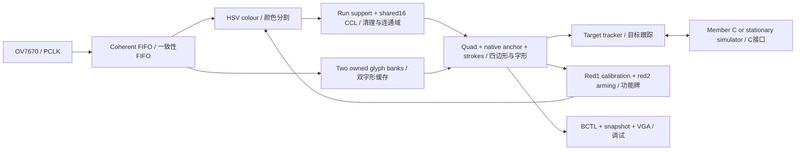

# MTRX3700 Member B — FPGA perception / FPGA 感知子系统

## 1. Scope and current status / 范围与当前状态

Member B reads coloured number signs from real OV7670 pixels, calibrates red/blue segmentation, selects and tracks blue bays1–6, displays diagnostics on VGA and exposes a synchronous interface to Member C. The board wrapper is stationary and does not instantiate motor, chassis UART, steering or navigation control. Real microphone input is deferred by the user; JTAG/BCTL drives the non-motion C simulator for this development phase.

Member B 从实际 OV7670 像素识别红蓝数字牌、校准红蓝分割、选择并跟踪蓝色车位1–6，通过 VGA 显示诊断并向 Member C 提供同步接口。独立板级顶层保持固定，不实例化电机、底盘串口、转向或导航控制。本阶段按用户要求暂缓麦克风，使用 JTAG/BCTL 驱动无运动的 C 模拟器。

The implementation descends from the same-group preliminary repository by Hajin and Jiaze Sun; Hajin mainly contributed Member A work. Member B's confirmed SID is **540207680**. Original staff/IP notices remain applicable. See [OWNERS.md](OWNERS.md) for file-level responsibility, origin and unsigned human-review status; Git preserves earlier code history. A starter ZIP was not used as the replacement project.

项目起源于 Hajin 与 Jiaze Sun 共同构建的同组前置代码，Hajin 主要负责 Member A。Member B 已确认学号为 **540207680**。原课程代码与 IP 声明仍适用；逐文件归属、来源和尚未签署的人类审阅状态见 [OWNERS.md](OWNERS.md)，旧代码由 Git 历史保存。项目没有用 Starter ZIP 覆盖原工程。

| Evidence layer / 证据层 | Verified checkpoint / 已执行结果 | Boundary / 边界 |
|---|---|---|
| MODEL | Previous checkpoint222 tests passed, including a clean exported copy; new pair rules passed seven focused cases / 前检查点222项通过，含干净副本；新配对七项针对测试通过 | Final post-migration full-suite result must be recorded separately / 迁移后完整回归须单独记录 |
| RTL_SIM | `a9caa52f`:35-bench audited aggregate; new pair source passed two focused benches, full run in progress / 旧源35项汇总，新配对两项针对通过、完整执行中 | Original negative-vector-export failure stays in VERSION / 原向量导出覆盖失败保留于版本记录 |
| COURSE R6 RTL_SIM | `127d80b2`, Verilator5.050, actual Bash entry,89.781s, intended early-lock mutant CAUGHT / 新源码实跑规定入口并抓住缺陷 | Separate from full ModelSim, fitting and camera / 与完整ModelSim、拟合和相机分开 |
| QUARTUS_FIT_TIMING / PROGRAMMED | `0xa9caa52f`, private schema7: fitted, timed, downloaded and build identity read back / 完成拟合时序、下载和板上身份回读 | Applies to that frozen source, not later edits / 仅适用于对应冻结源码 |
| CAMERA_HW | `a9caa52f`:three normal-mode trials passed; calibration committed; SW8 comparison and SW9 pause/resume actually read back / 三轮正常模式通过、校色提交、两开关模式已实际回读 | Exact normal/bypass metrics in VERSION; real failures30158/37621 remain / 精确比较数值见版本记录，真实反例仍成立 |
| VGA_PHYSICAL | User confirmed raw-camera-only output with current SW9 up; earlier SW0/SW1 four combinations confirmed / 用户确认当前SW9仅相机；旧检查点四种面板确认 | USER_REPORTED_PHYSICAL, not photographed or a value calibration / 用户实体确认，非照片或数值校准 |
| MIC_HW | DEFERRED_BY_USER / 用户暂缓 | `audioReady=0`; JTAG SELECT is not speech / JTAG 数字不是语音识别 |

The current calibration-pair refinement is not included in `a9caa52f` fit/program evidence. Update this table only from completed, source-linked results. Detailed changes, exact build/SOF hashes, failed attempts and run locations belong in [VERSION_README.md](VERSION_README.md), not a second competing interface document.

当前校色配对修正尚不属于 `a9caa52f` 的拟合与下载证据。此表只能按已完成且绑定源码的结果更新。详细版本变化、build/SOF 哈希、失败记录和运行目录统一见 [VERSION_README.md](VERSION_README.md)，不要再建立另一份相互冲突的接口文档。

## 2. Repository and inputs / 仓库与输入

| Path / 路径 | Purpose / 用途 |
|---|---|
| `rtl/common/`, `rtl/capture/`, `rtl/vision/` | Types, CDC, camera capture and pixel algorithms / 类型、跨域、采集与像素算法 |
| `rtl/interaction/`, `rtl/tracking/`, `rtl/debug/`, `rtl/top/` | Calibration, tracking, C simulator/JTAG/VGA and integration / 校色、跟踪、C模拟器/JTAG/VGA与顶层 |
| `quartus/PartBDebug.qpf` | The single production project, top `perceptionDemoTop`, device5CSEMA5F31C6 / 唯一生产工程与器件 |
| `tests/rtl/manifest.json`, `tests/python/` | Self-checking HDL and independent/host tests / 自检 HDL 与独立参考/主机测试 |
| `tests/fixtures/camera/` | Small genuine camera regression PNGs with manifest, origin and hashes / 小型真实相机回归输入、来源与哈希 |
| `tools/echo7.py`, `tools/lib/`, `tools/tcl/` | Supported CLI, models/exporters and JTAG transport / CLI、模型/向量导出与 JTAG 传输 |
| `assets/markers/` | Single-page artwork, recovered geometry and synthetic templates / 单页标牌、恢复的几何与合成模板 |
| `docs/` | Original Brief, lecture and proposal PDFs / 原始Brief、讲义与提案PDF |
| `build/` | Ignored private build copies, IP, SOF, captures, vectors and run logs / 忽略的私有构建副本、IP、SOF、抓帧、向量与日志 |

The three root Markdown documents are this development/contract README, the version record and OWNERS. Generated databases, simulator outputs, personal toolchains and large captures do not belong in the tracked tree. Required small regression inputs are intentionally tracked; deleting them breaks reproducibility. `.gitignore`, `.gitattributes` and `.editorconfig` define exclusion, UTF-8 and line-ending conventions. Do not use destructive Git cleanup to hide uncommitted work.

根目录的三份 Markdown 分别为本文开发/接口说明、版本记录和 OWNERS。编译数据库、仿真输出、个人工具链和大抓帧不进入版本库；必要的小型回归输入应被明确跟踪，不能当作杂物删除。忽略规则、UTF-8 和换行约定由相应配置文件管理，不使用破坏性 Git 清理掩盖未提交修改。

Print [the formal artwork](assets/markers/ECHO7_All_Markers_A4_v2.pdf) at100% actual size: one297×210mm landscape A4, fold line x=148.5mm. Red1 with its own blue reference and red2 occupy the left half; blue1–6 occupy two columns by three rows on the right. Each main region is54×60.75mm; colours are red#C00000, blue#0057B8 and white digits. Paper/PDF colours are not sensor RGB thresholds. Native input remains320×240.

按100%实际尺寸打印[正式标牌](assets/markers/ECHO7_All_Markers_A4_v2.pdf)：同一张297×210mm横向 A4，中线 x=148.5mm 对折。左侧为红1及其专属蓝参考条、红2；右侧两列三行蓝1–6。主区54×60.75mm，红#C00000、蓝#0057B8，数字为白色。纸面/PDF 色值不是传感器阈值，相机输入保持320×240。

The original JSON was absent from the migrated input, so [marker_spec.json](assets/markers/marker_spec.json) and [scene_manifest.json](assets/markers/scene_manifest.json) explicitly record `RECOVERED_FROM_SUPPLIED_PDF` as a design recovery. `recover_from_pdf.py` reproduces the SVG/PNG/templates from PDF paths. Synthetic images/hex files are pixel replays, not full OV7670 bus transactions or camera photographs. The manifest and test regions never supply runtime IDs.

迁移输入缺失原始 JSON，因此上述几何/场景文件明确标为从所给 PDF 恢复的设计资料；恢复脚本从 PDF 路径生成 SVG/PNG/模板。合成图和 hex 是像素回放，不是完整 OV7670 总线事务，也不是实拍。场景答案与测试区域绝不进入运行时识别。

The default test keeps the full sheet unfolded. Optional folding is done by a person. Added duplicate blue1/2 cards are a separately declared ten-sign test arrangement; they do not change the enabled bay set or the formal one-page artwork. [frame30158's regions](tests/fixtures/camera/frame30158/expected_regions.json) score its photographed arrangement only; [frame19645's regions](tests/fixtures/camera/frame19645/expected_regions.json) describe a different pose and must not be substituted.

默认整页展开，折页必须由人完成。额外蓝1/2重复牌属于另行声明的十牌测试场景，不改变启用号码与正式单页标牌。frame30158和frame19645的独立区域标注对应不同取景，不能混用；相机或纸张移动后必须重新核对评分区域。

## 3. Tools, build and real hardware / 工具、构建与真实硬件

Use Python3 with the versions in [requirements.txt](requirements.txt). The inspected Windows environment uses Quartus Prime18.1 Lite, ModelSim Altera Starter10.5b and Verilator5.050 for the course runner. `doctor` discovers executable paths and actual JTAG targets; Windows Store Python aliases do not qualify. Linux uses its installed executables; do not copy Windows absolute paths.

使用 Python3 及 requirements 中的依赖。当前 Windows 实际工具为 Quartus Prime18.1 Lite、ModelSim Altera Starter10.5b，课程 runner 使用 Verilator5.050。`doctor` 发现绝对路径与实际 JTAG 目标，Windows Store 别名不算可用 Python；Linux 使用本机实际安装路径。

```powershell
# Inspected local example / 当前机器示例
$python = 'C:/Users/15402/.cache/codex-runtimes/codex-primary-runtime/dependencies/python/python.exe'
& $python tools/check_repository.py
& $python tools/echo7.py doctor
& $python tools/echo7.py test --replay
& $python tools/echo7.py test --rtl
& $python tools/echo7.py --quartus-bin 'C:/intelFPGA_lite/18.1/quartus/bin64' --timeout 3600 build
& $python tools/echo7.py program
& $python tools/echo7.py capture --fresh
& $python tools/echo7.py status
```

`build` hashes and copies the exact explicit source closure into `build/member_b/<run>/source/`; Quartus runs against that private copy. Generated Qsys/IP, databases, reports and SOF stay there. A build passes only with the intended top/device, a newly produced SOF, complete fitting, reviewed warnings, required clocks and accepted setup/hold/recovery/removal/CDC checks. A failed build's old SOF is never promoted. The build manifest binds source buildId to SOF SHA256.

`build` 将明确依赖闭包按哈希复制到私有运行目录，Quartus 仅编译该副本，生成 IP、数据库、报告和 SOF 都留在其中。通过必须包括正确顶层/器件、本次生成的 SOF、完整拟合、警告审查和所需时钟/时序/CDC 检查；失败构建遗留的旧 SOF 不能冒充新成果。构建清单绑定源码 buildId 与 SOF SHA256。

The board path is OV7670 → camera capture → FPGA processing/display buffers → DE1-SoC VGA, with USB-Blaster JTAG for volatile `.sof` programming, BCTL control/status and GCTL/GRAB snapshots. The discovered board was `DE-SoC [USB-1]`, Cyclone V5CSEMA5; chain index2 was an observed identity, not a hard-coded assumption. `--cable` and `--device` resolve ambiguity and are shared by program/capture. Multiple matching targets are an error. Never program the HPS or an unverified old image.

实际链路为 OV7670→相机接收→FPGA处理/显示缓冲→DE1-SoC VGA；USB-Blaster JTAG 用于易失 `.sof` 下载、BCTL 控制/状态和 GCTL/GRAB 抓帧。已发现设备为 DE-SoC USB-1 的 Cyclone V5CSEMA5，链上序号2只是当时实测结果，不是写死假设。下载与采集使用同一明确 cable/device，多目标歧义必须报错，不能误选 HPS 或旧镜像。

The source programmes OV7670 MVFP=0x07 and COM8=0xE7. COM8 enables AGC/AWB/AEC; exposure and white balance are not frozen. SCCB currently writes these values without register readback. Decoders/replay receive MVFP explicitly. Calibration adapts classification under current imaging; it does not establish an exposure lock, a calibrated lux/K range or immunity to changing illumination.

源码配置 MVFP=0x07、COM8=0xE7；后者开启 AGC/AWB/AEC，并未锁定曝光和白平衡。现有 SCCB 为写入流程，没有寄存器回读验证。解码/回放显式接收 MVFP；校色仅适配当前成像下的分类阈值，不等于曝光锁定或经标定的照度/色温范围。

## 4. Architecture, clocks and frame ownership / 架构、时钟与帧所有权



| Module / 模块 | Responsibility and timing / 职责与时序 |
|---|---|
| `capture/ov7670_*`, `cameraStreamBridge`, `common/asyncPixelFifo` | Preserve sensor configuration and capture tokens; transfer pixels/metadata atomically / 保留传感器配置与采集，整体跨域 |
| `hsvColourGate`, `horizontalRunFilter`, `causalMaskCleanup` | Classify raw colour, then remove unsupported pixels only for candidate extraction / 原色分类后仅对候选路径清理 |
| `boundedCandidates` | Fifteen active labels per colour, sixteen shared completed slots; explicit colour and whole-frame overflow / 每色15活动标签、总16完成槽，显式颜色与整帧溢出 |
| `glyphBanks` | Two320×240×2-bit banks,37.5KiB logical storage; synchronous read / 两个2位字形缓存，同步读取 |
| `projectiveMarkerReader`, `nativeAnchorReader` | Pixel-derived quad, unique native anchor,32×40 sampling and stroke/hole rejection / 像素四边形、唯一原生锚点与字形判决 |
| `colourSampler`, `fixedSheetInteraction` | Raw RGB sample validation, shadow profile, permitted SOF commit / 原RGB样本验证、影子配置、许可下SOF提交 |
| `targetTracker`, `memberCSimulator` | Current observations, three-frame lock, requests/events and cache-age rules / 当前观测、三帧锁定及请求/事件/年龄 |
| `memberBDebug`, `frame_snap` | Transport acknowledgement with separate action acceptance/error, and same-frame captured status / 传输ACK与动作接受/错误分开，同帧抓取 |
| `memberBVgaContour`, `memberBVgaLabels`, `memberBVgaDiagnostics`, `memberBVgaOverlay` | Colour contours, typed labels and frame-published RGB/HSV panels / 色域轮廓、类型标签与整帧发布诊断 |
| `perceptionCore`, `perceptionDemoTop` | Integratable CLOCK_50 core and stationary board wrapper / 可集成核心与无运动板级封装 |

`CLOCK_50` is50MHz. The video PLL generates25MHz display and10MHz camera XCLK. With the selected camera programme (`CAMERA_FPS=25`, CLKRC=0x81, DBLV=0x4A), returned PCLK is constrained as an independent20MHz source; it is not treated as a PLL-related clock after travelling through the camera/cable. SCCB is100kHz. JTAG has its own clock. [PartBDebug.sdc](quartus/PartBDebug.sdc) and [MemberBCdc.sdc](quartus/MemberBCdc.sdc) define the actual constraints.

系统主时钟50MHz；显示 PLL 产生25MHz显示时钟和10MHz相机 XCLK。当前相机程序下返回 PCLK 按独立20MHz约束，不能因 XCLK 来源相同就将经过相机/排线的 PCLK 当成同步 PLL 时钟。SCCB 为100kHz，JTAG 使用独立时钟；具体约束以上述 SDC 为准。

Single-bit asynchronous controls use synchronisers. Multi-bit pixels, requests, results and configurations cross through FIFOs or stable-payload request/acknowledge handshakes. Two independent synchronisers per bit are not an atomic bus transfer. Held buses remain unchanged until acknowledgement returns. The SDC uses bounded crossing delay/skew and narrow justified exceptions; no whole perception clock domain is globally excluded to hide failures. Synchroniser Meta-to-Sync paths remain checked.

异步单比特控制使用同步器，多比特像素、请求、结果和配置通过 FIFO 或稳定载荷握手跨域，不能逐位两级同步后声称整体原子。握手总线保持到确认返回；SDC 使用有界延迟/偏斜和明确端点的例外，不以切掉整个处理时钟域掩盖失败，同步器后级路径仍受检查。

Every candidate and glyph result carries one frameId, original captureStartUs, configVersion and bank identity. Banks have FREE/WRITING/READY/READING ownership. Reading a bank being overwritten is forbidden; lack of a free bank drops the entire new frame with diagnostics. A newer invalid/drop observation wins over a colliding older completion; the old bank is released, but its result cannot overwrite the newer loss or advance calibration. Camera capture never stops because C holds ready low.

候选和字形结果必须绑定同一 frameId、原始采集时间、配置版本和 bank。缓存所有权分 FREE/WRITING/READY/READING，禁止读取正在覆盖的缓存；无空闲 bank 时丢弃完整新帧并计数。较新坏帧/丢帧与旧完成结果同沿到达时，前者优先，旧 bank 释放但旧结果不能覆盖失锁或推进校色。C 反压不能停止相机。

## 5. Colour, candidates and digit reading / 颜色、候选与数字识别

Production colour algorithm2 implements HSV tests through signed integer products: red signed hue−24°…0°, blue200°…260°, saturation≥0.5, initial value floors R48/B20. Calibration changes the two value floors as one complete profile; white thresholds remain fixed. HSV separates brightness from hue better than a fixed RGB magnitude test, but cannot separate physically overlapping measured hues or restore lost optical detail.

生产颜色算法2用有符号整数乘积实现 HSV 条件：红色环绕色相−24°…0°、蓝色200°…260°、饱和度至少0.5，默认亮度下限 R48/B20。校色原子更新整组红蓝下限，白字门槛固定。HSV 比固定 RGB 大小门槛更明确地区分亮度和色相，但不能分开实际重叠的色相，也不能恢复丢失的光学细节。

CCL receives complete horizontal runs of at least3pixels followed by causal left-or-above support. Raw colour retained for the reader's corner extraction is not eroded by those filters. Labels0/1–15 mean sentinel/active handles; completed count is5bits and supports16. Completed red and blue regions share one16-slot pool in retirement order; simultaneous retirement allocates red first. No colour quota is reserved. If only one slot remains, the second retirement raises overflow and invalidates the whole frame. Active labels remain separate by colour. Maintenance requires335 invalid processing clocks per row,336 for end-of-frame publication; the core guard is341 including upstream latency. A continuous gap-free fake stream cannot prove this hardware schedule.

连通域输入先保留至少3像素的完整横向同色游程，再做左/上邻支持清理；读字形所用原色缓存不经过该腐蚀。标签0是哨兵，1–15为活动句柄，完成计数为5位可表示16。红蓝完成区域按退休顺序动态共享16槽，同沿红蓝退休先分红色，不预留配额。仅剩一槽时第二个区域触发溢出并使整帧无效，不能隐藏重复目标。活动标签仍分色管理。每行维护需要335个无效处理时钟，末帧发布336个，核心含前级延迟保护341个；没有行间空隙的假输入不能证明实际调度可用。

Reader5 finds16 directional contour supports, the farthest pair and maximum signed-cross-product points on opposite sides to form a bounded convex quad. The canonical start is minimum(x+y), then y/x tie-break; orientation0–3 is a cyclic corner offset, **not a measured continuous angle**. Four native anchor hypotheses are checked before the glyph. Exactly one valid anchor permits one32×40 homography pass. The algorithm never chooses direction because one guessed direction yields a convenient digit. SW8's bbox baseline uses the same automatic anchor/number/rejection rules.

Reader5 从16个方向轮廓支撑点中取最远对及两侧最大叉积点形成有界凸四边形。规范起点按最小(x+y)、再y/x打破平局，方向0–3表示循环角点偏移，**不是测量得到的连续角度**。先检查四个原生锚点假设，只允许唯一有效方向进入一次32×40单应采样，不能选择“哪个方向碰巧能读出数字”。SW8轴对齐基线保留相同自动方向、字形与拒识规则。

The independent native anchor is a closed four-connected strong-white component in a quad-derived neighbourhood: at least3pixels, at least2rows and2columns, bounded extent/area, and exactly one qualifying component. Boundary-connected paper, multiple anchors and local active-label overflow reject. Glyph projection checks seven strokes and two empty holes; digit1 uses the same rectangle-relative ROI without recentering its narrow stroke. Blue accepts1–6; red accepts1/2; unknowns and the numberless blue reference do not receive bay IDs.

独立原生锚点必须是四边形预测邻域内闭合的四连通强白分量：至少3像素、跨2行2列，大小/面积有界且唯一。触边白纸、多锚点和局部标签溢出均拒绝。字形检查七段笔画投影和两个空洞；数字1仍用相对主色区的统一 ROI，不围绕窄笔画重新居中。蓝色只接受1–6，红色只接受1/2，未知图形和无数字蓝条没有车位编号。

Bank classes are00background,01raw colour,10weak stroke,11strong white. Strong white requires `R+2G+B>=384` and channel spread≤64. Weak strokes additionally allow sum≥334, spread≤64 and `2*spread<max(R,G,B)`; strong white remains included. This is fixed empirical classification, not automatic white calibration. Historical readers1–4 remain explicit replay profiles; current defaults are reader5/colour2/shared16/active15. Model canonical geometry sorting is not hardware slot order.

缓存编码为00背景、01原色、10弱笔画、11强白。强白要求加权和至少384且通道差不超过64；弱笔画额外允许和至少334、差不超过64并满足两倍差小于最大通道。强白包含在笔画集合中。这是固定经验分类，不是自动白色校准。旧读字算法1–4保留显式历史回放，当前默认5/2/共享16/活动15；模型的几何排序不代表硬件槽顺序。

## 6. Calibration, switches and display / 校色、开关与显示

Fixed-sheet mode allows red1 and red2 to remain together. Three consecutive good red1/reference observations begin one permitted calibration attempt. Eight valid raw-RGB sampling frames must satisfy count, brightness, contamination, geometry and frame-to-frame stability checks. The reference must belong geometrically to red1 and must not be an accepted blue bay. Previous-frame ROI use is checked against the sampled frame's location. A validated shadow profile commits atomically at input SOF, increments configVersion and clears target confirmation. Failed or cancelled attempts retain the last complete profile. Red1 remaining visible does not repeatedly recalibrate after success.

固定纸面允许红1/红2同时常驻。连续三个有效红1及专属参考观测开启一次许可下的校色尝试；八个有效原始 RGB 采样帧须通过数量、亮度、污染、几何与帧间稳定检查。蓝参考必须按几何属于红1，不能是已接受的蓝车位。使用上一帧 ROI 时须复核实际采样帧的位置。验证后的 shadow 在输入 SOF 原子生效、版本加一并清跟踪确认，失败/取消保留旧完整配置；成功后红1常驻不反复校色。

Calibration pairing still uses one of four configured orientations and bbox geometry, **not arbitrary-angle/projective calibration**. Source127d80b2 replaces the old fixed±4pixel endpoint tolerance with a scale-relative doubled-centre condition `abs((refLo+refHi)-(cardLo+cardHi)) <= 2*ceil(cardWidth/16)` and at least80% overlap of card width. It retains reference width80–120% of card width, reference height10–30% of card height, gap0…cardHeight/8, a recognised red1, valid unaccepted blue candidate, unique pair and good frame. Signed15-bit arithmetic avoids negative-offset errors and doubled centres avoid half-pixel rounding. Raw sampling/purity/count≥16per colour, eight valid frames and previous-ROI movement≤3pixels are unchanged. These source rules still require their own full fitting/programming/new-camera proof. Default recovery is common reset; the protocol's atomic default restoration must only be exposed through an implemented, logged command.

校色仍按四种配置方向和包围框配对，**不是任意角度/投影校色**。源码127d80b2以相对牌宽的双中心条件和至少80%牌宽交叠替换旧每端点±4像素容差；保留参考宽为牌宽80–120%、高为牌高10–30%、间隔0至牌高八分之一、真实红1、有效且未接受为车位的蓝候选、唯一配对与好帧。15位有符号运算避免负偏移错误，双中心避免半像素取整。原RGB纯度/每色至少16样本、八有效帧和上一ROI位移不超过3像素不变。这些源码规则仍须本轮完整拟合/下载/新实拍证明，不能由读字自动方向推断任意角度校色完成。共同复位恢复默认；协议默认恢复语义也只有实际实现且记录的命令才能开放。

| Switch / 开关 | Down0 / 下拨0 | Up1 / 上拨1 |
|---|---|---|
| SW0 | No per-object RGB/HSV panel / 不显示逐对象面板 |4×4 raw-display RGB/HSV for accepted signs and the uniquely paired BJ strip / 已识别牌及唯一 BJ 的4×4采样 |
| SW1 | No centre panel / 无中心面板 |8×8 centre box, mean RGB/HSV, detected colour and unique accepted-box association / 中心8×8、均值和颜色/关联数字 |
| SW8 | Measured-quad perspective sampling / 实测四边形透视采样 | Axis-aligned bbox baseline, algorithms still running / 轴对齐基线，算法继续运行 |
| SW9 | Perception and normal VGA / 正常处理与VGA | Perception/interaction paused at input SOF, exact raw camera VGA at packet boundary / 输入SOF暂停处理，显示包边界切纯相机 |

SW0 and SW1 may be enabled together. Blue objects use#0–#7, red#A–#F; BJ has a separate row and is only the uniquely paired calibration strip. UI tags are association labels, not bay IDs. Unknown candidates do not occupy empty panels. Display capacity overflow is shown explicitly, while recognition/tracking still uses all16shared slots. RGB/S/V are0–255 and H is0–359degrees, calculated from mean raw-display RGB before overlays. Values publish together at display SOP as `VGA HELD`; the scan and native metadata IDs may differ. STALE/BAD must prevent old panels being mistaken for current measurements. The centre digit is an accepted-main-bbox association, not OCR of eight pixels.

SW0/SW1可同时开启。蓝对象编号#0–#7、红对象#A–#F，BJ独占一行且仅表示唯一配对的校色条；这些是显示关联号，不是车位号码。未知候选不占空面板，显示容量溢出明确提示，但识别/跟踪仍保留16槽。RGB/S/V范围0–255，H为0–359度，来自覆盖图形前原显示RGB均值。数值在显示SOF一起发布为 VGA HELD，显示扫描与原生元数据编号可能不同；STALE/BAD不能让旧面板冒充当前测量。中心数字来自已接受主区的唯一框关联，不是对8像素小框单独读字。

Contours follow raw HSV boundaries, supporting several same-colour and non-rectangular regions; a contour alone is not recognition. SW9 overrides every overlay and SW0/SW1. Camera reception, original frame count and time continue while processing is paused. Input-SOF pause/resume increments configuration once per applied transition, cancels uncommitted calibration, keeps committed colour settings and clears tracking. Disabled-frame reports are explicit bad/empty observations. Previously presented stalled transactions remain stable. Readiness falls immediately on the disabled request and rises only after a fresh normal completion; resume requires three new unique frames to lock. Switch request, processing mode and actual display mode are separately reported during transitions.

轮廓沿原始HSV边界，可显示多个同色非矩形区域，但轮廓本身不是识别。SW9优先关闭所有覆盖图形，不受SW0/SW1影响。暂停时相机、原生帧号和时间继续；输入SOF应用暂停/恢复时版本只增一次、取消未提交校色、保留已提交颜色并清跟踪。禁用帧明确报告坏/空观测，已展示且被反压的事务仍稳定。readiness在禁用请求后立即下降，恢复后直到新正常完成帧才上升，锁定仍须三个新唯一观测。切换请求、处理实际模式、显示实际模式分别记录，过渡期短暂不同合法。

## 7. Authoritative Member B/C contract v2 / 唯一 B/C 契约v2

This section and [perception_pkg.sv](rtl/common/perception_pkg.sv) define the single public contract. [perceptionLink.sv](rtl/common/perceptionLink.sv) provides perception/controller/monitor directions; [perceptionCore.sv](rtl/top/perceptionCore.sv) is the integration entry and [memberCSimulator.sv](rtl/debug/memberCSimulator.sv) is a stationary consumer. All fields are unsigned, packed in table order from most significant to least significant. This internal FPGA contract does not specify off-chip serial byte order.

本节及共享 package 是唯一公共契约；perceptionLink 定义双方/监视方向，perceptionCore 为集成入口，memberCSimulator 为无运动消费者。字段均无符号，按表序从高位到低位打包；此 FPGA 内部接口不定义片外串行字节序。

`PERCEPTION_CONTRACT_VERSION=2`, `DEFAULT_ACTIVE_BAY_MASK=10'h07E`, `INVALID_BAY_ID=4'hF`. Only1–6 are enabled;0/7/8/9 are invalid selections. CLEAR is a distinct operation. `fixedSheetMode=1` is a B configuration, not another C channel. Contract version is distinct from run-time configVersion and private debug schema. The public widths are22/139/104/76bits; legacy75-bit status cannot silently connect to the76-bit version. No per-transaction version field is added; both sides build from the same package and verify `$bits`.

公共协议版本2、掩码0x07E、无效ID为15，只启用1–6；CLEAR独立，不能复用0。fixedSheetMode属于B配置，不增加C通道。协议版本、运行配置版本和私有调试schema是不同概念。四个结构位宽为22/139/104/76，旧75位状态不能隐式补位连接；双方从同一package构建并检查位宽，不额外逐包添加版本字段。

### 7.1 Clock, reset and channels / 时钟、复位与通道

| Signal / 信号 | Bits / 位宽 | Direction / 方向 | Meaning / 含义 |
|---|---:|---|---|
| `CLOCK_50` |1| Top→B/C | Shared50MHz rising edge / 共用50MHz上升沿 |
| `reset` |1| Top→B/C | Common synchronous active-high / 共同同步高有效复位 |
| `timeUs` |32| Top→B/C | Shared microsecond counter, modulo2³², resets0 / 共享微秒计数、模回绕 |
| `interactionEnable` |1| C→B | Enable interactions/arming; low cancels unfinished work and disarms / 允许交互，低取消未完事务并撤武装 |
| `interactionPermit` |1| C→B | C confirms stationary and permits actual work continuously / C确认静止并持续许可实际工作 |
| `targetRequest`, `targetRequestValid/Ready` |22,1,1| C→B, C→B/B→C | Request transaction / 请求事务 |
| `targetReport`, `targetReportValid/Ready` |139,1,1| B→C, B→C/C→B | Per-capture target result; valid does not mean observed / 采集帧结果，valid不等于看见 |
| `userEvent`, `userEventValid/Ready` |104,1,1| B→C, B→C/C→B | Interaction terminal event / 交互终结事件 |
| `status` |76| B→C | Registered current status, no valid/ready / 注册的当前状态，无独立握手 |

A transfer occurs only on `!reset && valid && ready`. A sender must assert valid without waiting for ready. Once `valid && !ready`, valid and the entire payload remain unchanged until transfer or common reset, including across new requests, commits and cancellation. Reset takes priority, clears driven valid/ready, queues, bank ownership, tracker history and C caches. Reset restores version0/default profile, calibrated=0, speechArmed=0, busy=0, kind=NONE, state=IDLE and no target; readiness stays0 until recovered. Independent B-only reset with C retaining state is unsupported; it would require a new epoch/supervision contract.

只有非复位且valid/ready同为1的沿发生传输；发送方不能等ready才置valid。反压后valid及整个载荷保持到握手或共同复位，新请求、提交或取消也不能改写。复位优先，清双方valid/ready、队列、bank、跟踪历史和C缓存；恢复默认颜色/version0、未校准、未武装、空闲无目标，链路恢复前readiness为0。不支持B独自复位而C继续沿用旧缓存，这需要另行升级epoch/监控契约。

### 7.2 `targetRequest_t` —22bits / 目标请求

| Field / 字段 | Bits | Meaning / 含义 |
|---|---:|---|
| `operation` |2|0=`TARGET_CLEAR`,1=`TARGET_SELECT`;2/3reserved / 保留 |
| `requestTag` |16| New tag per request,0legal; modulo wrap / 每次新请求标签，0合法 |
| `bayId` |4| SELECT accepts1–6; CLEAR ignores / SELECT只接受1–6，CLEAR忽略 |

At acceptance C changes its expected tag and clears cached measurement; B clears confirmation. A new request binds from the first complete capture after safe application. Frames already captured/processing keep their old bound tag. An invalid operation/ID is consumed, clears selection, retains the new tag, sets FAULT_REQUEST_INVALID and reports bayId15/targetSelected0/INVALID_REQUEST; it cannot leave the old target active. CLEAR gives NO_SELECTION. Tags compare by equality, not magnitude, and must not be reused while old same-tag transactions can remain. Acceptance is not lock.

请求接受后C切换期望tag并清缓存，B清连续确认；新请求从安全生效后的首个完整采集帧绑定。已采集/处理中旧帧仍保留旧tag。无效操作/ID也被消费，但清选择、保留新tag、置故障并报告无效请求，不能暗中维持旧目标；CLEAR报告无选择。tag按相等比较，不比大小，旧同tag事务可能滞留时不能复用。接受不代表锁定。

### 7.3 `targetReport_t` —139bits / 目标报告

| Field / 字段 | Bits | Meaning / 含义 |
|---|---:|---|
| `requestTag` |16| Request bound at capture / 采集时绑定请求 |
| `frameId` |16| Original capture sequence,0legal / 原生采集序号 |
| `captureStartUs` |32| Actual capture SOF time / 真实采集SOF时间 |
| `configVersion` |16| Configuration actually used by this frame / 本帧实际配置 |
| `bayId` |4| Selected1–6, otherwise15 / 选中号码或15 |
| `frameGood` |1| Whole consistent frame/candidates/glyph/config / 整帧与附属数据一致可用 |
| `observed` |1| Exactly one reliable current selected target / 当前唯一可靠目标 |
| `locked` |1| Confirmed across three consecutive distinct good frames / 连续三个不同好帧确认 |
| `ambiguous` |1| Multiple accepted locations for selected number / 同号多个位置 |
| `targetSelected` |1| Legal logical selection, not visibility / 逻辑选择合法，不等于可见 |
| `centreU` |8| Public u0–239 / 对外横坐标 |
| `centreV` |9| Public v0–319 / 对外纵坐标 |
| `boxWidth` |8| Inclusive transformed main-region width1–240 / 变换后主区宽 |
| `boxHeight` |9| Inclusive transformed main-region height1–320 / 变换后主区高 |
| `quality` |8| Observed quality1–255, not probability / 质量分，不是概率 |
| `reason` |8| Enumeration below / 下表枚举 |

| Value | `reportReason` | Meaning / 含义 |
|---:|---|---|
|0|`REPORT_OK`|Current observation locked / 当前已锁定 |
|1|`REPORT_NO_SELECTION`|No selection / 无选择 |
|2|`REPORT_ACQUIRING`|Observed, fewer than three confirmations / 可见未满三帧 |
|3|`REPORT_NOT_FOUND`|No current selected target / 当前未发现 |
|4|`REPORT_DUPLICATE_ID`|Same-ID ambiguity / 同号歧义 |
|5|`REPORT_FRAME_BAD`|Bad/inconsistent frame / 坏帧或错帧 |
|6|`REPORT_CONFIG_CHANGED`|Configuration invalidated confirmation / 配置切换 |
|7|`REPORT_REQUEST_CHANGED`|Request invalidated confirmation / 请求切换 |
|8|`REPORT_PIPELINE_NOT_READY`|Current pipeline unavailable / 当前链路不可用 |
|9|`REPORT_INVALID_REQUEST`|Invalid operation/ID / 无效请求 |
|10|`REPORT_LOW_QUALITY`|Insufficient classification/geometry / 质量不足 |
|11|`REPORT_RESOURCE_DROP`|Capture discarded for resource shortage / 资源丢帧 |

`observed=0` requires centreU/V, boxWidth/Height and quality all0, and locked0. `observed=1` requires frameGood1,targetSelected1,ambiguous0; reason is ACQUIRING until locked then OK. Missing/bad/ambiguous frames, capture gaps, new requests and configuration changes immediately clear continuity/lock; returning targets need three fresh distinct confirmations. Repeated snapshots/transfers do not count. C backpressure losing a report is not a lost capture. For duplicates: good frame, selected1, ambiguous1, observed0, locked0, zero measurements, DUPLICATE_ID; never choose largest/first. Different numbers together are normal. Every completed frame produces an observation, including absent targets; candidate overflow or frame mismatch invalidates the whole frame.

observed为0时公开位置、尺寸、quality全部清零且不能锁定；为1则必须好帧、已选择且无歧义，满三帧前ACQUIRING，之后OK。缺失/坏帧/歧义/采集缺口/新请求/新配置立即清确认和锁，重现需三个新帧。重复快照或传输不计数，C反压漏收报告不等于B漏采帧。同号多位置时保留好帧与选择，但歧义、无观测无锁定、测量零，不能取最大或第一个。不同号码同时存在正常，每个完成帧都有观察记录，候选溢出/错帧使整帧无效。

### 7.4 Coordinates, time and sequence / 坐标、时间与序号

Native320×240 and public240×320 remain distinct. The inclusive coloured main bbox is transformed **before** centre rounding; never use a white-glyph centroid, fixed cell or predicted history as current public geometry. Internal ROI orientation does not change this contract.

原生320×240与对外240×320分开；对包含端点的主色区框先变换再向下取中心，不能用白字质心、固定格子或历史预测代替当前测量。内部ROI旋转不改变外部契约。

```text
uMin=yMin                 uMax=yMax
vMin=319-xMax             vMax=319-xMin
centreU=floor((uMin+uMax)/2)
centreV=floor((vMin+vMax)/2)
boxWidth=uMax-uMin+1      boxHeight=vMax-vMin+1

ageUs=(timeUs-captureStartUs)&0xffffffff
fresh=(ageUs<0x80000000) && (ageUs<=maxAgeUs)
delta=(newFrameId-lastFrameId)&0xffff
newer=(delta>0) && (delta<0x8000)
```

Extend additions before summing endpoints; x10–13/y20–24 gives public centre(22,307), width5,height4. Capture time is taken at actual SOF and travels with bank/frame/config; publication, completion, handshake and PC transfer never refresh it. Initial maxAgeUs150000 is a design budget, not a blanket measured guarantee. Recheck age whenever C uses a cached value, even without new reports. A half-range future/invalid timestamp rejects. Frame delta0 is duplicate;1–32767newer;32768–65535reject.65535→0 is legal. After a half-range gap clear history before reacquisition. eventId uses the same modular deduplication; requestTag/configVersion/interactionId mainly match current equality. Any16-bit identifier reuse must exclude stale same-value transactions.

端点加法先扩位，上例说明先旋转再取整的重要性。时间来自真实SOF并随bank/帧/配置传递，发布、处理完成、握手或PC接收不能刷新。初始150000µs只是设计预算；C每次用缓存都重新算年龄，半范围未来/无效时间拒绝。帧差0重复，1–32767更新，其余拒绝，65535→0合法；半范围中断后先清历史。eventId同样模序号去重，其余ID主要按当前相等匹配，复用前排除同值旧事务。

### 7.5 `perceptionStatus_t` —76bits / 当前状态

| Field / 字段 | Bits | Meaning / 含义 |
|---|---:|---|
| `interactionBusy` |1| Real active wait/sample/classify/result-queue transaction / 实际活跃事务 |
| `kind` |2|0NONE,1CALIBRATION,2SPEECH,3reserved / 类型 |
| `state` |4| State table below / 下表状态 |
| `calibrated` |1| At least one complete profile committed since reset/default recovery / 本次复位/恢复后曾成功提交 |
| `audioReady` |1| Actual capture and vocabulary ready, not activity detection / 真采音与词表就绪 |
| `perceptionReady` |1| Current consistent visual result path usable / 当前视觉链可用 |
| `activeCfgVersion` |16| Currently active configuration, not stalled report's version / 当前配置 |
| `reportDropCount` |16| Saturating replaced-not-presented report count / 待发报告替换饱和计数 |
| `eventOverflow` |1| Event capacity shortage, sticky to reset / 事件容量不足保持到复位 |
| `faultFlags` |16| Sticky historical fault bits / 历史故障位 |
| `interactionId` |16| Current/latest actual interaction / 当前或最近实际交互 |
| `speechArmed` |1| Red2 opened input; starting still needs readiness/permission/space / 红2武装意图 |

| Value | State | Required busy/kind / busy与kind约束 |
|---:|---|---|
|0|`INTERACTION_IDLE`|0/NONE |
|1|`INTERACTION_WAIT_PERMIT`|1/CALIBRATION, bounded wait / 有限等待 |
|2|`INTERACTION_CAL_COLLECT`|1/CALIBRATION |
|3|`INTERACTION_CAL_VALIDATE`|1/CALIBRATION |
|4|`INTERACTION_CAL_COMMIT`|1/CALIBRATION, final commit result pending / 等提交结果 |
|5|`INTERACTION_LISTEN`|1/SPEECH, actual utterance started / 已开始话语 |
|6|`INTERACTION_CLASSIFY`|1/SPEECH |
|7|`INTERACTION_RESULT_QUEUE`|1/current terminal transaction kind / 当前终结事务类型 |
|8|`INTERACTION_REARM`|0/NONE, silence interval / 静音间隔 |
|9|`INTERACTION_SPEECH_ARMED`|0/NONE, speechArmed1, idle wait / 空闲等声 |

Fault bits0–6 are CAMERA_TRANSPORT, CANDIDATE_OVERFLOW, MASK_BUFFER_OVERRUN, CONFIG_REJECTED, AUDIO_CAPTURE, REQUEST_INVALID, INTERNAL_PROTOCOL;7–15reserved0. Sticky history does not mean a fault persists; readiness describes current usability. Idle armed allocates no new interactionId, no permanent queue reservation and no repeated NO_SPEECH events. The speech contract is retained for future integration; current microphone implementation/acceptance remains deferred.

故障位0–6依次为相机传输、候选溢出、mask缓存超限、配置拒绝、音频采集、请求无效、内部协议，7–15保留0。历史位不等于持续故障，当前可用性看readiness。空闲武装不分配新交互ID、不永久占队列、不反复产生无声错误；语音协议保留用于后续集成，当前真实麦克风实现/验收仍暂缓。

### 7.6 Fixed-sheet lifecycle and cancellation / 固定纸面生命周期与撤销

After successful calibration, three good red2 observations under the new configuration set speechArmed1; idle busy is0. A future actual utterance may start only with armed+enable+permit+audioReady, required silence and a reserved terminal-event slot. Start allocates interactionId and sets busy; end/classification produces one proposal or explicit rejection. The next utterance cannot be appended while CLASSIFY. After enqueue, busy0/kindNONE, armed remains and a silence interval rearms without removing red2. C accepts a proposal then sends a new SELECT; B cannot silently select internally.

成功校色后新配置下连续三个有效红2观测设置武装，空闲busy为0。未来真实话语只能在武装、enable、permit、audioReady、静音条件与事件空位均满足时开始，起点分配ID并忙碌，终点分类只产生一次提议或拒识；CLASSIFY不能拼入下一段。入队后空闲并经静音重武装，不要求移走红2。C接受提议后再发SELECT，B不能内部偷偷选择。

Wait-for-permit, valid-sample collection and active utterance processing have finite configured timeouts; idle silence has none. Initially failed automatic calibration retries cool down1s and reconfirm red1 for three frames. Repeated identical failure episodes are coalesced before enqueue; changed reason, cancellation and eventual success are retained. Explicit attempts each yield one terminal event. Retrying still needs actual red1/pixels, not an injected success. Initial failed calibration does not unlock red2's fixed-sheet stage.

等待许可、有效采样和活跃话语处理都有配置的有限超时，空闲等声不作为超时事务。首次自动校色失败冷却1秒后重新三帧确认，重复同原因失败在入队前按episode合并，原因变化、取消和最终成功保留；每次显式尝试仍只有一个终结事件。重试仍需真实红1和像素，不能注入成功；初始校色失败不能开放固定纸面红2阶段。

| Change / 变化 | Committed profile / 已提交配置 | Armed / 武装 | Target / 目标 |
|---|---|---|---|
| Red cards remain/disappear; page is folded / 红牌常驻、消失、翻页 | Keep / 保持 | Keep if already armed / 已武装则保持 | Current visible pixels only; loss clears lock / 仅当前可见像素 |
| permit0 | Keep; commit race below / 保持，按提交竞态 | Idle intent may remain; no new utterance / 可保持意图，不启动 | Continue truthful observation / 继续真实观察 |
| enable0 | Keep | Clear and clear start/silence history / 清武装和历史 | Keep logical selection / 保留逻辑选择 |
| Re-enable / 再使能 | No automatic repeat after success / 不重复成功校色 | Must see real red2 again / 重新看见红2 | Existing request rules / 按原请求 |
| Explicit recalibration / 显式重校 | Keep old until commit; failure keeps old / 提交前/失败保旧 | Clear then require red2 again / 清后重新红2 | New config requires3frames / 新配置三帧 |
| Restore default / 恢复默认 | Atomic SOF,version++,calibrated0 / 原子切换 | Clear | Clear confirmation / 清确认 |
| Common reset / 共同复位 | Default,version0,calibrated0 | Clear | Clear selection/cache / 清选择缓存 |

Only completed profile/arming state persists across folding. Moving red1 during sampling can invalidate that attempt. After selecting blue3, returning to the red half may keep targetSelected1 but must give observed0; returning to the blue half requires three fresh frames again. Debug retry/default restoration is not an extra targetRequest operation and cannot directly assert recognised/calibrated state.

翻页只保留已完成的配置/武装，采样期间移走红1可使尝试失败。选蓝3后翻到红侧可保留targetSelected，但必须observed0；翻回仍需三个新帧。调试重试/恢复不新增targetRequest操作，也不能直接写“识别/校色成功”。

`interactionPermit` is continuous authorisation. permit0 during WAIT_PERMIT is normal waiting; after sampling/classification begins, revocation discards unfinished samples/shadow/results. enable0 also disarms. In idle ARMED, permit0 is not a cancellation event: keep intent but clear incomplete onset history and require silence on resume. Current commit domain is CLOCK_50 at the camera FIFO SOF token; a revocation visible on that edge wins, but a previously committed profile never rolls back. Any future cross-domain commit must await final committed/not-committed acknowledgement before emitting exactly one correct terminal event.

permit是持续许可：等待阶段为0可以正常等待，已开始采样/分类后撤销必须作废未完成样本、shadow和结果；enable撤销额外清武装。空闲武装下permit为0不产生取消事件，只保留意图、清不完整起点，恢复后先静音。当前提交位于CLOCK_50处理相机FIFO SOF的沿，该沿可见撤销优先，已经提交的不回滚。未来若改跨域提交，必须等待最终提交/未提交确认后才形成唯一正确终结事件。

### 7.7 `userEvent_t` —104bits and queues / 用户事件与队列

| Field / 字段 | Bits | Meaning / 含义 |
|---|---:|---|
| `eventId` |16| Increment once per enqueue; first1, wrap legal / 每次入队增，首个1 |
| `eventType` |4| Below; NONE never queued / 下表，NONE不得入队 |
| `bayId` |4| Speech proposal1–6; information15 / 语音号码或信息15 |
| `quality` |8| Proposal1–255, not probability; other events may0 / 提议质量非概率 |
| `issuedAtUs` |32| Formation time, not refreshed in FIFO / 形成时刻，不随等待刷新 |
| `configVersion` |16| Event's active version; DONE uses newly committed / 事件对应版本 |
| `reason` |8| Below / 下表原因 |
| `interactionId` |16| Actual attempt/utterance; first1, wrap legal / 实际交互编号 |

| Value | Event / 事件 | Meaning / 含义 |
|---:|---|---|
|0|`EVENT_NONE`|Reserved, never enqueue / 保留禁入队 |
|1|`EVENT_SPEECH_BAY_REQUEST`|Proposal; C separately SELECTs / 提议，由C另发SELECT |
|2|`EVENT_CALIBRATION_DONE`|Actually committed / 已实际提交 |
|3|`EVENT_CALIBRATION_FAILED`|Failed, old profile intact / 失败保旧 |
|4|`EVENT_INPUT_REJECTED`|One real input rejected/capture fault / 一次输入拒识或采音故障 |
|5|`EVENT_INTERACTION_CANCELLED`|Unfinished transaction cancelled / 未完事务撤销 |
|6|`EVENT_INTERACTION_TIMEOUT`|Active transaction timeout / 活跃事务超时 |

Event reason values0–11 are OK,LOW_CONFIDENCE,BAY_DISABLED,NO_SPEECH,AUDIO_UNAVAILABLE,CAL_CARD_INVALID,CAL_SAMPLES_INVALID,PERMIT_REVOKED,ENABLE_REVOKED,WAIT_TIMEOUT,CAPTURE_TIMEOUT,INTERNAL_ERROR; others reserved. Successful proposal/DONE use0, failures use the appropriate nonzero reason. Idle silence generates no periodic NO_SPEECH.

事件原因0–11依次为正常、低可信、号码禁用、无语音、音频不可用、校色牌无效、样本无效、许可撤销、使能撤销、等待超时、采集超时、内部错误，其余保留；成功提议/完成用0，失败用相应非零原因，空闲静音不定期刷无声错误。

The event FIFO holds4entries including the visible unconsumed head. Starting an actual interaction reserves one terminal slot until completion; with no capacity, do not start, set eventOverflow and never overwrite an event. Idle arming does not permanently reserve capacity. Reports have one immutable visible slot and one replaceable latest-pending slot; replacing pending increments saturating reportDropCount. Events and reports buffer independently, with no camera backpressure.

事件FIFO总计4条，包括已展示未消费队首。实际交互开始前预留一个终结槽直到完成，无容量则不开始、置eventOverflow，绝不覆盖事件；空闲武装不永久占位。报告分一个不可变展示槽和一个可替换最新待发槽，替换后drop饱和计数。事件/报告独立，不反压相机。

Once an event is queued/presented it cannot be withdrawn or rewritten after cancellation. C immediately stops accepting speech on enable/permit revocation, records `cancelCutoffUs=timeUs` and the active interaction as cancelled; do not wait for a cancellation event. This also rejects **all** pre-revocation queued proposals, not just the latest interaction. Keep userEventReady consuming/discarding old events so the queue drains. Information events may be logged; already accepted SELECT and committed configuration remain until explicit CLEAR/new commit.

事件入队/展示后撤销不能抽走或改写。C在enable/permit撤销时立即停收语音提议、记录撤销时间与被取消的活跃交互，不等取消事件；还须拒绝此前队列中**所有**未消费旧提议，而不只最后一次交互。保持ready消费丢弃旧事件以排空队列，信息事件可记日志，已接受SELECT和已提交配置不自动回滚。

Default eventMaxAgeUs=2000000 is an initial design budget. C first applies eventId deduplication, active enable/permit, enabled ID, current version/session, cancelled-session rejection and the same unsigned age/future-time check as reports. Then apply:

默认事件年龄2000000µs为初始设计预算。C先检查eventId去重、当前使能/许可、有效ID、当前版本/会话、非取消会话及无符号年龄/未来时间，再检查撤销围栏：

```text
sinceCancelUs=(timeUs-cancelCutoffUs)&0xffffffff
cancelFenceActive=haveCancelCutoff && (sinceCancelUs<=eventMaxAgeUs)
afterCutoffUs=(event.issuedAtUs-cancelCutoffUs)&0xffffffff
rejectPreCancelProposal=cancelFenceActive &&
                       (afterCutoffUs==0 || afterCutoffUs>=0x80000000)
```

All budgets are below2³¹µs. Events formed in the same microsecond as cancellation reject conservatively. Clear the fence after its age budget or common reset; a later cancellation restarts it. Time filtering does not replace cancelled interactionId filtering: an active cancelled utterance could finish later. Stale/cancelled speech may be consumed but cannot create SELECT.

预算必须小于2³¹µs，同微秒事件保守拒绝；围栏超龄或复位后清除，下一撤销重新开启。时间过滤不能代替取消会话ID过滤，因为被取消话语可能稍后才结束。旧/取消提议可被消费，但不得触发SELECT。

### 7.8 Member C's usable-observation predicate / C端可用观测条件

```text
currentRequest.operation==TARGET_SELECT
&& currentRequest.bayId in {1,2,3,4,5,6}
&& report.requestTag==currentRequest.requestTag
&& report.bayId==currentRequest.bayId
&& report.configVersion==status.activeCfgVersion
&& report.targetSelected && report.frameGood
&& report.observed && report.locked && !report.ambiguous
&& status.perceptionReady && !status.interactionBusy
&& fresh(report.captureStartUs,timeUs)
```

C may additionally require calibrated as its policy; a real default-profile observation is distinct from a completed user calibration. Idle armed has busy0 and must not permanently block observation. Active calibration/utterance can still report real visual data for recording, but busy0/events are not movement permission. B supplies no distance, steering, parking-complete or safe-to-drive decision. New request/config, current-stream bad/missing observations and age expiry invalidate cache. Old tag/config, duplicate or out-of-order packets cannot replace a current valid cache; cached use continues checking live status/time. JTAG SELECT exercises this same interface, never speech.

C可按自身政策额外要求calibrated，但默认配置真实观察与已完成用户校色是两件事。空闲武装busy0不能永久阻断观察，实际交互时仍可记录真实视觉结果；busy0或事件不是运动许可。B不提供距离、转向、停车完成或可行驶结论。新请求/配置、当前流坏/缺帧与过期使缓存失效，旧tag/配置、重复/倒序包不能替换当前有效缓存，每次使用还检查实时状态/时间。JTAG选择走同一接口，绝非语音证据。

## 8. Private debug interface and commands / 私有调试接口与命令

Public v2 remains unchanged. Private schema7 has96 frozen32-bit words; GRAB appends captured frameId/buildId for98words. BCTL exposes96. Schema6's historical split16-per-colour trial is distinct and must not be decoded as shared16. Model JSON schema is another independent version. Every slot carries explicit colour, including rejection; slot/order is never an ID source.

公共v2不变。私有schema7为96个冻结32位字，GRAB附采集frameId/buildId后共98字，BCTL读取96字。历史schema6每色16槽不是共享16，不能混解；模型JSON版本又是独立概念。每槽包括拒识也显式带颜色，槽号/排序不能提供答案。

| Words / 字 | Current meaning / 当前含义 |
|---|---|
|0–1|Magic0x45425031, schema7/public contract2 / 魔数及版本 |
|3–6|Completed native frameId, original capture time, completion time and frame configuration / 完成帧身份、原始采集/完成时间及配置 |
|7|Red/blue minima, configured orientation; bit20completed-frame SW8 bypass,21completed-frame raw mode,22synchronised SW9 request,23actual VGA raw mode / 阈值、方向、三层实际模式 |
|9|Bits4:0red count,9:5blue count; total≤16 / 红蓝5位计数，总计≤16 |
|18–21|Visible event, or explicitly flagged last-consumed history / 当前事件或明确标记的历史 |
|22–23|Sample counts bound to last processed calibration sample / 绑定最后校色采样帧的数量 |
|24–87|16shared slots×4words; first word bit30isBlue / 16共享槽，显式颜色 |
|88|Current request / 当前请求 |
|89|Last sample frame/count/checks / 最后采样帧、数量与检查 |
|90|bit0eventValid,1reportValid,2eventHistory,3BJvalid,bits7:4BJglobalSlot / 有效位、历史与BJ槽 |
|91–93|frameGood,buildId; word93bytes: sharedLayout1/total16/active15, low nibbles active peaks / 帧有效、构建与容量高水位 |
|94|Saturating completionDiscardCount in31:16; low bits3transport history,2overflow,1candidate error,0schedule overrun / 丢弃与故障 |
|95|colourAlgorithm2,readerAlgorithm5,white84/spread64 / 实际算法与白字参数 |

BCTL transport acknowledgement returns for a completed command transaction, including BUSY/disabled errors. Successful calibration/speech-arm **action acceptance** is reported only when the interaction FSM consumes that action; busy/disabled rejects it explicitly and does not queue a retry. Transport ACK alone is not acceptance, starting or completion. After successful acceptance, verify interactionId, eight valid samples, terminal event and config increment. A held toggle/address read cannot issue another action. Last-event history is never delivered again to C. Calibration's verify-busy command fails if a second request rejects correctly but the first never commits.

包括BUSY/禁用错误在内，完成的BCTL命令事务都会返回传输ACK；校色/武装的**动作成功接受**只在交互FSM实际消费动作时报告，忙碌/禁用明确拒绝且不排队。仅传输ACK不代表接受、开始或完成；成功接受后仍需验证交互ID、八个有效样本、终结事件与版本增量。保持toggle或读取地址不能重复执行，历史事件不重新发给C；verify-busy不能因第二请求正确被拒绝就掩盖第一次未提交。

| Command / 命令 | Executed meaning / 实际含义 |
|---|---|
|`doctor`|Tools, files, constraints and actual target discovery / 工具、文件、约束与设备发现 |
|`test --replay`|MODEL/host regression with real failure propagation / 模型及主机回归 |
|`test --rtl [--only names...]`|Actual self-checking HDL execution / 真正自检仿真 |
|`build`, `program`|Source-linked Quartus, then verified volatile SOF download / 绑定源码的编译和易失下载 |
|`capture --fresh`|New snapshot transaction, frame/schema/CRC/build checked / 新事务及帧/校验/身份核验 |
|`capture --held`|Old snapshot only; never another lock frame / 仅旧快照，不增加锁定帧 |
|`status`|Actual build/config/candidates/interaction/status / 实际状态 |
|`select --bay 1..6`, `clear`|C-simulator request, not vision bypass / C请求，不绕过视觉 |
|`orientation --profile 0..3`|Configured geometry profile, not a forced digit / 配置几何方向，不注入数字 |
|`calibrate --arm [--verify-busy]`|Permit another real red1/sample attempt / 允许另一真实红1采样 |
|`speech --arm`, `speech --record`|Reserved/deferred real-input path; no fake recognition / 保留/暂缓真实语音路径 |
|`test --hardware --trials 1..3`|30new sampled reports per trial, all failures retained / 每轮30新采样报告，保留失败 |
|`autodebug`|Replay→RTL→build→program→fresh capture→hardware assessor / 编排完整链 |

Commands use argument arrays, timeouts and JSON results under ignored build. Exit0 means that command's executed pass;1failure;2external block or explicit deferral. Each layer remains separate. Capture success is transport/acquisition success, not proof every printed marker is recognised. A `.sof` download is not a recognition result. JTAG transfer duration is never FPGA processing latency.

命令使用参数数组、超时与build下JSON结果。退出0为该命令执行通过，1失败，2外部阻塞或明确暂缓，各层含义独立。抓帧通过是传输/采集通过，不证明每张牌识别成功；下载也不是识别结果，JTAG文件传输耗时不算FPGA算法延迟。

## 9. Tests, measurements and recovery / 测试、测量与恢复

Development tests cover glyphs/types, absent/multiple/reflected anchors, unknown digits, swapped/deleted strokes, native rotation, shared capacity/overflow, short row gaps, same-frame banks, reset/backpressure, modulo counters, calibration cancellation/failure retention, duplicate ambiguity and stale C caches. Synthetic counterfactuals must follow changed pixels, never the original cell's answer. Real fixtures used during tuning remain regression inputs, not independent post-change evaluation.

开发测试覆盖字形/类型、缺失/多重/镜像锚点、未知数字、换字/删笔画、旋转、共享容量/溢出、短行间隔、同帧bank、复位反压、回绕、校色撤销保旧、同号歧义与C缓存过期。反事实输出必须跟随像素变化，不能仍给原格子答案；调参用实拍是回归输入，不是修改后独立验收。

The course R6 entry is `bash run_all_tests.sh` with Verilator5.050, make, C++ compiler, Python/NumPy/Pillow. It builds clean directories, runs module and production pixel-to-report system tests, then requires a deliberate early-lock tracker defect to be caught by the intended assertion. PASS/FAIL/CAUGHT and≤300s are checked. ModelSim's larger development suite is separate. The Windows wrapper sets only child environment variables; it does not install software or alter global PATH/policy.

课程R6入口需要规定版本工具，在干净目录编译模块与生产像素到报告系统测试，再要求故意提前锁定缺陷被指定断言抓住，检查PASS/FAIL/CAUGHT和300秒上限。ModelSim较大开发回归独立记录，Windows封装只设置子进程环境，不修改全局PATH/策略或暗中安装。

```powershell
& $python tools/run_r6_windows.py --compiler-bin 'C:/Program Files/JetBrains/CLion 2026.1.3/bin/mingw/bin' --bash 'C:/Program Files/Git/bin/bash.exe'
& $python tools/echo7.py test --rtl --only projectiveMarkerReader_tb projectiveBypass_tb --capture-result '<actual-fresh-capture-result.json>'
& $python tools/echo7.py calibrate --arm --verify-busy
& $python tools/echo7.py --timeout 900 test --hardware --trials 3 --truth-regions tests/fixtures/camera/frame30158/expected_regions.json
```

The angle/pose/lighting must still match that independently annotated truth; otherwise annotate the new actual pixels before scoring. `--truth-regions` requires explicit trials and stays host-only. The R7 capture-result command replays the captured profile and identical real pixels through normal/bypass RTL and the reference model; it proves implementation agreement, not printed-label accuracy or another fresh hardware observation.

实际角度、位置和照明须仍匹配独立标注，否则先按新实拍重新标注。truth必须配显式轮数且仅供主机评分。R7命令把真实图与实际配置送入两种RTL和模型，证明实现一致性，不等于打印答案准确率或再次实拍。

| B design metric / B设计指标 | Threshold / 门槛 | Goal / 目标 | Measurement / 测法 |
|---|---|---|---|
|Typed marker accuracy / 类型数字正确率|≥95%,zero wrong IDs / 至少95%且无错号|100% fixed-scene / 固定场景100%|All8formal signs or declared10physical signs per sample; rejection/bad frames remain denominator / 所有牌入分母，拒识坏帧不丢弃 |
|Capture-to-completion / 采集至完成|≤150ms maximum / 最大150ms|≤100ms|Unsigned board completionUs−captureStartUs over all completions, including invalid / 同板时基，坏帧也计 |
|Calibration / 校色|≤2s under stable valid samples; failed samples retain old / 稳定有效条件2秒、失败保旧|≤1s and100% after commit / 1秒与提交后100%|Actual attempt/start to version commit; conservative observed IDLE-to-new-version bound when exact start unavailable / 实际尝试或明确保守上界 |

Use three30-observation trials with five current-request reports for each SELECT1–6, preserving failed/unlocked and intervening sampled observations. In the ten-sign scene, score both duplicate1/2 locations separately; SELECT1/2 must report ambiguity and zero geometry, not success from missing one copy. SELECT3–6 reacquire normally. A new request needs three frames; timestamp-bounded old-request drains are retained as transitions, never relabelled current data. Any stale/future/config mismatch, old report after the first current report, or violated bound fails. The95%/150ms/2s figures are frozen DESIGN targets, not course rubric thresholds.

三轮每轮30观察，按SELECT1–6各五份当前请求报告，保留失败/未锁定及等待中采样。十牌场景分别评分每个重复1/2，选择它们必须歧义清零，不能漏掉副本后算唯一跟踪成功；3–6正常重锁。新请求仍需三帧，按时间界定的旧请求排空作为过渡保留，不改成当前数据；超龄/未来/错配置、首份当前之后再出旧报告或越界都失败。数值门槛是设计指标，不是课程评分原文。

For R9 keep SW9 down, compare SW8 normal/bbox on the same fixed camera/sheet/lighting using the same three trials and metrics. Record actual switch mode/config and truthful operator condition attestation. The comparator's COMPARISON_VALID means compatible inputs, not that either mode passed or that normal is better. SW9 pure camera is a separate demonstration, not the quantitative algorithm bypass. If the scene changes, do not pool those trials.

R9保持SW9下拨，在同一固定相机/纸张/照明下比较SW8两模式的同样三轮指标，记录实际模式/配置与真实操作者条件确认。COMPARISON_VALID仅说明可比较，不代表任何模式通过或正常模式更好。SW9纯相机是另一个演示，不是定量算法旁路；场景改变后不能混合统计。

Recover from missing tools by rerunning doctor with explicit discovered paths; from ambiguous JTAG by choosing the actual cable/device; from a failed build by reading that run's first relevant error and keeping its logs; from stale/CRC/schema mismatch by fixing transport and requesting fresh capture. Never use held data, old SOF or a model result to fill a missing hardware gate. Keep SW8/SW9 down for normal acceptance, verify buildId and configuration, then run:

缺工具则doctor并配置实际路径，JTAG歧义则明确设备，构建失败从该轮相关首错修起并保留日志，旧帧/CRC/schema不符先修传输再新采集。不能用held、旧SOF或模型结果补硬件缺口。正常验收先SW8/SW9下拨、确认buildId与版本，再运行：

```powershell
& $python tools/echo7.py --quartus-bin 'C:/intelFPGA_lite/18.1/quartus/bin64' --timeout 3600 autodebug --trials 3 --truth-regions tests/fixtures/camera/frame30158/expected_regions.json
```

This recovery command is correct only while that photographed arrangement still applies; use a newly reviewed region file after movement. Meaningful RTL changes require a new build/program/fresh-capture cycle after relevant regressions. Documentation-only results never certify an unbuilt logic change.

该恢复命令仅在对应取景仍适用时成立，移动后换经过复核的新区域文件。实质RTL变化必须相关回归后重新构建/下载/新采集，文档整理不能证明未构建的新逻辑。

## 10. Known limits and design decisions / 已知限制与设计决策

Two genuine failures remain distinct. Frame30158's rotated extra blue2 has only a1×3/3-pixel strict-white anchor; weak white adds no adjacent support. With a manually fixed diagnostic orientation its digit strokes are complete, but production correctly retains anchor rejection. Frame37621's rotated extra blue1 is connected in raw HSV (1180pixels) but RUN3 splits it into two pieces; the downstream reader rejects incomplete shapes. The latter is a cleanup failure, not the former's anchor failure. A passing sampled90-frame trial does not erase either real counterexample.

两类真实失败必须分开：30158额外旋转蓝2的强白锚点只有1×3三像素，弱白也未增加邻接支持；固定人工诊断方向后笔画完整，但生产保留锚点拒识。37621额外旋转蓝1在原HSV中1180像素连通，RUN3将其切成两块，后续拒绝残缺字形。前者锚点、后者清理，不是一锅放宽阈值。90帧采样通过不能抹去这些反例。

Relaxing the anchor to1pixel thickness was evaluated offline and rejected: a projected-location-constrained prototype falsely accepted16/232 negative cases containing a small noise cluster, versus0/232 for production. Larger image-only tests initially missed that small-pixel counterexample. No untested thin-anchor rule was deployed. Rotation tests cover measured synthetic angle/size sets and actual fixtures, not all possible homographies, clipping or blur. Lux, colour temperature and camera angle are not instrumented; no numeric operating range is claimed.

允许一像素厚锚点的离线试验已被否决：即使限制预测位置，也在232负例中误接16个小噪声簇，而生产为0；较大图测试最初漏掉该低像素反例。没有将未验证细锚规则下载。旋转测试只覆盖已测合成角度/尺寸与实拍，不覆盖所有单应、裁切或模糊。照度、色温与角度未仪器标定，不宣称数值工作范围。

White automatic calibration, exposure freeze/readback, arbitrary-angle calibration, genuine spoken1–6 recognition and complete-vehicle integration are not implied by visual digit success. VGA diagnostic numbers sample the display stream and do not prove an atomic native-camera photometric frame. Upstream display-buffer tearing is a separate display limitation. Student review and team report/demo obligations remain human responsibilities.

读字成功不意味着自动白色校准、曝光冻结/回读、任意角度校色、真实语音1–6或整车集成完成。VGA数值来自显示流，不证明与原生相机帧原子对应的光度测量；上游显示缓冲撕裂属于另一个显示限制。学生审阅、团队报告与演示仍由人完成。

## 11. Course traceability / 课程需求追踪

COURSE means an explicit supplied source; USER means the requested project scope; DESIGN means our chosen implementation/acceptance rule. The supplied final [Major Project Brief](docs/Major_Project_Brief_2026.pdf) takes precedence over earlier taskpack statements that the Brief was absent. The [three-person proposal](docs/ECHO-7_Three-Person_Proposal.pdf) is not a replacement rubric. Source page numbers below are PDF pages unless a footer is specified. The original lectures are [L1 introduction](docs/01-L1_introduction-1.pdf), [Digital Programming](docs/02-L1_introduction2digitalProgramming.pdf), [HDL](docs/03-L2_HDL_coloured-1.pdf), [FPGA Design](docs/04-L4_FPGA_Design-1.pdf) and [Modular/Testbench](docs/05-L3_Modular_Testbench_Hardware-2.pdf).

COURSE为可定位课程来源，USER为用户范围，DESIGN为实现/验收选择。已提供正式Brief，因此旧输入“Brief未提供”的说法只是历史状态；提案不是正式评分替代品。以下页码为PDF页，特别说明时才指页脚。

| Category/source / 类别来源 | Requirement / 要求 | Current implementation / 落实 |
|---|---|---|
|COURSE Brief p3R5,p4|3–5team metrics incl time/accuracy, conditions/units/three trials/threshold/goal / 团队可测指标|Three B contributions above, explicit fixed-scene boundaries / 上述B指标与条件 |
|COURSE Brief p3R6,p6|Verilator5.050 clean module/system tests, PASS/FAIL/CAUGHT,≤300s / 自检和故意缺陷|`run_all_tests.sh`, independent assertions and mutant / 规定入口与真实运行 |
|COURSE Brief p3R7,p6|Independent model vs designed RTL on recorded real input / 真实输入对拍|Captured profile/pixels through both modes / 原图配置和RTL/模型 |
|COURSE Brief p3R8,p5|Per-source real SID/origin and substantial synthesizable work/testbench / 逐文件归属及实质贡献|OWNERS SID540207680, original notices, human review unsigned / 真实学号与来源 |
|COURSE Brief p3R9,p4|Physical switch bypass of major processing while other functions remain / 物理旁路比较|SW8 quad vs bbox; SW9 raw is separate / 两开关不混淆 |
|COURSE L1 pp15,18 / C01–02|Incremental teamwork, records/style/recovery / 增量分工记录|Git, source hashes, scoped modules and version record / 版本与可恢复实现 |
|COURSE L1 p19 / C03|Understand/test AI output, report appendix / 理解验证AI并附说明|Actual tests, failures and appendix below / 真实验证与下文 |
|COURSE L1 pp14,17 / C04–05|Equipment care and genuine contribution evaluation / 设备与真实贡献|Correct target/pins; no invented SparkPlus/signoff / 不伪造评价 |
|COURSE Digital pp42–43,46,48 / C06–09|Separate simulation/synthesis/fit/timing/configuration; inspect hierarchy / 区分流程并查层级|Explicit CLI layers, source closure, resource/timing gates / 独立结果层 |
|COURSE Modular p26,pp35–36 / C10–12|Synthesizable design, self-checks/assertions / 可综合与自检|Executed RTL, automation nonzero on failure / 实跑与非零失败 |
|COURSE Modular pp2–8; HDL pp18,22,51–52 / C13–14|Modules, ports, parameters / 模块端口参数|Named ports and bounded compile-time capacities / 命名端口有界容量 |
|COURSE HDL pp15,49; Modular pp9–11 / C15–16|Widths/signs, blocking/nonblocking discipline / 位宽符号赋值|Sized arithmetic, sequential<=, complete combinational= / 显式规则 |
|COURSE FPGA p35; Modular pp37–40 / C17–18|SV types/processes, no accidental latches / 类型过程无意外锁存|Typed package, reset/FSM/default assignments / 类型和完整赋值 |
|COURSE FPGA p28 / C19|Synchronise asynchronous events / 异步事件同步|Single-bit synchronisers; DESIGN adds atomic FIFO/handshake / 多位整体跨域 |
|COURSE Modular pp47–51, footer49–53 / C20–22|Synchronous RAM, readmemh example, BRAM mapping / 同步RAM与实际推断|Owned glyph banks, Fitter memory check / 缓存与映射检查 |
|COURSE HDL pp25,27,33; Modular pp35–36,49 / C23–24|Actual `$display`, `$signed`, `$readmemh` uses / 实际语言示例|No imported unrelated global `$`/initial ban / 不扩展旧作业禁令 |
|COURSE FPGA p46|SignalTap/ISSP/JTAG board tools / 板级工具|BCTL/GCTL/GRAB and actual discovery / 实际调试链 |
|USER|1–6,onefoldableA4, no motion, postponed speech / 集合版式边界|Pixel-only IDs, C simulator and audio deferred / 真像素与延期说明 |
|USER|Perspective, multiple contours, diagnostics and shared pool / 透视多轮廓诊断共享池|Reader5, SW0/1/8/9, active15/shared16 / 实际实现 |
|DESIGN|Same-frame/overflow/drop invariants; three-frame lock / 同帧溢出和锁定|Ownership, conservative rejection and counted loss / 所有权与明确失败 |

The lecture grade percentages and dates do not define per-feature accuracy thresholds. Do not infer rubric points, deadlines or report requirements from this README; consult the supplied final Brief and current course notices. The group still owns its integrated robot tests, report and contribution assessment.

讲义成绩比例/日期不定义各功能识别率门槛，不能由本文推断评分点、截止时刻或新报告要求；以正式Brief和最新课程通知为准。整车验证、报告与贡献评价仍归团队。

## 12. Student walkthrough and AI appendix / 学生讲解与AI附录

Start with the printed sheet and one real crop: colour proposes a region; white pixels supply a number; the independent anchor fixes direction. Explain why the blank blue strip is BJ only after a valid red1 pair and why slots never encode answers. Trace frameId/time/config/bank through the FIFO, CCL and reader; show what a short row gap or full bank does. Select a unique target, observe three-frame acquisition, then demonstrate absent/duplicate/new-request behaviour from meaningful tests. Inspect a stalled transaction and show the entire payload remains stable.

从纸面和真实crop讲起：颜色提出区域，白像素提供数字，独立锚点确定方向；说明蓝条必须有效配对红1才是BJ，槽号不含答案。沿FIFO、CCL、reader追踪帧号/时间/配置/bank，说明短行间隔或满bank如何处理。选择唯一目标展示三帧确认，再用有效测试演示缺失/重复/新请求；检查反压事务的完整载荷稳定。

Demonstrate eight-frame raw calibration and atomic version commit; explain why idle armed is not busy and revocation cannot rewrite an already visible event. Show SW0, SW1, both, then SW8's fair algorithm comparison and SW9's true raw-camera pause. Distinguish the source build ID, fitted SOF hash, real capture image, reference/RTL replay and physical VGA confirmation. A screenshot of an offline preview is not an oscilloscope or monitor measurement.

演示八帧原RGB校色和原子版本提交，解释空闲武装不忙、撤销不能重写已展示事件；展示SW0、SW1、同时开启、SW8公平算法比较及SW9真实纯相机暂停。区分源码ID、SOF哈希、实拍、模型/RTL回放和实体VGA确认，离线预览截图不等于显示器或仪器测量。

OpenAI Codex assisted code, tests, models, marker recovery, tool execution, debugging and documentation. Real student ownership is listed separately; generated text does not certify human review. The team must understand and verify the work, select actual decisions/failures/tests for its AI appendix and produce its own required report/decision statement. The supervised demonstration/Q&A is performed by students without an AI assistant. A full authentic chat transcript requires export by the account owner if required; a reconstructed narrative must not be represented as an original transcript.

OpenAI Codex协助源码、测试、模型、标牌恢复、工具执行、调试和文档。学生归属另列，生成文字不证明人类已审阅。团队须理解验证工作，以真实决策/失败/测试撰写AI附录并完成自己的报告/决策说明；受监督演示问答由学生独立完成，不使用AI助手。若需完整真实对话，应由账号所有者导出，不能将重建叙述冒充原始记录。

Representative decisions worth explaining are: FSM-consumed action acceptance distinct from transport ACK; bounded shared candidates rather than colour quotas; FIFO/bank ownership rather than per-bit bus synchronisation; genuine anchor rejection rather than forced nearest digit; frame-original timestamps rather than PC receipt time; and separate MODEL/RTL/FIT/PROGRAMMED/CAMERA/VGA evidence. The version record includes errors and corrections as well as successes. No microphone, movement or untested lighting-range claim is hidden behind a general “complete” label.

可讲解的真实决策包括：FSM实际消费后的动作接受与传输ACK分开；有界动态共享候选而非分色配额；FIFO/bank所有权而非总线逐位同步；锚点不足拒识而非强取最近数字；原始采集时间而非PC接收时间；分层证据而非互相替代。版本记录保留错误、修复和成功，不用笼统“全部完成”隐藏麦克风、运动或未测光照范围。
